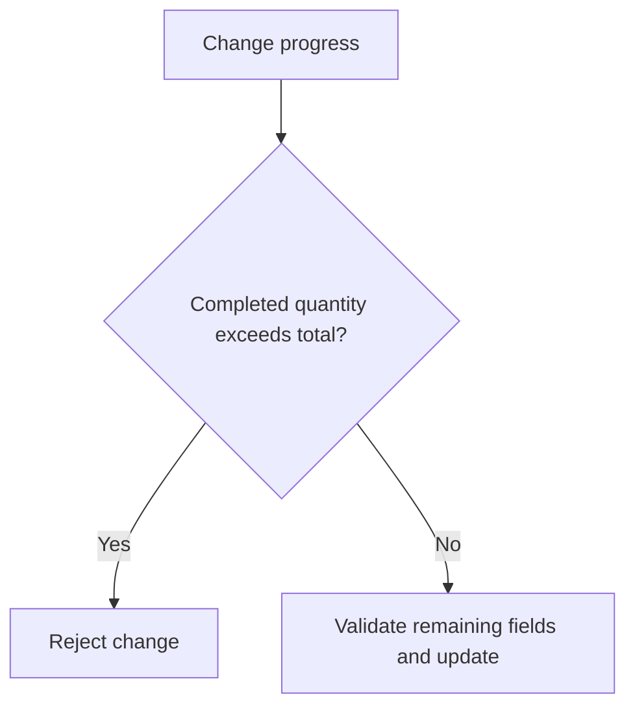

# Work items

**Implemented** · [Design](design.md) · [Core flow](#decision-flow) · [Representative tests](../../../../backend/internal/business/object/application/progress_test.go) · [Code](../../../../backend/internal/business/object/README.md) · [Guidance](../../../../backend/internal/business/object/AGENTS.md)

[Frontend](../../../../frontend/miniapp/src/business/object/README.md) · [Public API](../../../../api/contract/object/README.md) · [Subobject UI](../../../../frontend/miniapp/src/business/subobject/README.md)

## Domain design

**Subdomain classification:** core construction quantity/progress candidate.

**Language:** totals, completed quantities and states define progress; absent completion differs from explicit zero.

**Context/contracts:** Repository supplies scope; Object owns quantity/progress rules.

**Acceptance:** total 5/completed 8 rejects; equivalent decimals produce identical completion states.

[Implementation/tests](../../../../backend/internal/business/object/application/progress_test.go) · [Strategic classification criteria](../../../references/ddd/README.md)

Specifications cover quantity, progress/state. [Inline quantities/repository audit](design.md#quantity-audit) records implemented history, pending inline editing and acceptance.

[Domain design/operation contracts](design.md) · [Backend entry](../../../../backend/internal/business/object/README.md)

## Work-item progress decision flow

[Entry adapter](../../../../backend/internal/business/object/adapter/http/routes.go) · [Decision rules](../../../../backend/internal/business/object/application/progress_test.go) · [Application output port](../../../../backend/internal/business/object/application/port/object.go) · [Related tests](../../../../backend/internal/business/object/application/progress_test.go)

[Guidance](../../AGENTS.md) · [Repository capabilities](../README.md#repository-capabilities) · [Domain overview](../../README.md)

[Minimal ObjectTemplate workflow](template.md): create immutable v1, select, apply atomically and open an independent Object tree. Drafts, revisions and legacy migration remain future work.
