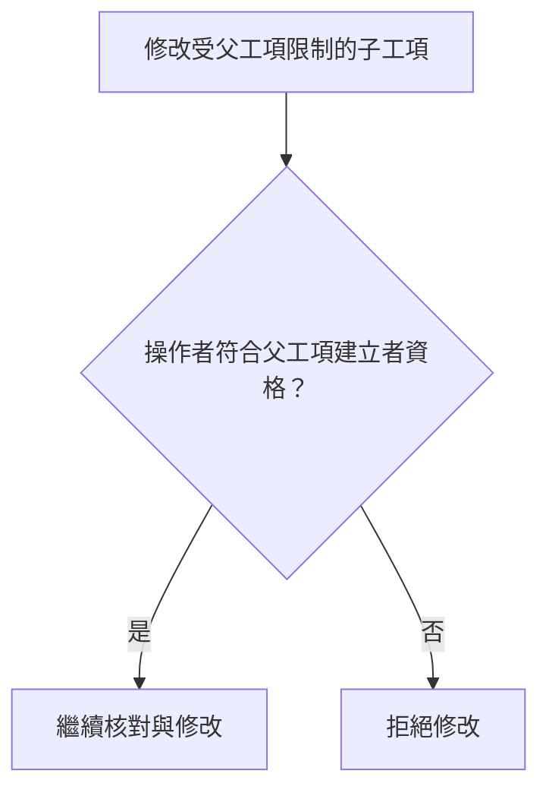

# 子工項

**已有實作** · [設計規格](design.md) · [核心流程](#decision-flow) · [判定實作](../../../backend/internal/business/subobject/adapter/firestore/store.go) · [程式目錄](../../../backend/internal/business/subobject/README.md) · [維護指引](../../../backend/internal/business/subobject/AGENTS.md)

## 領域設計

**子域定位**　工程工項細分的支援候選。

**通用語言**　父工項界定子工項的歸屬；父工項建立者是部分寫入操作核對的身分。

**上下文與契約**　Subobject 依賴 Repository 與父 Object 的資料，處理子工項操作；日誌可引用子工項，但不能經由引用變更其父工項。

**驗收案例**　在要求父工項建立者資格的操作中，即使操作者可讀取該儲存庫，也不能以他人身分修改子工項。

[對照實作或測試](../../../backend/internal/business/subobject/adapter/firestore/store.go) · [戰略設計與分類準則](../../architecture/ddd/README.md)

子工項依附父工項；父子關係與操作範圍可對照工項規格及子工項實作。

[領域設計與操作契約](design.md) · [後端實作入口](../../../backend/internal/business/subobject/README.md)

## 修改受父工項限制的子工項的判定流程

[操作入口與適配器](../../../backend/internal/business/subobject/adapter) · [判定依據](../../../backend/internal/business/subobject/adapter/firestore/store.go) · [應用層輸出介面](../../../backend/internal/business/subobject/application/port/subobject.go) · [相關測試](../../../backend/internal/business/subobject/adapter/firestore/store_test.go)

[適用工作指引](../AGENTS.md) · [上層導覽](../README.md)
