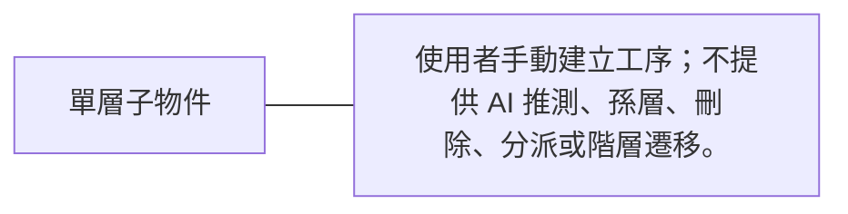
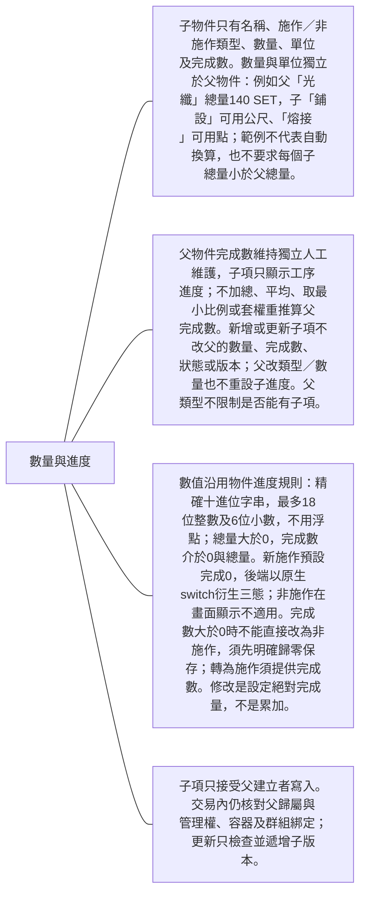
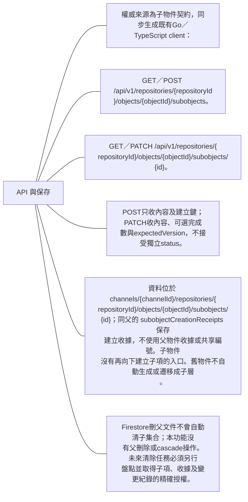
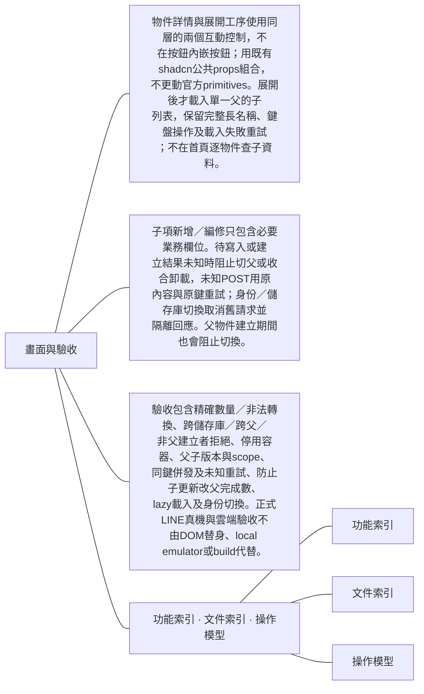

# 子工項設計

物件與子物件都回傳 `requiresProgressReset`。編輯既有資料時，畫面依此旗標提示須先儲存零進度才能改為非施作。新輸入的數量與完成數共用精確十進位表單驗證；後端在更新時仍核對最新的持久化進度。

[跨領域歸屬契約](../../architecture/contracts/object-subobject-ownership.md) · [領域入口](README.md)
