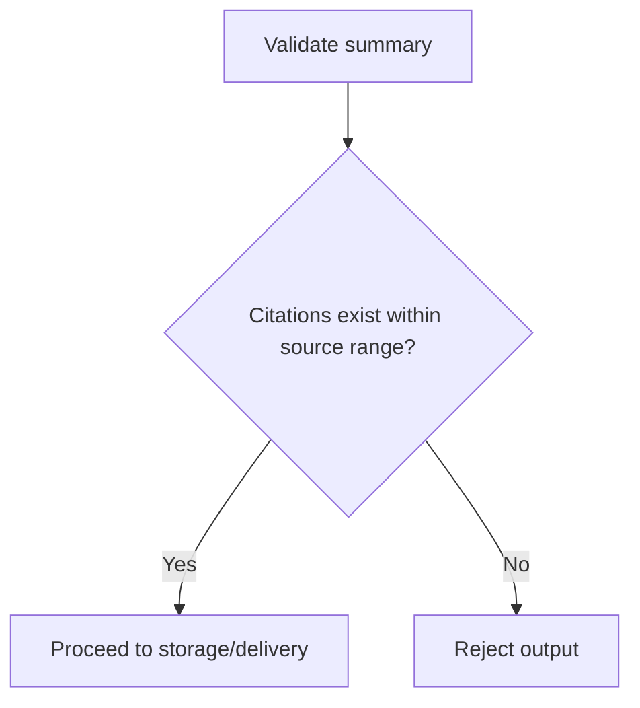

# Group chat summaries

**Implemented** · [Design](summary.md) · [Core flow](#decision-flow) · [Decision implementation](../../../backend/internal/business/summary/application/summarization/validation.go) · [Code](../../../backend/internal/business/summary/README.md) · [Guidance](../../../backend/internal/business/summary/AGENTS.md)

## Domain design

**Subdomain classification:** supporting group-information organization candidate.

**Language:** source messages provide citable evidence; summaries cite source numbers; edits/deletion affect evidence.

**Context/contracts:** LINE supplies events and models supply candidate text. Summary owns collection/output validation and decides persistence/delivery.

**Acceptance:** model changes still validate citations; missing/out-of-range citations reject persistence/delivery.

[Implementation/tests](../../../backend/internal/business/summary/application/summarization/validation.go) · [Strategic classification criteria](../../references/ddd/README.md)

Specifications cover collection, generation and citations.

[Business specification](summary.md) · [Backend summary implementation](../../../backend/internal/business/summary/README.md)

## Model summary decision flow

[Entry adapter](../../../backend/internal/business/summary/adapter/http/summarization/summary.go) · [Decision rules](../../../backend/internal/business/summary/application/summarization/validation.go) · [Application output port](../../../backend/internal/business/summary/application/port/errors.go) · [Related tests](../../../backend/internal/business/summary/adapter/firestore/documents_test.go)

[applicable guidance](../AGENTS.md) · [parent directory guide](../README.md)
