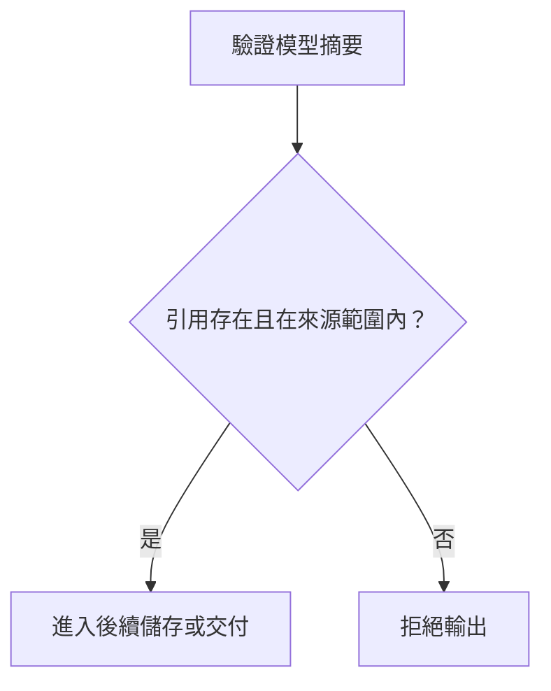

# 群聊摘要

**已有實作** · [設計規格](summary.md) · [核心流程](#decision-flow) · [判定實作](../../../backend/internal/business/summary/application/summarization/validation.go) · [程式目錄](../../../backend/internal/business/summary/README.md) · [維護指引](../../../backend/internal/business/summary/AGENTS.md)

## 領域設計

**子域定位**　群聊資訊整理的支援候選。

**通用語言**　來源訊息是可引用的證據；摘要是附來源編號的生成結果；訊息編輯或刪除會影響可用證據。

**上下文與契約**　LINE 提供訊息事件，模型供應商提供候選文字。Summary 擁有收錄及輸出驗證規則，決定結果能否儲存或發送。

**驗收案例**　更換模型後仍須檢查引用；結果缺少引用或引用超出來源範圍時，拒絕儲存與發送。

[對照實作或測試](../../../backend/internal/business/summary/application/summarization/validation.go) · [戰略設計與分類準則](../../references/ddd/README.md)

摘要規格涵蓋訊息收錄、產生摘要及來源引用。

[相關業務規格](summary.md) · [後端summary 實作說明](../../../backend/internal/business/summary/README.md)

## 驗證模型摘要的判定流程

[入口適配器](../../../backend/internal/business/summary/adapter/http/summarization/summary.go) · [判定依據](../../../backend/internal/business/summary/application/summarization/validation.go) · [應用層輸出介面](../../../backend/internal/business/summary/application/port/errors.go) · [相關測試](../../../backend/internal/business/summary/adapter/firestore/documents_test.go)

[適用工作指引](../AGENTS.md) · [上層導覽](../README.md)
