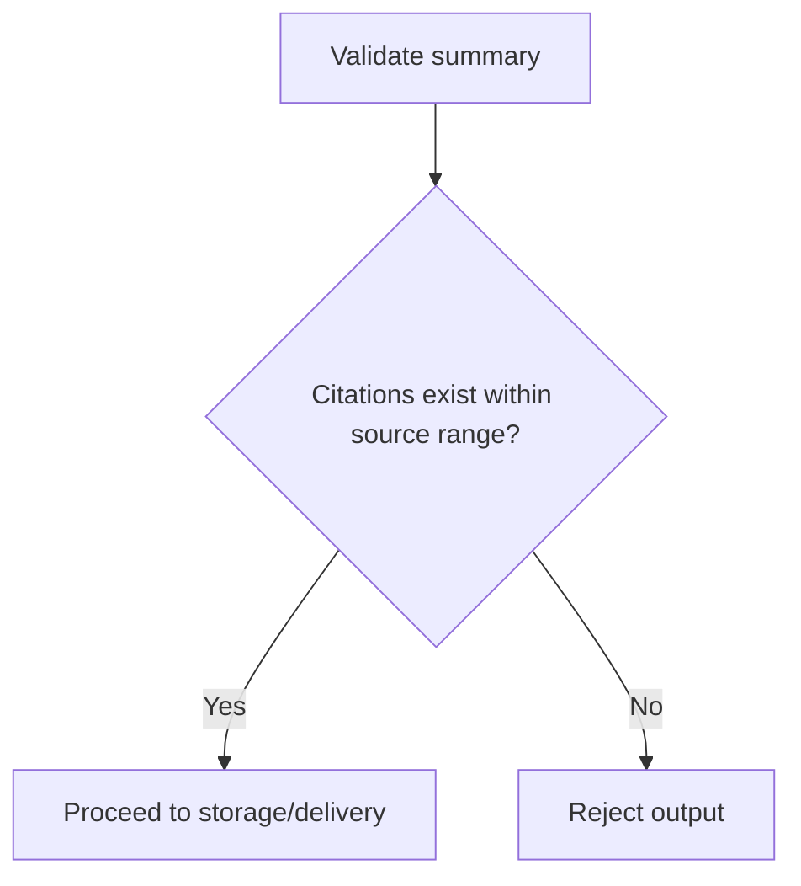

<a id="群聊摘要"></a>

# Group chat summaries 設計

**Implemented** · [Design](summary.md) · [Core flow](#decision-flow) · [Decision implementation](../../../backend/internal/business/summary/application/summarization/validation.go) · [Module guidance](../../../backend/internal/business/summary/AGENTS.md)

<a id="領域設計"></a>

## Domain design

**Subdomain classification:** supporting group-information organization candidate.

**Language:** source messages provide citable evidence; summaries cite source numbers; edits/deletion affect evidence.

**Context/contracts:** LINE supplies events and models supply candidate text. Summary owns collection/output validation and decides persistence/delivery.

**Acceptance:** model changes still validate citations; missing/out-of-range citations reject persistence/delivery.

[Implementation/tests](../../../backend/internal/business/summary/application/summarization/validation.go) · [Strategic classification criteria](../../references/ddd/AGENTS.md)

Specifications cover collection, generation and citations.

[Business specification](summary.md) · [Backend summary implementation](../../../backend/internal/business/summary/AGENTS.md)

<a id="decision-flow"></a>

<a id="驗證模型摘要的判定流程"></a>

## Model summary decision flow



[Entry adapter](../../../backend/internal/business/summary/adapter/http/summarization/summary.go) · [Decision rules](../../../backend/internal/business/summary/application/summarization/validation.go) · [Application output port](../../../backend/internal/business/summary/application/port/errors.go) · [Related tests](../../../backend/internal/business/summary/adapter/firestore/documents_test.go)

[Domain guidance](../AGENTS.md)

## 後端分層結構

下列為[Group chat summaries 後端模組](../../../backend/internal/business/summary/)的完整檔案樹，包含實作、測試與目錄文件。

**範圍**　此樹列出「群組摘要」模組根目錄內的 31 個檔案。檔名以 `_test.go` 結尾的是測試；同名檔案依所在目錄區分職責。

**分層對照**　共通範本中，以下路徑未在此模組根目錄下獨立設置：`domain/valueobject/`、`domain/service/`、`domain/event/`、`domain/policy/`、`application/command/`、`application/query/`、`application/dto/`、`adapter/scheduler/`。子功能的分層以樹中實際路徑為準。

```text
backend/internal/business/summary/
├── adapter/                                  # 外部系統轉接
│   ├── firestore/                            # Firestore 保存與查詢
│   │   ├── documents.go                      # 保存文件格式（讀寫 Firestore 資料）
│   │   ├── documents_test.go                 # 驗證保存文件格式（讀寫 Firestore 資料）；TestSummaryDocumentBoundaryCompatibility
│   │   ├── errors.go                         # 錯誤分類（讀寫 Firestore 資料）
│   │   ├── ports.go                          # 外部能力介面（讀寫 Firestore 資料）；Edit、Collect
│   │   └── summary.go                        # 摘要（讀寫 Firestore 資料）；Summary
│   ├── http/                                 # HTTP 入口
│   │   └── summarization/
│   │       ├── summary.go                    # 摘要（處理 HTTP 請求與回應）；WorkerVerifier、SummaryWorker
│   │       └── summary_test.go               # 驗證摘要（處理 HTTP 請求與回應）；TestSummaryWorkerRequiresAuthentication
│   ├── line/                                 # LINE 整合
│   │   ├── messagecollection/
│   │   │   └── collection.go                 # 訊息收集（處理 LINE 互動）；Collection、Observe
│   │   ├── summarization/
│   │   │   ├── commands.go                   # 操作指令（處理 LINE 互動）；Commands、Reply
│   │   │   ├── summary_delivery.go           # 摘要投遞（處理 LINE 互動）；SummaryDelivery、Send
│   │   │   └── summary_delivery_test.go      # 驗證摘要投遞（處理 LINE 互動）；TestDeliveryRetainsRetryAndHidesSDKFailures
│   │   ├── summary.go                        # 摘要（處理 LINE 互動）；Store、Summary
│   │   └── summary_test.go                   # 驗證摘要（處理 LINE 互動）；TestSummaryCollectsGroupTextSilentlyWithActor、TestSummaryEnqueuesWithoutCallingModel
│   ├── messaging/
│   │   └── cloudtasks/
│   │       └── summarization/
│   │           ├── queue.go                  # 佇列任務；Queue、Enqueue
│   │           └── queue_test.go             # 驗證佇列任務；TestSummaryQueueUsesStableIDAndOIDC
│   └── summarizer/
│       └── summarization/
│           ├── client.go                     # 外部服務呼叫；New
│           ├── gemini.go                     # Gemini模型呼叫；Gemini、Summarize
│           ├── gemini_test.go                # 驗證Gemini模型呼叫；TestGeminiBoundsAndSources
│           ├── openai.go                     # OpenAI模型呼叫；OpenAI、Summarize
│           └── openai_test.go                # 驗證OpenAI模型呼叫；TestOpenAISummaryContract、TestSummaryProviderSelection
├── application/                              # 應用用例
│   ├── messagecollection/
│   │   └── message_test.go                   # 驗證訊息；TestCollectionWindow、TestEditPreservesOriginalExpiryAndRejectsReplay
│   ├── port/                                 # 外部能力介面
│   │   ├── messagecollection/
│   │   │   └── message.go                    # 訊息（定義用例所需介面）；Store
│   │   ├── summarization/
│   │   │   └── summary.go                    # 摘要（定義用例所需介面）；CommandStore、Store
│   │   └── errors.go                         # 錯誤分類（定義用例所需介面）
│   └── summarization/
│       ├── summary.go                        # 摘要；Service、Run
│       ├── summary_test.go                   # 驗證摘要；TestRunReusesSavedResultAfterPushFailure、TestRunCancelsIfDisabledDuringGeneration
│       ├── validation.go                     # 輸出驗證
│       └── validation_test.go                # 驗證輸出驗證；TestValidateSummary
├── domain/                                   # 領域模型與規則
│   └── entity/                               # 實體與聚合
│       ├── messagecollection/
│       │   └── message.go                    # 訊息（維護領域狀態與規則）；Message、CanCollect
│       └── summarization/
│           └── summary.go                    # 摘要（維護領域狀態與規則）；Job
└── AGENTS.md                                 # 本目錄開發指引
```
