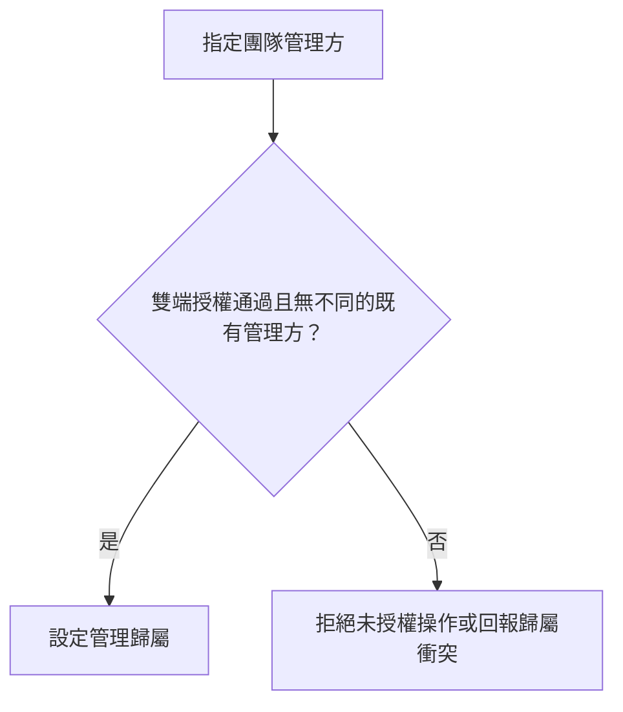

# 團隊

**已有實作** · [設計規格](design.md) · [核心流程](#decision-flow) · [判定實作](../../../backend/internal/business/team/adapter/firestore/store.go) · [程式目錄](../../../backend/internal/business/team/README.md) · [維護指引](../../../backend/internal/business/team/AGENTS.md)

## 領域設計

**子域定位**　團隊治理的支援候選。

**通用語言**　管理範圍指出管理方是組織或企業；管理方識別碼指出是哪一個。群組 ID 可識別團隊，群組關係不等於管理授權。

**上下文與契約**　Group 提供群組識別，Organization 或 Enterprise 提供管理方資料；Team 同時核對管理方與團隊端資格。

**驗收案例**　團隊已有管理方時，改掛另一管理方應回傳衝突；即使操作者有目標組織管理權，也需要通過團隊端的管理者檢查。

[對照實作或測試](../../../backend/internal/business/team/adapter/firestore/store.go) · [戰略設計與分類準則](../../architecture/ddd/README.md)

團隊與組織的歸屬及管理範圍見組織所有權目標規格。

[領域設計與操作契約](design.md) · [後端實作入口](../../../backend/internal/business/team/README.md)

## 指定團隊管理方的判定流程

[操作入口與適配器](../../../backend/internal/business/team/adapter) · [判定依據](../../../backend/internal/business/team/adapter/firestore/store.go) · 本領域目錄未見獨立 Go 測試；以上述驗收案例核對實作

[三領域授權邊界](../../architecture/contracts/organization-team-ownership.md#ownership-boundaries)

[適用工作指引](../AGENTS.md) · [上層導覽](../README.md)
