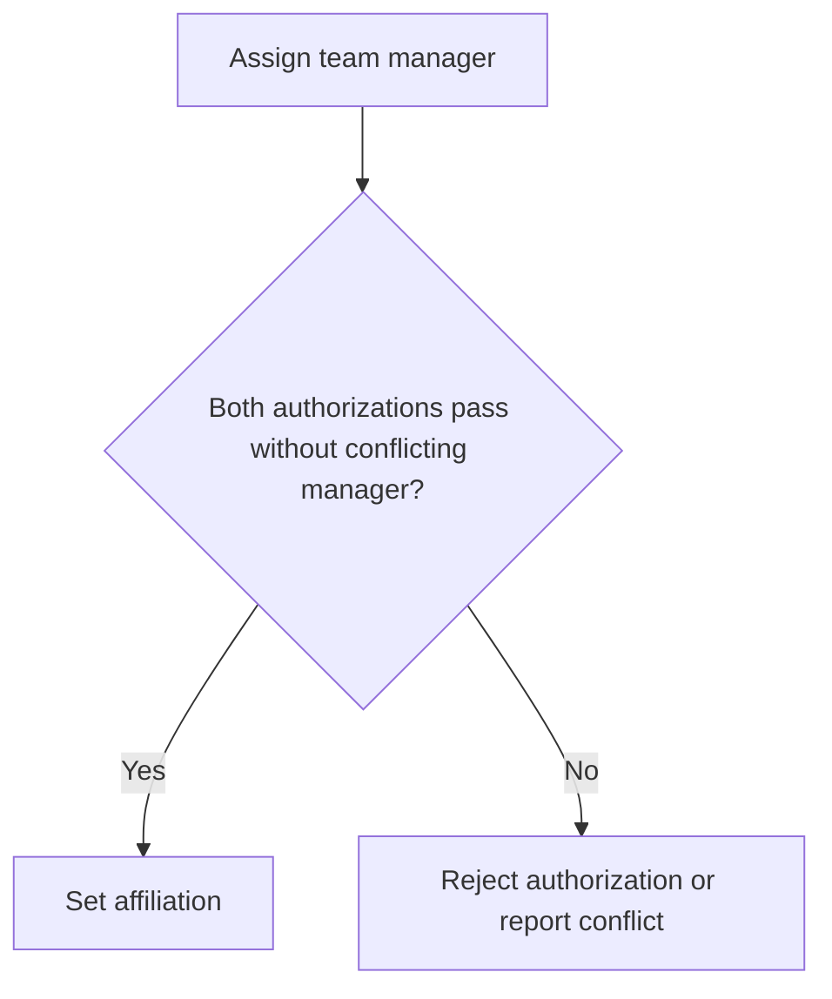

# Team

**Implemented** · [Design](design.md) · [Core flow](#decision-flow) · [Decision implementation](../../../backend/internal/business/team/adapter/firestore/store.go) · [Code](../../../backend/internal/business/team/README.md) · [Guidance](../../../backend/internal/business/team/AGENTS.md)

## Domain design

**Subdomain classification:** supporting team-governance candidate.

**Language:** management scope identifies organization/enterprise; manager ID identifies which one. Group IDs identify teams without granting management.

**Context/contracts:** Group supplies identity; Organization/Enterprise supply manager facts; Team verifies both manager-side and team-side eligibility.

**Acceptance:** conflicting reassignment rejects. Target organization managers must also pass team administrator checks.

[Implementation/tests](../../../backend/internal/business/team/adapter/firestore/store.go) · [Strategic classification criteria](../../references/ddd/README.md)

See organization ownership targets for team affiliation/management scope.

[Domain design/operation contracts](design.md) · [Backend entry](../../../backend/internal/business/team/README.md)

## Team management decision flow

[Entry adapter](../../../backend/internal/business/team/adapter/http/routes.go) · [Decision rules](../../../backend/internal/business/team/adapter/firestore/store.go) · [Lifecycle regression](../../../backend/internal/business/team/adapter/firestore/assignment_lifecycle_test.go) · [Activation regression](../../../backend/internal/business/team/adapter/firestore/activation_test.go) · [Qualification and observation regressions](../../../backend/internal/business/team/adapter/firestore/group_catalog_test.go). These require a loopback Firestore emulator; file presence alone does not establish executed acceptance.

[authorization boundaries across three domains](../../contracts/organization-team-ownership.md#ownership-boundaries)

[applicable guidance](../AGENTS.md) · [parent directory guide](../README.md)
