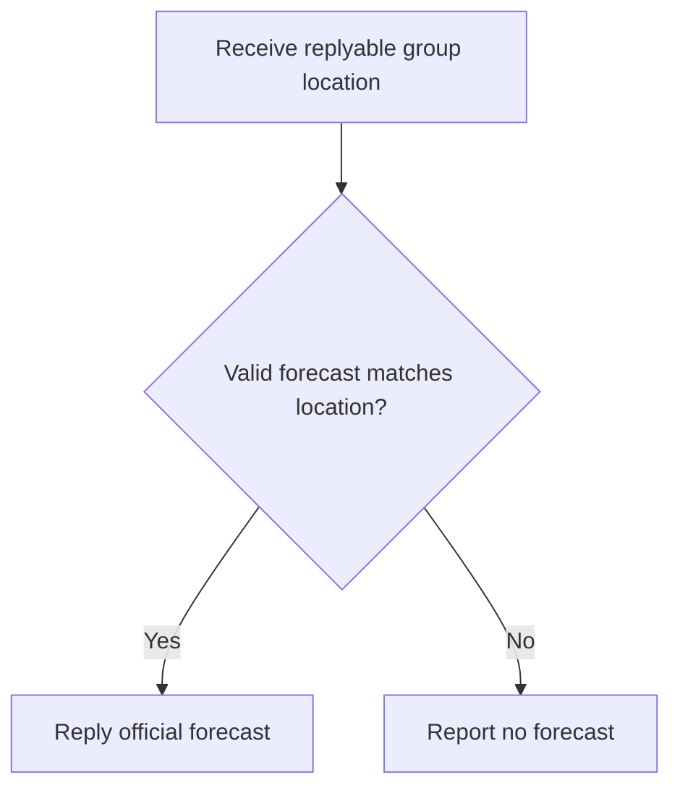

# Weather 設計

**Implemented** · [Design](weather.md) · [Core flow](#decision-flow) · [Representative tests](../../../backend/internal/business/weather/adapter/line/forecast/forecast_test.go) · [Module guidance](../../../backend/internal/business/weather/AGENTS.md)

## Domain design

**Subdomain classification:** external forecasts are generic; group queries support the product.

**Language:** location is query input, providers supply forecasts and group replies present one query result.

**Context/contracts:** LINE identifies replyable group events; weather adapters query CWA. Shared location inputs do not unify attendance purpose/authorization.

**Acceptance:** group locations trigger forecasts; non-group/non-replyable events cannot trigger that reply flow.

[Implementation/tests](../../../backend/internal/business/weather/adapter/line/forecast/forecast.go) · [Strategic classification criteria](../../references/ddd/AGENTS.md)

See weather specifications for queries/LINE interaction.

[Business specification](weather.md) · [Backend weather implementation](../../../backend/internal/business/weather/AGENTS.md)

## Replyable group location decision flow

[Entry adapter](../../../backend/internal/business/weather/adapter/cwa/forecast/cwa.go) · [Decision rules](../../../backend/internal/business/weather/adapter/line/forecast/forecast_test.go) · [Related tests](../../../backend/internal/business/weather/adapter/line/forecast/forecast_test.go)

[Domain guidance](../AGENTS.md)
