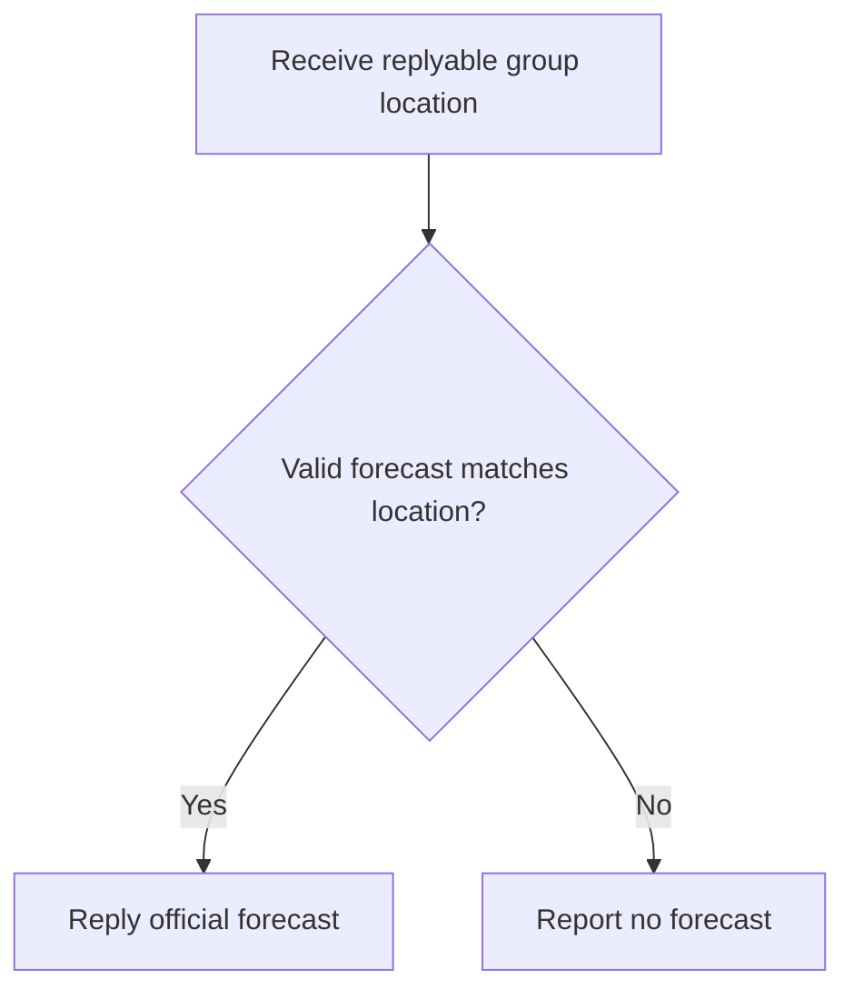

<a id="天氣"></a>

# Weather 設計

**Implemented** · [Design](weather.md) · [Core flow](#decision-flow) · [Representative tests](../../../backend/internal/business/weather/adapter/line/forecast/forecast_test.go) · [Module guidance](../../../backend/AGENTS.md)

<a id="領域設計"></a>

## Domain design

**Subdomain classification:** external forecasts are generic; group queries support the product.

**Language:** location is query input, providers supply forecasts and group replies present one query result.

**Context/contracts:** LINE identifies replyable group events; weather adapters query CWA. Shared location inputs do not unify attendance purpose/authorization.

**Acceptance:** group locations trigger forecasts; non-group/non-replyable events cannot trigger that reply flow.

[Implementation/tests](../../../backend/internal/business/weather/adapter/line/forecast/forecast.go) · [Strategic classification criteria](../../references/ddd/design-guide.md)

See weather specifications for queries/LINE interaction.

[Business specification](weather.md) · [Backend weather implementation](../../../backend/AGENTS.md)

<a id="decision-flow"></a>

<a id="收到可回覆的群組位置的判定流程"></a>

## Replyable group location decision flow



[Entry adapter](../../../backend/internal/business/weather/adapter/cwa/forecast/cwa.go) · [Decision rules](../../../backend/internal/business/weather/adapter/line/forecast/forecast_test.go) · [Related tests](../../../backend/internal/business/weather/adapter/line/forecast/forecast_test.go)

[Domain guidance](../../AGENTS.md)

## 後端分層結構

下列為[Weather 後端模組](../../../backend/internal/business/weather/)的完整檔案樹，包含實作、測試與目錄文件。

**範圍**　此樹列出「天氣」模組根目錄內的 7 個檔案。檔名以 `_test.go` 結尾的是測試；同名檔案依所在目錄區分職責。

**分層對照**　共通範本中，以下路徑未在此模組根目錄下獨立設置：`domain/valueobject/`、`domain/service/`、`domain/event/`、`domain/policy/`、`application/command/`、`application/query/`、`application/port/`、`application/dto/`、`adapter/http/`、`adapter/firestore/`、`adapter/messaging/`、`adapter/scheduler/`。子功能的分層以樹中實際路徑為準。

```text
backend/internal/business/weather/
├── adapter/                                  # 外部系統轉接
│   ├── cwa/
│   │   └── forecast/
│   │       ├── cwa.go                        # 中央氣象署預報；Client、Lookup
│   │       └── cwa_test.go                   # 驗證中央氣象署預報；TestLookupRejectsInvalidCoordinates、TestSelectRegionalForecast
│   └── line/                                 # LINE 整合
│       └── forecast/
│           ├── forecast.go                   # 天氣預報（處理 LINE 互動）；ForecastLookup、ReplyForEvent
│           ├── forecast_test.go              # 驗證天氣預報（處理 LINE 互動）；TestWeatherOnlyGroupLocation、TestWeatherFailureReplies
│           └── render.go                     # 預報訊息排版（處理 LINE 互動）；Weather
├── domain/                                   # 領域模型與規則
│   └── entity/                               # 實體與聚合
│       └── forecast/
│           └── forecast.go                   # 天氣預報（維護領域狀態與規則）；Forecast
└── AGENTS.md                                 # 本目錄開發指引
```
