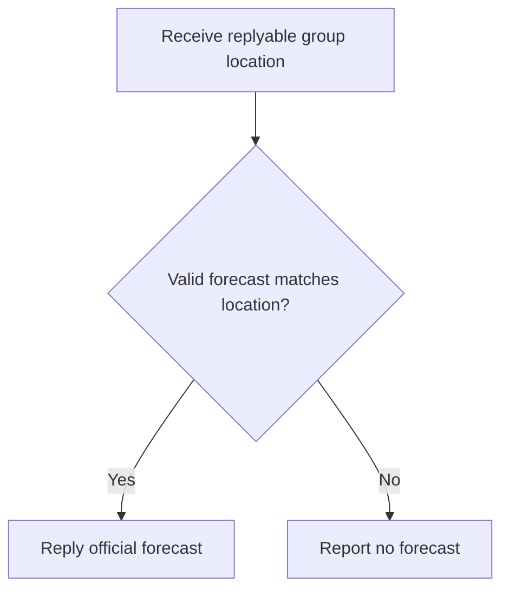

# 群組位置天氣

<a id="群組位置天氣"></a>

- Bot 在群組收到 LINE 內建「分享位置」訊息後，直接回覆目前有效時段的縣市天氣預報。 私訊位置、地圖網址、一般文字不觸發。沒有名單、訂閱、排程或位置儲存。

- 部署環境注入 CWA_API_KEY（氣象資料開放平臺會員授權碼）；未設定時回覆尚未設定。 API Key 不放進前端或日誌。此功能不需要 Firestore，不影響出勤的設定。

- 使用 F-D0047-091 縣市未來一週預報，讀取目前有效的「天氣預報綜合描述」，直接呈現官方溫度、降雨及天氣文字。 先用 LINE 位置地址中的縣市名稱比對（兼容台／臺），代表點距離不得超過 100 公里。 沒有相符地址時，以球面距離選最近的官方代表點，最多 60 公里，回覆明確標示「鄰近縣市預報」。 這是基礎區域近似，不是行政區邊界判定、鄉鎮定位或座標即時觀測；山區與縣市邊界尤其需注意。 不支援的遠端位置、過期預報或上游錯誤不回傳虛構天氣。

- 每次分享查詢一次 API，3 秒逾時、4 MiB 回應上限，不自動跟隨重新導向。第一版沒有快取或背景工作。 重送位置事件不再次查詢；回覆失敗不保證送達，使用者可重新分享。

- 來源：氣象署 API 說明、 資料集、 產品格式說明。 直接連線目前回傳 403，欄位依官方網頁搜尋摘錄核對；仍需有效 API Key 做真實資料驗收。

  - [API 說明](https://opendata.cwa.gov.tw/dist/opendata-swagger.html)

  - [資料集](https://opendata.cwa.gov.tw/dataset/forecast/F-D0047-091)

  - [產品格式說明](https://www.cwa.gov.tw/Data/data_catalog/1-1-1.pdf)

<a id="天氣"></a>

## Weather 設計

**現行實作** · [判定流程](#decision-flow) · [代表測試](../../../backend/internal/business/weather/adapter/line/forecast/forecast_test.go) · [模組規則](../../../backend/AGENTS.md)

<a id="領域設計"></a>

### Domain design

**Subdomain classification:** external forecasts are generic; group queries support the product.

**Language:** location is query input, providers supply forecasts and group replies present one query result.

**Context/contracts:** LINE identifies replyable group events; weather adapters query CWA. Shared location inputs do not unify attendance purpose/authorization.

**Acceptance:** group locations trigger forecasts; non-group/non-replyable events cannot trigger that reply flow.

[Implementation/tests](../../../backend/internal/business/weather/adapter/line/forecast/forecast.go) · [Strategic classification criteria](../../references/ddd/design-guide.md)

See weather specifications for queries/LINE interaction.

<a id="decision-flow"></a>

<a id="收到可回覆的群組位置的判定流程"></a>

### Replyable group location decision flow



[Entry adapter](../../../backend/internal/business/weather/adapter/cwa/forecast/cwa.go) · [Decision rules](../../../backend/internal/business/weather/adapter/line/forecast/forecast_test.go) · [Related tests](../../../backend/internal/business/weather/adapter/line/forecast/forecast_test.go)

[Domain guidance](../../AGENTS.md)

### 後端分層結構

下列為[Weather 後端模組](../../../backend/internal/business/weather/)的完整檔案樹，包含實作、測試與目錄文件。

**範圍**　此樹列出「天氣」模組根目錄內的 7 個檔案。檔名以 `_test.go` 結尾的是測試；同名檔案依所在目錄區分職責。

**分層對照**　共通範本中，以下路徑未在此模組根目錄下獨立設置：`domain/valueobject/`、`domain/service/`、`domain/event/`、`domain/policy/`、`application/command/`、`application/query/`、`application/port/`、`application/dto/`、`adapter/http/`、`adapter/firestore/`、`adapter/messaging/`、`adapter/scheduler/`。子功能的分層以樹中實際路徑為準。

```text
backend/internal/business/weather/
├── adapter/                                  # 外部系統轉接
│   ├── cwa/
│   │   └── forecast/
│   │       ├── cwa.go                        # 中央氣象署預報；Client、Lookup
│   │       └── cwa_test.go                   # 驗證中央氣象署預報；TestLookupRejectsInvalidCoordinates、TestSelectRegionalForecast
│   └── line/                                 # LINE 整合
│       └── forecast/
│           ├── forecast.go                   # 天氣預報（處理 LINE 互動）；ForecastLookup、ReplyForEvent
│           ├── forecast_test.go              # 驗證天氣預報（處理 LINE 互動）；TestWeatherOnlyGroupLocation、TestWeatherFailureReplies
│           └── render.go                     # 預報訊息排版（處理 LINE 互動）；Weather
├── domain/                                   # 領域模型與規則
│   └── entity/                               # 實體與聚合
│       └── forecast/
│           └── forecast.go                   # 天氣預報（維護領域狀態與規則）；Forecast
└── AGENTS.md                                 # 本目錄開發指引
```
