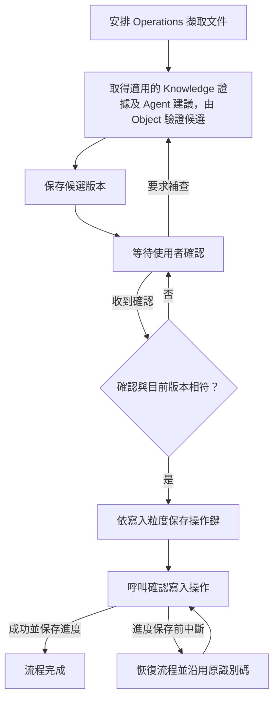

# Workflow 設計

**狀態：確認與恢復已有應用層實作；兩個 Object 文件入口已接入同步準備；通用流程模型為提案** · [確認與恢復流程](#design-diagram) · [跨領域驗收](../../proposals/domain-collaboration.md) · [模組規則](../../../backend/AGENTS.md)

現行應用層可用版本比對[記錄確認及恢復命令](../../../backend/internal/business/workflow/application/confirmation.go)。[中斷恢復測試](../../../backend/internal/business/workflow/application/confirmation_test.go)涵蓋命令已成功但流程進度保存失敗時沿用原提交鍵的情境。兩個 Object 文件入口目前是同步準備操作，沒有建立 Workflow Run。

[Domain guidance](../../AGENTS.md)

## 核心契約

以下為領域責任與概念範圍；現行實作及提案狀態依頁首與後端分層結構區分。Workflow 負責流程編排與生命週期管理。

- 流程定義（Workflow Definition）
- 觸發條件（Trigger）
- 步驟（Step）
- 條件分支（Condition）
- 依賴關係（Dependency）
- 排程（Schedule）
- 流程實例（Run）
- 人工審核（Approval）
- 狀態轉移（State Transition）
- 失敗重試與補償（Retry、Compensation）

**輸出**為有序、可追蹤的作業流程。

## Workflow 領域設計

以下流程模型為提案。目錄入口見[領域導覽](../../../backend/internal/business/workflow/)。

Workflow 定義固定步驟、等待條件及恢復位置。步驟可以呼叫 [Operations](../operations/design.md) 執行工作，也可以委派有界任務給 [Agent](../agent/design.md)，再按回傳結果繼續。文件流程依[跨領域協作圖](../../proposals/domain-collaboration.md#document-workflows)向 Knowledge 取得授權證據，向 Agent 取得建議或作業請求，並安排 Operations 執行。需要跨請求恢復時才引入持久化，儲存格式與公開 API 留待使用案例決定。

### 流程模型

依 [狀態機](../../references/ddd/state-machine.md)及[樂觀併發](../../references/ddd/optimistic-concurrency.md)，持久化時以 `RunID` 識別一次流程，用執行版本保護轉換。候選版本、目標與命令組成確認的值，確認與提交識別碼在同一轉換保存。競爭請求的舊版本回報衝突。完成狀態只能由有效收據推進；結果未知可用原提交識別碼恢復。拒絕、過期與撤權應有明確結果。

<a id="design-diagram"></a>

### 確認與恢復流程圖

未來設計



### 流程恢復驗收

先執行擷取操作，再保存候選版本並等待使用者確認。只有確認與目前版本相符時才進入寫入步驟；補查造成候選變動時需重新確認。驗收時模擬寫入成功後、流程進度保存前發生中斷，確認恢復後以相同操作鍵重試，只寫入一次。辨識物件逐筆保存結果並各自恢復；個人範本整份確認與儲存。

### 對外契約草案

以下為邏輯簽章，實作時對照既有介面。身分及資源範圍取自可信呼叫情境。

| 操作                                                                | 結果、副作用與失敗語意                                                                           |
| ------------------------------------------------------------------- | ------------------------------------------------------------------------------------------------ |
| Start(actor, resourceID)                                            | 建立或取回本次流程與等待步驟；記錄所引用的草稿版本。                                             |
| AcceptConfirmation(actor, runID, candidateVersion, target, command) | 核對確認者、流程、候選版本、目標及命令，執行前保存寫入意圖與識別碼；過期確認要求使用者重看。     |
| Resume(actor, runID)                                                | 讀取等待點。若寫入結果未定，先查原結果，或以原碼安全重送；若版本衝突回到確認，遇權限拒絕則停止。 |

[共用架構、時序與驗收](../../proposals/domain-collaboration.md)

[物件呼叫文件辨識能力與驗收](../../proposals/domain-collaboration.md#物件呼叫文件辨識能力)

## 後端分層結構

現行檔案樹；只列出已實作的正式程式碼：

```text
backend/internal/
├── business/workflow/application/
│   └── confirmation.go  # 確認、版本比對與命令恢復；定義 RunStore、Command 出站契約
```

Application 的公開方法是入站能力；`RunStore` 與 `Command` 由消費端定義，實際儲存與業務命令實作須由組裝端注入。兩個 Object 文件入口使用[共用文件準備流程](../../proposals/domain-collaboration.md#現行同步接線)，沒有接入 `confirmation.go` 的跨請求確認與恢復。目錄沒有獨立 Domain 或持久化 Adapter；上方確認與恢復流程圖仍是未來設計。

[workflow 模組原始碼](../../../backend/internal/business/workflow/) · [代表測試](../../../backend/internal/business/workflow/application/confirmation_test.go) · [六邊形架構參考](../../references/ddd/hexagonal-architecture.md)
