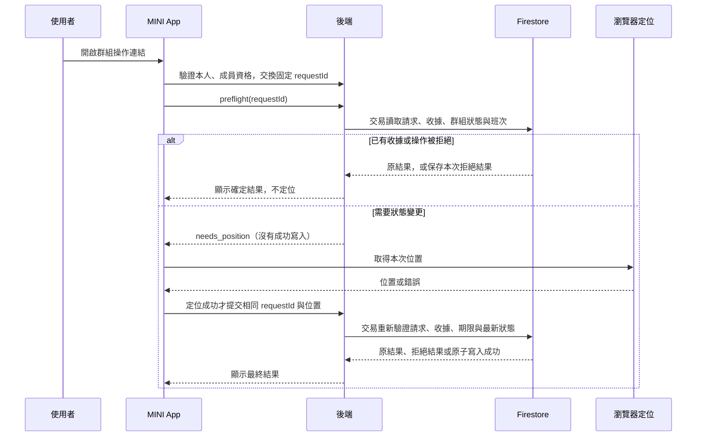

# 基礎出勤

首版處理群組定位上下班，以及 1:1 分群查詢本人紀錄。群組指令／Postback 建立短效請求，MINI App 先確認操作結果，需要新增時才取得位置並提交後寫入出勤；部署與真實 LINE／Firestore 驗收需另外執行。
目前已有打卡、月紀錄、分頁與更正流程的程式實作；雲端設定、索引／回填與渠道驗收須另外確認。
[查詢、Web 分頁與更正重試](attendance-queries.md) 說明操作與啟用方式；[工時計算與更正證據](worktime.md) 說明計算規則。
[基礎設施與接入](../development/foundation.md) 保留建置順序與環境限制，不代表功能尚未開始。
本次重構沿用既有檢查，不新增測試工程。

## 最小操作

| 操作 | 行為 |
| --- | --- |
| 上班 | 後端確認操作人員身分，保存上班時間，回傳操作結果。 |
| 下班 | 後端確認操作人員身分，記錄對應出勤的下班時間，回傳操作結果。 |
| 本人紀錄 | 僅回傳已驗證操作人員自己的出勤資料，至少包含上班時間與下班時間；尚未下班要明確呈現。 |

後端以可信身分識別操作人員，不接受前端自行指定他人的 user ID 作為授權。
打卡時間由後端產生，不直接信任前端傳入的時間。
資料保存失敗時不能回覆打卡成功。重複點擊或 LINE 重送不能悄悄新增重複紀錄。
只有上班沒有下班時，保留未完成狀態，不自行猜測下班時間。

群組輸入「出勤」可查人數看板，「補卡」開啟人工審核申請，「漏下班」仍可檢查本人未結束班次；詳見[看板與漏下班檢查](attendance-board.md)。

群組已另提供最小[請假登記](leave.md)；送出不代表核准，也不修改出勤。

## 原始首版範圍與後續實作

原始首版不包含排班、請假、加班審核、薪資、工作地點半徑判斷、人臉打卡、補登審核、管理員報表與通知推送。
已實作既有班次更正、無班次補卡、人工核准／駁回與本人撤回；補卡僅處理已結束班次，核准前有效紀錄不變。完整角色管理尚未提供，先沿用群組審核者白名單；詳見上述更正文件。
不為上述功能預建模組或通用框架；既有 LINE 能力矩陣是參考，不代表全部都要實作。

## 已採用的首版規則

- Messaging API：群組輸入「打卡」取得 Flex 操作按鈕，每個按鈕以短效 launch capability 直開 MINI App。開頁後驗證 LINE 本人及群組成員資格，再建立綁定本人與動作的打卡請求；此時尚未打卡。
- MINI App：使用者同意定位後，將 LINE ID token、requestId、latitude、longitude、accuracyMeters、capturedAt 送至 `POST /api/v1/attendance/punches`。後端驗證身分、請求歸屬與位置，再執行 Firestore 交易。拒絕定位不新增紀錄，不判斷半徑或在場真實性。
- 1:1 輸入「出勤紀錄」列出本人有紀錄的群組；輸入「出勤紀錄 編號」查該群最近五筆。群組查詢只回私訊引導，不開放 1:1 上下班。
- 各群組獨立計算；每人每群組同時只允許一段未完成出勤，一天可以多段。跨日下班關閉原本未完成紀錄。
- 顯示 Asia/Taipei，Firestore 保存 UTC。使用伺服器處理時間，不將事件時間當打卡時間；事件時間只用來拒絕早於最近處理事件的亂序操作。
- 重複上班回傳原上班時間；沒有未完成紀錄時下班明確拒絕。相同事件重送讀取原交易結果。
- 不需人員核准名單，也不查好友資格。共享操作卡可由原群組成員開啟，但須由伺服器再次查核成員資格；非成員不能使用。結果顯示在 MINI App，不將精確座標推送群組。

## 啟用與資料

設定 `GOOGLE_CLOUD_PROJECT` 與 `LINE_MESSAGING_API_CHANNEL_ID` 後初始化出勤資料庫；任一未設定則出勤關閉，打卡回覆尚未啟用。
可選用 `FIRESTORE_DATABASE_ID`（省略為 `(default)`）。
沿用既有 Messaging API secret／access token 與 runtime ADC，執行帳戶需具有指定資料庫讀寫權限。
定位打卡另需 MINI App 的 Channel ID、LIFF ID、openid scope；Messaging API 與 MINI App 必須屬於同一 LINE Provider，否則兩邊 user ID 無法直接比對。LINE ID token 必須由伺服器驗證，不能相信前端自行指定的 userId/groupId。

LINE Developers Console 需開啟 Allow bot to join group chats，再邀請 Bot 入群。群組成員不必先各自加 Bot 好友；私訊查紀錄可先加好友開啟一對一。
舊有 `ATTENDANCE_MEMBERS_JSON` 設定不再讀取，不影響使用資格。私訊上下班只引導回群組，不建立另一套個人打卡。

資料位於 `channels/{channelID}/users/{SHA256(userID)}` 下：

- `attendance/{SHA256([groupID,eventID])}`：schemaVersion、groupID、clockInAt、clockOutAt（尚未下班則省略）。
- `attendanceStates/{SHA256(groupID)}`：recordID、lastEventTime。
- `attendanceEvents/{SHA256([groupID,eventID,action])}`：code、record（原操作結果快照）。

定位打卡的 schemaVersion 為 2；上班／下班各自保存 clockInPosition／clockOutPosition（經緯度、精度、採樣時間）。舊版紀錄仍可讀取。
`channels/{channelID}/punchRequests/{requestID}` 保存原 groupID、userKey（雜湊）、eventID、action、eventTime、expiresAt；相同事件重送不延長原請求期限。同一請求重試讀取原交易結果，不能新增第二次打卡。未完成請求逾時不接受新的寫入。

複合 ID 使用 JSON array 編碼後雜湊。事件結果、出勤紀錄與狀態在同一交易提交；回覆在交易外發送。
查詢固定本人路徑。索引切換前沿用舊紀錄讀取與 Go 排序，仍有全歷史讀取成本；切換後使用群組投影、月份範圍查詢與游標分頁。切換、回填與新 API 契約見 [出勤查詢與更正](attendance-queries.md)。LINE 訊息已有畫面分頁，不能視為資料庫已分頁。
不儲存 reply token、完整事件或姓名；位置只隨打卡與去重結果保存，不建立持續定位歷史、不寫一般日誌。資料保存期尚待營運決策；去重結果不能先於可能重送期間刪除。punchRequests 可另設 expiresAt TTL；TTL 並非即時到期機制，程式仍自行檢查到期時間。

官方契約核對：LINE 文件來源 `line/line-developers-docs-source`，main revision `090500a12f9777995006d9fb5cafab8d83a792b2`；[LIFF 開啟與 query 傳遞](https://developers.line.biz/en/docs/liff/opening-liff-app/)、[伺服器驗證身分](https://developers.line.biz/en/docs/liff/using-user-profile/)、[同 Provider 的使用者 ID](https://developers.line.biz/en/docs/messaging-api/getting-user-ids/)。手機定位、Channel Provider 設定及真實 Firestore 交易仍需實機驗收。

LINE Developers Console 必須啟用 Webhook redelivery。寫入或出勤回覆失敗回傳 503，允許重送；
reply token 有效期與一次使用限制仍適用，去重保證不重複打卡，不保證每次回覆送達。遇回覆不明確時，私訊查詢本人紀錄。

## 後續產品變更

- 首期入口：Bot 或 MINI App 選定其一先接通；不預設兩者同步開發。
- 人員識別：LINE 身分如何對應允許打卡的人員，首次使用如何取得資格。
- 時間歸屬：顯示時區、跨日下班如何對應上班紀錄，以及是否允許一天多段出勤。
- 操作結果：重複上班／下班、沒有上班就下班時，明確拒絕或回傳既有結果的規則。

以上項目首版已依前節收斂；後續若改動，在本頁更新規則。
確認後才固定相應 API、Firestore 路徑／欄位、唯一性與原子更新方式；
不在基礎設施尚未穩定時一次建完全部功能。

## 群組直達 MINI App（待上線驗收）

群組輸入「打卡」後，上班／下班／休息開始／休息結束／確認休息按鈕可直接開啟 LIFF。卡片各帶一個十分鐘的隨機 launch token，伺服器保存群組與動作；token 不含或信任使用者 ID。LIFF 驗證本人後，伺服器以 Messaging API 群組成員查詢確認身分，成功才將同一卡片、同一人交換為固定 request ID。重開不延長有效期。舊式 `?request=` 連結與舊 postback 卡片已停用，需在群組重新輸入「打卡」取得新卡片。定位與提交沿用原本的授權、五分鐘位置新鮮度、出勤狀態機與交易回執。

上線前須確認 MINI App／LINE Login channel 與 Messaging API channel 在同一 provider，否則 user ID 不能對齊；需以真實群組測試 200／非成員／Bot 離群及 API 故障。共享卡片可被轉傳，但非原群組成員應拒絕。只有打卡 API 確認成功後，LIFF 內才嘗試關閉；權限或網路失敗保留頁面重試。視窗關閉不會自動向群組發送成功訊息。

## 定位前預檢、狀態與時序

狀態機由後端 `worktime.ApplyEvent` 統一判斷；前端不以快取的上班狀態決定授權。
`POST /api/v1/attendance/punches/preflight` 只接收本人綁定的 requestId，沿用身分、CSRF、請求期限與交易驗證。
它是結果解析操作：可保存拒絕結果的收據，但不會建立成功打卡或保存位置。

| 目前狀態 | 要求動作 | 預檢結果 |
| --- | --- | --- |
| 同一請求已有交易收據 | 任一 | 回原結果，即使目前狀態已改變；不定位 |
| 沒有未結束班次 | 上班 | `needs_position` |
| 上班中或休息中 | 上班 | `already_in` 與原上班時間；不定位 |
| 沒有未結束班次 | 下班／休息／確認 | `not_in`；不定位 |
| 上班中 | 下班／休息開始／確認休息 | `needs_position` |
| 上班中，沒有休息開始 | 休息結束 | `not_resting`；不定位 |
| 休息中 | 休息開始／確認休息 | `already_resting`／`break_incomplete`；不定位 |
| 休息中 | 下班／休息結束 | `needs_position`（仍須通過時間順序檢查） |
| 請求比最後套用事件早 | 任一尚無收據的操作 | `stale_event`；不定位 |
| 請求到期且沒有收據，或不屬於本人 | 任一 | 403；不定位、不新增打卡 |
| 無法確認後端狀態 | 任一 | 顯示錯誤，可重試；不定位 |

預檢與提交共用同一交易及狀態機。`needs_position` 不保留名額、不建立事件、收據或班次，也不保證稍後提交必定成功。
拒絕結果一旦寫入收據，同一 requestId 永遠重播該結果；若之後狀態改變，要回群組取得新操作卡。
所有成功的操作沿用既有定位要求（包含休息與確認休息），本次不變更位置證據政策。

前端依序為 `idle → exchanging → checking → locating → submitting → idle`；
預檢有確定結果時直接從 checking 返回 idle；任一步驟失敗也返回 idle 並保留訊息。
定位只有收到 `needs_position` 後才能啟動；拒絕、斷線或無效預檢回應不能繼續。
定位期間若另一裝置完成操作，最終提交會依最新狀態拒絕或回傳原收據，不會依預檢快照新增重複紀錄。

- 定位失敗：不送出打卡；重試同一 requestId 時先重新預檢。
- 提交斷線／逾時：結果未知，不宣稱失敗或成功；重試先讀取收據。已有成功結果時直接顯示，不再定位。
- 離頁／登出：中止等待並以 generation 忽略遲到的 HTTP 或定位回應；已送出的交易無法撤回。
- 同頁操作失敗重試：保留同一 requestId 並先預檢；離頁、Session 重設或完整重新開頁則清除本頁快取並重新驗證 launch 有效期與群組資格，有效的同一卡片仍交換為相同 requestId。
- 超過期限：已有收據的本人 requestId 可重播；未完成請求禁止新增寫入。定位期間不會延長期限。
- 預檢與提交各有 5 秒後端期限、10 秒前端期限；群組連結交換為後端 8 秒、前端 10 秒。定位沿用 10 秒裝置 timeout 與 15 秒前端保護，不以延長等待掩蓋流程問題。

本次核對 LINE 官方來源 main `dea09dc6e63fc5c6a3754abfbb304fc6fce4cc54` 的
[伺服器使用使用者資料](https://developers.line.biz/en/docs/liff/using-user-profile/)，保留伺服器驗證本人。
React 19.3.1 的非同步結果處理參照 Context7 `/reactjs/react.dev` 官方 useEffect cleanup 文件；Next.js 16.4.5 參照安裝包內 use-client 指引。
Graphify／Repomix 輔助核對呼叫與來源覆蓋，不證明手機定位或資料庫整合已驗收。

## 程式入口與命名

定位前的 HTTP `/punches/preflight` 由 `PunchResolver.ResolvePunchAttempt` 處理：它會讀取既有收據，或保存本次拒絕結果，因此不是純查詢。`PunchSubmitter.SubmitPunch` 接收定位後的提交；兩者共用 `executePunch` 的同一套交易與 `ApplyEvent`，不複製狀態機。

交易以私有 `punchCommand` 明列使用者、群組、事件、`ReceivedAt`（伺服器接收時間）、`EventTimeMillis`（排序用毫秒時間）、位置與請求 ID，並以 `Mode` 明確區分 `resolvePunch`／`recordPunch`，不以缺少位置推測模式。
`GroupHistoryReader` 單獨提供本人歷史讀取，查詢不再要求同時具備定位提交能力。
`RecordsOverlappingMonth` 包含跨月及未結束班次；`verifyAndRebuildRecords` 會驗證事件／更正證據並重建回傳班次，不寫回資料庫。事件重播函數為 `worktime.RebuildSessions`。
