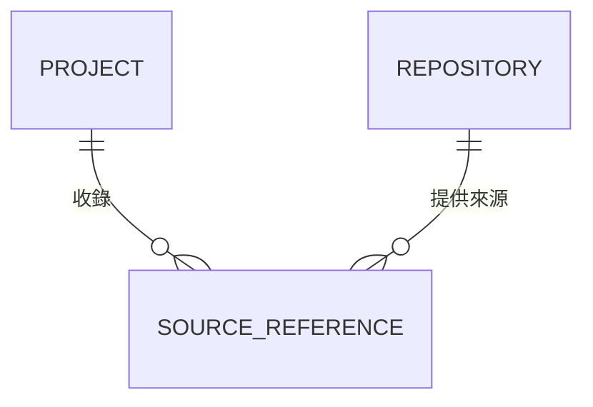
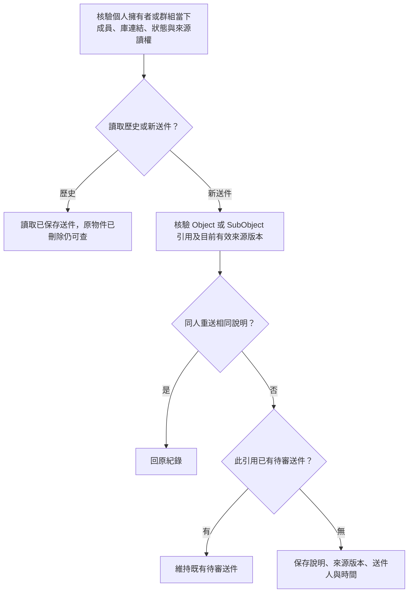

# 個人或工程群組擁有的 Project

## 邊界與身份

個人或工程群組擁有 Project，並綁定 Repository。Project 擁有專案內容、收錄項目、版本、作者管理權及防重規則；Repository 是物件／子物件／問題／討論的來源讀取範圍，不再是 Project 的聚合根。建立時選擇同一 owner 的初始來源，之後可連結其他有權讀取的 Repository。

工程群組直接保存於 `channels/{channelId}/groups/{groupId}`，由已驗簽的群組生命週期獨立建立／更新，候選索引及目前成員核驗獨立於 Repository Service。

## 操作契約

| 欄位 | Group 列表／詳情 | Project 列表／詳情／建立／更新 | ProjectItem 列表／加入／移除 |
| --- | --- | --- | --- |
| Actor | 既有 Session／Bearer 驗證的本人 | 同左 | 同左 |
| Resource／Action | channel 內 Group；List／Get | owner 內 Project；List／Get／Create／Update | Project 自有項目；List／Add／Remove |
| Context／Authority | 可信群組候選不代表授權；ACTIVE Group 與當下群組成員核驗 | 個人本人或 Group 成員可讀／建立，Project 建立者管理內容；來源資格另外核驗 | Project 建立者管理收錄，來源事項仍依目前 Repository 讀取資格 |
| Policy／Decision | 非成員、停用、不存在不揭露；外部核驗失敗不當作允許 | 一個初始來源及多個可連結來源；沿用內容限制、expectedVersion 與防重鍵；Project 無獨立完成狀態 | 同 Project 不重複，同事項可在不同 Project；項目 ID 與 Issue ID 分開，來源資格不允許則不揭露來源內容 |
| Result | 本人可開啟的 Group／基本資料，不授予 Issue 寫權 | Project 自有資料／版本；不寫 Repository、Issue 內容或狀態 | 僅改關聯及 Project 版本，來源事項完全不變；進度由可讀來源查得，不複製 Issue 狀態 |
| 重送／併發 | 讀取無副作用；外部成員資格不宣稱與資料庫原子 | 舊建立鍵及收據維持同結果／同鍵異內容衝突；更新過期版本拒絕，無變化不加版本 | expectedVersion 序列化收錄／移除，結果不明先讀取再決定 |
| Event／Audit | 保存必要群組事件排序，不記 token／profile | 保留原作者、建立／更新時間及版本追溯 | 關聯變動與 Project metadata 同交易，無外部通知 |

Project 自有資料的授權不得再要求 Repository 作為父容器。來源成員資格被撤銷或來源不可用時，來源 Issue 的內容、狀態及衍生進度不能由 Project 權限繞過；不得把未知統計回傳成零或以舊來源資料冒充成功。前端隱藏按鈕不能代替後端檢查。

Canonical來源hydration失敗時，已授權的Project自有metadata仍可讀取／管理，回應以`sourceAvailable=false`標明進度不可用；來源項目內容不因此開放。Project 容器或 item 結構錯誤以及取消／逾時仍回錯誤，不當成來源降級；legacy路徑維持原失敗語義。

## API、頁面與側欄

- Group 提供獨立 List／Get；Project 新入口為 `/api/v1/owners/{ownerId}/projects` 及其專案／items 子資源。Create 明確指定 `defaultRepositoryId`，URL 的 Group 或 Project ID 不是授權憑證。
- 舊 `/api/v1/repositories/{repositoryId}/projects...` 保留相容 adapter，解析來源庫及其擁有者 後呼叫同一組用例，不維護第二份授權或寫入邏輯。原回應、ID、版本、防重及分頁契約依相容檢查保留。
- 舊Repository統計的projects欄位相容回報以該Repository為來源的專案數，依唯一保存位置讀取；這是唯讀來源關聯統計，不表示Repository擁有或可寫Project。
- 正式專案頁為 `/miniapp/projects`，URL 保存 owner／Project 選取；側欄「專案」與「儲存庫」同層。Project 頁透過 Group API 與本人 Session 管理資料，不需要 RepositoryProvider 作為 Project 生命週期。
- Repository不再提供專案頁籤，專案由獨立入口開啟。新增專案的來源選擇只列可讀來源，不能因此取得事項修改／審核權。切換 Group、Project、身份或登出時取消舊請求並隔離畫面資料，上一頁、重新整理與直接連結可回到同一目標。
- 原官方 shadcn primitives 及 sidebar-07 模板維持不變；業務導覽在應用層組合。Pages Router 維持靜態輸出，Go 靜態頁路由亦註冊新入口，不新增前端框架或依賴。

## 最小來源引用骨架

每個 Project 可連結多個來源庫。引用指向物件、子物件、事項或討論，四類共用 items 集合。舊 `items` 入口保留 Issue 欄位、狀態、引用 ID、移除及 IssueCount／CompletedIssueCount 語意。物件完成數與專案事項統計分開。

新引用只保存sourceType、sourceId及子物件必要的parentObjectId與關聯追溯欄位；跨庫引用保存 sourceRepositoryId。物件改名、數量或狀態更新後，列表重新讀取來源目前值，不儲存一份可分歧的名稱／狀態快照。子引用需同時驗父物件路徑，不能只有子ID。來源引用不是存取或修改來源的授權。

| 欄位 | 列出引用 | 加入引用 | 移除引用 |
| --- | --- | --- | --- |
| Actor／Resource／Action | 本人可信Session／Bearer；owner 內 Project的來源引用；List | 同Project內Add | 同Project內Remove |
| Context／Authority | 個人本人或 ACTIVE Group 的目前成員；來源讀權另外核驗 | 同左且Project建立者；已連結來源庫、ACTIVE 與該庫的當下讀權 | Project建立者及Project版本，不要求來源仍可讀 |
| Policy／Decision | 來源缺失／失權保留占位，sourceUnavailable且不提供舊標題、數量或狀態；不令整個列表迴圈失敗 | sourceType與ID合法、父子歸屬正確，同Project同來源不重複 | 只刪引用，不刪來源，不繞過Project管理權或版本 |
| Result | 最新來源唯讀preview；不改來源與Project | 交易保存引用並更新Project版本／audit | 交易移除引用並更新Project版本／audit，來源不變 |
| 重送／併發 | 分頁游標綁本人與Project scope | 決定性來源鍵綁類型、父與來源ID，重送已存在同引用不重複；其他過期版本變更409 | 同引用重複移除不刪其他資料；其他過期版本變更409 |

四種引用共用 items 文件格式，將來源庫、來源類型、父物件及來源 ID 納入決定性鍵；不同庫的同名識別可獨立收錄。

新增API為GET／POST `/api/v1/owners/{ownerId}/projects/{id}/references`及DELETE同路徑`/{itemId}`；權威schema及生成型別隨本輪同步。加入時提交 sourceRepositoryId、sourceType、sourceId、可選 parentObjectId 與 expectedVersion。Project PATCH 可帶 linkRepositoryId 或 unlinkRepositoryId；解除後保留引用占位。

畫面保留現有專案建立／編輯，可選擇與連結儲存庫，再選種類再從來源清單選擇，子物件先選父再選子，不要求輸入UUID。來源失權仍顯示不可存取占位；Project建立者可移除引用，不能用快取舊preview洩漏內容。加入／移除待處理或結果未知時阻止切換Group／Project及卸載，先核回目前版本與引用再決定續送。

## 保存路徑與顯示範圍

| 位置 | Project 路徑 |
| --- | --- |
| HTTP | `/api/v1/owners/{ownerId}/projects/{id}` |
| Firestore 個人專案 | `channels/{channelId}/users/{userId}/projects/{projectId}` |
| Firestore 群組專案 | `channels/{channelId}/groups/{groupId}/projects/{projectId}` |

Project 文件保存 `ownerId` 與 `defaultRepositoryId`。同一擁有者底下的 `projectCreationScopes` 保存建立收據，Project 底下的 `linkedRepositories` 保存庫連結；每筆引用以 `sourceRepositoryId` 定位來源。

工程對象、待處理問題、決策討論分區顯示；專案詳情不把預設庫的 Issue 計數顯示為跨庫進度。Repository 統計中的專案數指以該庫為初始來源的專案數。

## 工程驗收送件

GET／POST `/api/v1/owners/{ownerId}/projects/{id}/references/{itemId}/inspection-submissions` 分別讀歷史與提交。資料保存在引用下的 `inspectionSubmissions`。施工進度維持原值，有送件紀錄的引用不可移除。
