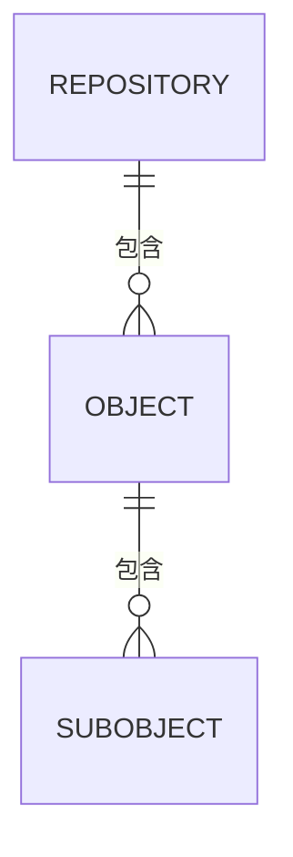

# 儲存庫物件

狀態：最小切片已完成本機實作與回歸驗證；正式 LINE／Firestore／手機環境待驗收。每個來源文件項次是一筆 Object，quantity 代表該項數量，不自動拆成單件資產。

## 範圍與欄位

儲存庫內提供「物件」列表、詳情、手動新增與編輯。新類型為施作／非施作，由使用者選擇，建立者可調整；核心不負責分類目錄、AI 模型、檔案解析、附件、價格／稅／付款／驗收、庫存、任意階層、問題關聯或刪除。文字型 PDF 入口由獨立自動匯入流程提供，結果可編修。單層工序由[子物件](subobjects.md)另行管理，父進度不由子項合算。

| 欄位 | 規則 |
| --- | --- |
| name、description | 名稱 1–120 字元、完整說明最多 8000 字元；首尾空白移除，不靜默截斷 |
| type、unit | 新UI使用 work（施作）／non_work（非施作）；原自由類型仍保留相容。單位必填1–32字元，不換算 |
| quantity | 精確正十進位字串，最多 18 位整數及 6 位小數；不用浮點數。拒絕零、負數、指數、千分位，整數前導零只允許單一 0，小數尾零正規化後保存 |
| completedQuantity | 可選精確非負十進位字串，精度同quantity；施作已知完成量須介於0與總量，非施作不保存完成量。缺值不是0 |
| status | 施作有完成量時由後端switch衍生：0為not_started、中間為in_progress、等總量為completed；新UI不可另選狀態。非施作在UI顯示不適用，底層三值僅相容保留；完成不代表驗收／付款 |
| sourceDocument、sourceRevision、sourceItemNo、sourcePages、materialCode | 可選來源追溯文字，各上限 200／80／80／80／120 字元；不儲存原件、個資或價格。來源文件與 revision 分開，頁碼可記跨頁範圍 |
| id、repositoryId、creatorId、version、createdAt、updatedAt | 後端可信來源，建立不可自行指定；不提供額外 #number |

來源欄位可獨立留白，只是追溯資料，不承諾 sourceDocument＋revision＋itemNo 唯一。同來源換建立鍵仍可新增另一筆；不自動認定為同一物件。新版 PDF 不會自動比對、合併或覆寫既有物件與狀態。來源項次不作為資料庫 ID。

## 物件與子物件歸屬

**現行實作**

此圖表示保存歸屬。子物件只有一層，父子數量、單位與進度各自維護。操作及路徑見[子物件規格](subobjects.md)。

## 進度與歷史相容

quantity是唯一總數，completedQuantity是完成數；畫面進度由兩者組成，不另外保存百分比或重複總量。後端以math/big精確比較18位整數／6位小數，前端以固定小數位的BigInt預驗，不使用float或int64保存數量。更新是設定絕對完成數，不是每次加一；同一值不製造版本變更。

施作已有完成量時，省略完成量保留現值；減少總量到完成數以下拒絕，除非同次明確提交合法新完成數。目前完成數大於0時拒絕轉為非施作或舊類型；須先明確將施作完成數調為0保存，再改類型。從非施作或舊自由類型轉施作必須明確提供完成數，不靜默歸零；新施作建立省略值才預設0。

歷史自由type（包含原字串恰為work／non_work）及缺完成量的紀錄仍可讀，沒有批次遷移或猜測Engineering就是施作。畫面顯示類型待確認／進度待補；轉施作時可依舊not_started／completed提供0／總量預填，使用者可改；舊in_progress不捏造數字。舊PATCHstatus相容路徑保留；已追蹤施作若另送與完成數矛盾的status則拒絕。非施作底層原status不因改名被重設，UI一律不適用，不能把technical status解釋成施作完成。

既有expectedVersion、建立者與當下成員資格不變；交易讀取目前總量／完成量／類型／版本後同時驗證與更新。舊建立鍵的v1內容指紋保持相容，缺完成量／新施作預設0可取回舊資源，不重設原紀錄。

## 操作契約

| 欄位 | List／Get | Create | Update |
| --- | --- | --- | --- |
| Actor／Resource／Action | Session／Bearer 可信使用者；指定 Repository 的 Object；讀取 | 同左；建立 Object | 同左；編輯既有 Object |
| Context／Authority | 啟用儲存庫、當下群組成員資格 | 同左；明確允許目前成員建立 | 目前成員且為建立者；目前資料與 expectedVersion |
| Policy／Decision | 容器與成員核驗通過才回傳；無權／不存在不揭露 | 驗證內容、建立鍵及容器；身分不能由客戶端宣告 | 交易內核對容器、作者、版本及輸入；拒絕不改資料 |
| Result | 列表／詳情，無副作用 | 伺服器產生 ID、初始狀態、version=1 與時間 | 有效變更遞增版本，回傳保存快照；相同內容不製造變更 |
| 重送／併發 | 游標綁定授權範圍及本人，分頁不可當總數 | Idempotency-Key 同本人／儲存庫／內容回原資源，不新增；同 key 不同內容 409。未知結果保留原 key 重試 | expectedVersion 過期 409，先重讀再決定，不能無條件覆寫 |
| Event／Audit | 不額外記錄讀取個資 | 保存建立者／時間與防重收據 | 保存操作者、版本、時間與變更；不含 token，無通知副作用 |

群組成員核驗屬當下外部觀察，不能和 Firestore 組成原子快照；交易仍核對容器啟用及群組綁定。讀取資格不自動授予修改他人資源的權限。身分或來源服務不可用時拒絕，不以快取或 UI 按鈕取代授權。

## API 與保存

權威來源為 [物件契約](../../../api/contract/object/objects.yaml)，由既有 OpenAPI 入口生成 Go／TS 型別：

- GET／POST `/api/v1/repositories/{repositoryId}/objects`；列表依不透明文件 ID 遞增分頁，不宣稱為建立時間或來源項次順序。
- GET／PATCH `/api/v1/repositories/{repositoryId}/objects/{id}`。
- 建立只收內容與可選來源欄位；新施作未提供完成量預設0，新非施作初始technical status為not_started。PATCH收完整內容、expectedVersion及可選completedQuantity／status；可選來源欄位省略時保留現值，明確空字串才清除；不做文件版本自動合併。

資料位於 `channels/{channelId}/repositories/{repositoryId}/objects/{id}`；不改 Issue、共用編號計數器或既有資料。建立資源與防重收據同交易提交；交易 callback 不呼叫外部服務或發通知。

結構化候選的獨立 [自動匯入流程](object-imports.md) 另外協調模型候選驗證／安全續跑，仍只呼叫本物件建立使用案例；不讓核心依賴匯入或 AI。

## 畫面與驗收

儲存庫物件頁籤使用既有元件與 typed client。只有作者顯示編輯；切換身份／儲存庫隔離舊回應，失敗保留可重試意圖。未知建立結果保留原 key 與內容，不以另一鍵重複提交。

最小驗收包含精確數量／非法輸入、預設及三態轉換、未登入／非成員／停用／跨儲存庫拒絕、非作者修改拒絕、版本衝突、防重重送與內容衝突、未知結果重試、前端載入／失敗／切換身份及手機表單。使用脫敏測資；真實商業 PDF 不進儲存庫或公開 fixtures。

實作位置：後端 [object](../../../backend/internal/business/object/README.md)、前端 [object](../../../frontend/miniapp/src/business/object/README.md)；正式 LINE／Firestore／手機整合另行驗收，測試替身或 build 不代表正式環境通過。本輪驗證不將真實來源文件的 54 項寫入資料庫。

[功能索引](../README.md) · [文件索引](../../README.md) · [操作模型](../../foundation/architecture/business-operation.md)
