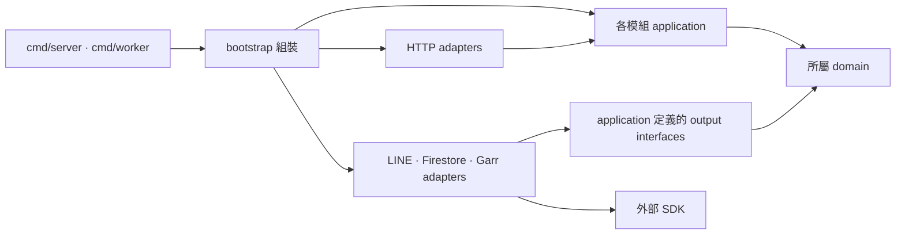

# 套件依賴與圖譜

## 技術棧與 SDK 維護

技術組成與主要 SDK 概覽見[根 README](../../../README.md#技術棧與-sdk)。Go 依賴以 [go.mod](../../../backend/go.mod)、前端依賴以 [package.json](../../../frontend/miniapp/package.json)、API client 以[其 package.json](../../../api/client/package.json)、工具版本以 [mise.toml](../../../mise.toml)為準，不在文件複製固定版本。

修改整合前先定位既有 adapter 與使用端介面，核對實際套件及適用版本的官方文件；文件查證流程依[根指引](../../../AGENTS.md#mandatory-documentation-verification)。SDK、直接 HTTP 整合與開發工具須分開辨識；已列為依賴不等於已完成真實服務驗收。更換 SDK 或增加依賴涉及選型時，依[ADR 流程](decisions/README.md)記錄適用的決策，不以整理文件為由替換實作。

## 契約與不變條件的維護位置

| 契約 | 權威維護位置 | 導航時的界線 |
| --- | --- | --- |
| Project 所有權、群組資格與來源授權 | [Project 規格](../../features/project/projects.md) | 不從來源 Repository 推導 Project 所有權 |
| Repository 內資源、編號與交易防重 | [Repository 功能索引](../../features/repository/README.md) | 各功能保存自己的規則與相容例外 |
| 出勤狀態、工時與重送 | [出勤功能索引](../../features/attendance/README.md) | 依具體操作契約判定，不另維護通用業務狀態 |
| HTTP 格式、Session 與身分 | [OpenAPI](../../../api/README.md)、[Session](../identity/browser-session.md) | HTTP 結構驗證不取代業務授權 |
| 資料與可靠性規劃 | [資料契約](../persistence/data-contracts.md)、[可靠性索引](../reliability/README.md) | 遵循各頁狀態標示；規劃中的 schema／Outbox 不作為現行資料庫全貌 |
| 業務操作的共用描述方式 | [操作模型](business-operation.md) | 功能文件填具體操作；本頁只提供定位 |

## 目前實作

`backend/cmd/server → internal/server → 各功能入口與整合實作`。
核心只依賴標準庫與明確的純核心子套件。HTTP 使用生成 DTO 與所需能力介面，Firestore 使用獨立 document structs 並轉譯技術錯誤；HTTP 不依賴儲存 SDK。
共用傳輸不 import 功能，OpenAPI 接線只依賴生成型別與 http.Handler。LINE 與 HTTP 共用由 server 注入的出勤 store／時區／群組名稱能力，HTTP 不再從 LINE handler 取得依賴。

規則與驗證見 [後端功能邊界](backend-boundaries.md)。Go 的隱式介面與直接依賴由編譯及架構檢查約束，Graphify 用於輔助探索而非動態正確性證明。

以下完整分層表與圖保留為未來平台規劃，並非目前檔案樹。

> 狀態：目標 import 規則；圖中是允許依賴，不是假稱現有程式已實作。

## 允許方向

**未來設計**

圖表示 compile-time import；Use Case 執行時透過介面呼叫 adapter。Go 使用隱式介面實作，組裝時可驗證相容性。

| 套件 | 允許 | 禁止 |
| --- | --- | --- |
| domain | 標準庫、明確核准的領域值型別 | HTTP、LINE、Firestore、Garr、application、adapter |
| application | 所屬 domain、所需的小介面；有向且明確的跨模組契約 | adapters、SDK、組裝入口 |
| HTTP adapter | application、請求／回應轉換 | 直接寫 Firestore、跳過 Use Case 授權 |
| 外部 adapter | application 契約、domain、對應 SDK | import HTTP handlers、依賴 bootstrap |
| bootstrap | 設定、applications、adapters | 業務判斷 |

## 跨模組規則

- direct 與 group 不互相依賴，不把群組角色等同個人資源擁有權。
- application 如需通知，以使用端定義的介面接受交易性工作寫入；由 Firestore adapter 實作。
- 業務狀態與 Outbox 的原子提交介面以實際使用案例定義，不傳 Firestore transaction 型別進核心。
- jobs 不依賴 direct/group application；事件 dispatch 與具體 handler 綁定在 bootstrap，避免循環依賴。
- LINE rendering 留在 adapter，不能把 Flex JSON 型別當成領域實體。

## Graphify 與 Repomix 工作流

共用的定位、核對與驗收順序見[業務操作符合性流程](../../agents/workflow.md#business-operation-compliance)。Graphify 查不到節點時查當前程式，再以 `go list -deps ./...` 或 gopls 核對 import。程式改動後執行 `mise run graphify-update`。AST 可能遺漏 Go 隱式介面、動態 dispatch、TOML 與 Markdown。上方 Mermaid 描述尚未實作的目標架構。

全局審查使用完整 Repomix 包。日常審查限定所需文件與 Go 原始碼，排除生成技能與 binary。保持安全掃描開啟，逐項核對排除提示及敏感內容。

Graphify 統計不等同架構合規，Repomix token 減少不等同功能最佳化。目錄調整應以責任與依賴為依據，不以圖形美觀作為驗收。
