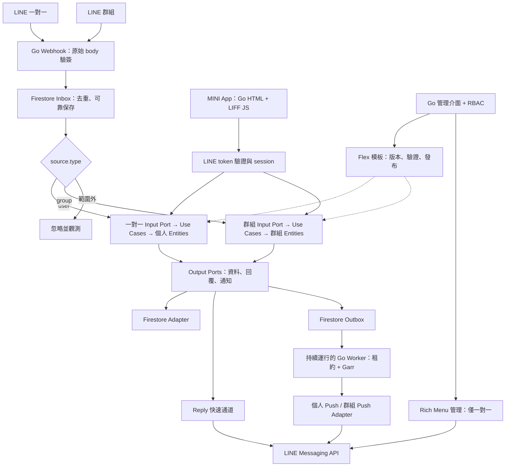

# 未來平台目錄規劃

> 狀態：規劃。以下是完整責任配置，非現有檔案清單；按交付階段建立，避免空目錄與空介面。
> 路徑從 repository root 起算；每個 Go 子目錄是獨立 package，不假設父目錄自動包含子目錄。

現行模組與啟用條件見 [架構總覽](overview.md)。本頁保留早期平台設計，供評估通用 Inbox、Outbox、租約與管理後台時參考。

## 第二層與第三層目錄

```text
cmd/
  server/
    main.go                 # HTTP 組裝與啟停
  worker/
    main.go                 # 常駐工作處理入口
internal/
  direct/
    domain/                 # User、DirectConversation、個人值型別與規則
    application/            # 個人 Use Cases；ports.go 定義所需介面
  group/
    domain/                 # Group、Role、群組狀態與規則
    application/            # 群組 Use Cases；ports.go 定義所需介面
  identity/
    domain/                 # Actor、Session、channel 身分
    application/            # 登入、session、驗證需求介面
  templates/
    domain/                 # 模板、版本、發布狀態
    application/            # 驗證、發布、回復、讀取已發布內容
  richmenu/
    domain/                 # Menu、Alias、指派目標
    application/            # 建立、上傳、發布、指派、回復
  jobs/
    domain/                 # Inbox、Outbox、UserTarget、GroupTarget、Lease
    application/            # 領取、續租、重試、完成；ports.go
  adapters/
    http/                   # 第三層：入站 HTTP adapter 群組
    line/                   # 第三層：LINE SDK、token 驗證與訊息呈現
    firestore/              # 第三層：repository、交易、租約與 DTO 轉換
    garr/                   # 第三層：pool、backoff、breaker 包裝
  web/
    templates/              # Go html/template：MINI App 與 admin 頁面
    static/                 # CSS、LIFF JS glue；使用 embed 管理
  bootstrap/
    server/                 # HTTP clients、routes、依賴與 shutdown 組裝
    worker/                 # clients、dispatch、pool 與 shutdown 組裝
  config/
    config.go               # 非機密設定解析與必要值驗證
```

## Adapter 的下一層拆分

adapters 本身已是第二層，以下明列第四層，避免把所有 adapter 塞進巨大 package。

```text
backend/internal/httpapi/
  webhook/                  # 原始 body 驗簽、事件轉換、Inbox 接收
  miniapi/                  # MINI App 個人／群組 API
  admin/                    # 管理頁面、發布操作
  middleware/               # session、CSRF、request ID、body limit
  health/                   # liveness/readiness
internal/adapters/line/
  messaging/                # Reply、個人 Push、群組 Push
  rendering/                # 業務結果 → Flex/Text/Quick Reply；不放授權
  identity/                 # LINE token 驗證 HTTP client
  richmenu/                 # Rich Menu API client
internal/adapters/firestore/
  direct/                   # 個人資料 repository
  group/                    # 群組資料 repository
  identity/                 # session 與身分關聯
  templates/                # 模板與發布版本
  richmenu/                 # 選單狀態與發布紀錄
  jobs/                     # Inbox、Outbox、租約與原子提交
internal/adapters/garr/
  execution/                # 程序內併發、退避、斷路器
```

MINI App Service Message adapter 在資格與需求確立後新增，不預建空實作。
每個 package 內以 `model.go`、`service.go`、`ports.go`、`*_test.go` 等責任命名；不要求每包都有同名檔案。

## 擴充規則

- direct 與 group 不互相 import；兩者相同的業務能力只有在實際成立後才抽成獨立模組。
- 不建立 shared/utils/common 雜物包；共用型別須有清楚責任，例如 jobs/domain 的發送工作目標。
- application 不能 import adapters；SDK 與 Firestore 型別留在 adapter。
- 機密由部署環境注入，config 不保存 token；工具設定仍由 mise.toml 管理。

依賴允許表見 [dependencies.md](dependencies.md)，實作順序見 [delivery.md](delivery.md)。

## 後續平台擴充參考流程



以下模組表是後續平台能力參考，不預建全部目錄或介面。

| 模組 | 身分與狀態 | 使用案例與授權 |
| --- | --- | --- |
| direct | User、DirectConversation、個人資源 | Message/Postback、Follow/Unfollow、Unsend；資源擁有權 |
| group | Group、GroupRole、群組資源 | Message/Postback、Join/Leave、成員事件、Unsend；群組角色與資源權限 |
| identity | 經驗證的 LINE 身分、session | 驗證預期 channel 與有效性；不信任前端 profile 或 decoded token |
| templates | 模板與不可變發布版本 | 驗證、測試發送、發布、回復 |
| richmenu | 選單、圖片參照、alias、指派 | 預設／個人化／切換；統一以 Messaging API 管理 |
| jobs | Inbox/Outbox 狀態、租約、typed target | 領取、重試、完成、人工處理 |

群組 userId 可能缺少，需個人權限的操作拒絕執行。平台群組管理角色須明確綁定，不假設 LINE 提供完整管理員名單。
群組內容對成員可見，私人結果導向 MINI App／一對一。群組不提供 Rich Menu。
新產品只支援 user/group；room 是仍有官方相容支援的歷史來源，不宣稱 API 全部已淘汰。
Service Message 待資格與模板確認後使用獨立 adapter，不當作任意 Flex Push。

## 設計查核紀錄

2026-11-07：Context7 查詢 `/line/line-openapi`（source、Reply、Push retry key、Rich Menu）、
`/line/line-liff-v2-starter`（vanilla LIFF）、`/websites/cloud_google_firestore_native`（交易、IAM）。
LIFF starter 不涵蓋完整 token 驗證，該項以官方 LIFF 文件補足。Garr 無 Context7 專屬索引，核對已安裝模組文件。
官方來源庫 main 查核提交：`090500a12f9777995006d9fb5cafab8d83a792b2`；不代表官方網站所有頁面均被來源庫收錄。

- [LINE 官方來源快照](https://github.com/line/line-developers-docs-source/tree/090500a12f9777995006d9fb5cafab8d83a792b2)
- [群組](https://developers.line.biz/en/docs/messaging-api/group-chats/)、[Rich Menu](https://developers.line.biz/en/docs/messaging-api/rich-menus-overview/)
- [LIFF 後端身分](https://developers.line.biz/en/docs/liff/using-user-profile/)
- [Firestore transactions](https://docs.cloud.google.com/firestore/native/docs/manage-data/transactions)
- [Garr](https://github.com/line/garr)
