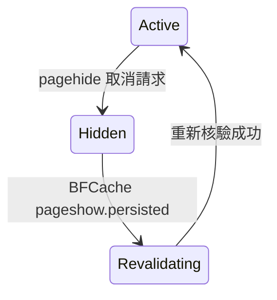

# React 前端生命週期

Next.js Pages Router 靜態輸出，React Strict Mode 啟用。出勤功能入口位於 `frontend/miniapp/src/business/attendance/{records,corrections,approvals,punch,leave}`；定位示範位於 `diagnostics/geolocation`。頁面仍以完整文件導覽隔離工作流程，未加入 SSR、App Router 或額外狀態套件。

- `identity/Session.tsx`：身分 Context、LINE 初始化、伺服器驗證、登入／登出、BFCache 恢復與型別化認證請求。LINE token 僅於交換後端 Session 時從 SDK 取得；後續 API 使用 Cookie 與記憶體中的 CSRF token。可見頁面有近期活動時，接近到期才以單一請求續期；閒置／背景不保活。登出會先撤銷後端 Session，失敗時保留重試入口。見 [Session 契約](../identity/browser-session.md)。SDK init single-flight；Strict Mode 清理會取消等待並拒收結果。
- `platform/line/sdk.ts`：官方 SDK script loader 與初始化共用 Promise。全域僅有官方 `window.liff`，沒有自訂 client、DOM dataset 或身分事件橋接。
- `shared/http/lifecycle.ts`：AbortController、獨立 deadline、世代檢查。即使底層忽略 abort，也不套用過期回應。已啟動 Promise 在預先取消時仍須觀察其成功／拒絕，避免未處理拒絕；外層取消仍回 AbortError，正常錯誤不吞掉。
- `shared/location/position.ts`：單次定位，成功、錯誤、逾時、取消一律 clearWatch；拒收無效座標及遲到 callback。權限等待另有 15 秒期限。
- `shell/AppFrame.tsx`：所有應用頁共用官方 sidebar-07 的外框、Breadcrumb 與收合開關；`shell/sidebar-07/` 保留 AppSidebar、NavMain、NavProjects、NavUser、TeamSwitcher 及 SidebarRail 結構。身分操作由 Shell 注入 NavUser，頁面不再重複顯示身分卡。定位診斷不要求 LINE 登入；空間 UI 預覽及專用導覽已移除。
- `shared/ui/` 與 `shared/utils.ts`：shadcn primitives 與樣式工具，由 shell／identity／business 組合使用；不擁有業務 API、授權判定或領域狀態。生成設定在 workspace `components.json`，`@/*` 對應 `src/*`。

## 頁面與身分生命週期

**現行實作**

身分世代改變時，`shell/Shell.tsx` 重建功能子樹並清除舊使用者資料、表單及重試狀態。正式 Shell 的 SessionProvider 下共用空間載入狀態，詳見[空間載入時序](../../features/repository/repository.md#空間載入時序)。

樣式編譯、Preflight、utilities 與歷史 CSS 移除範圍集中於 [CSS 編譯與版面](../../tooling/mcp/shadcn.md#css-編譯與版面)。樣式入口保留主題變數與必要的 base layer。

月摘要與明細分開請求，cursor 翻頁只讀明細；條件變更立即清空原畫面並取消舊讀取。更正申請同一份序列化草稿沿用同一 Idempotency-Key，內容變更才換碼；同步 ref 防止連點。審核必須先讀取目前編號，變更編號即作廢舊內容。

打卡由 `usePunch` 管理 exchange／locate／submit。自動打卡在可清理的 effect 中排程，Strict Mode 探測不重送；每頁只自動啟動一次。交換結果在同身分的重試間保留；不明提交結果不自動重試，手動重試沿用 requestId。離頁或登出清理 watcher／請求，回到頁面須重新驗證。關窗僅適用已確認的成功 code 與 LINE 內建瀏覽器。

診斷定位需手動啟動；驗證成功才更新座標結果，失敗／更新中保留上次成功結果並標示。診斷端點仍不保存位置。

開發與建置前，`prepare-assets` 會重建 `public/assets/`。歷史控制器 URL 回傳空操作腳本，舊快取頁面需重新整理。PDF 匯入另外使用同源提供的 PDF.js worker、CMap、字型與 WASM；部署時須連同靜態匯出提供這些檔案。[資產準備腳本](../../../scripts/tooling/prepare-miniapp-assets.mts) · [PDF 匯入限制](../../features/repository/object-imports.md)

執行 `pnpm test` 包含真實 React StrictMode 的 DOM 測試；`pnpm check` 包含應用與測試 TypeScript 檢查。測試替換原本依賴 DOM VM 的控制器檢查，涵蓋原打卡重試／取消案例及跨功能競態。裝置權限與 LINE 真實登入另做實機驗收。

查證：Context7 `/reactjs/react.dev` 的 Effects cleanup／過期回應指引、Next.js v16.4.5 的 Pages Router 靜態輸出與 Strict Mode；LINE 官方文件來源 main `dea09dc6e63fc5c6a3754abfbb304fc6fce4cc54` 的 LIFF 初始化與 ID token 驗證契約。套件依賴精確版本見 package.json／pnpm-lock.yaml。
