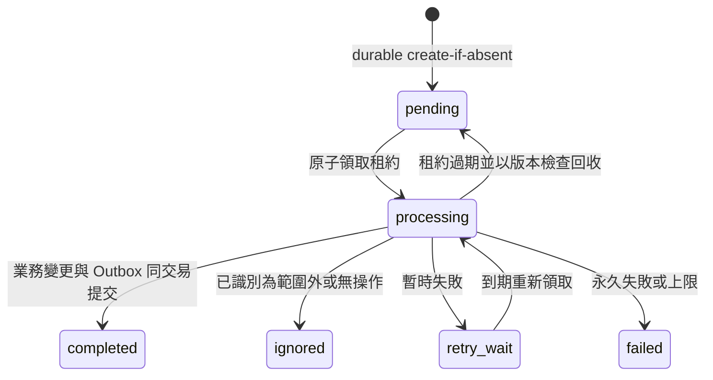
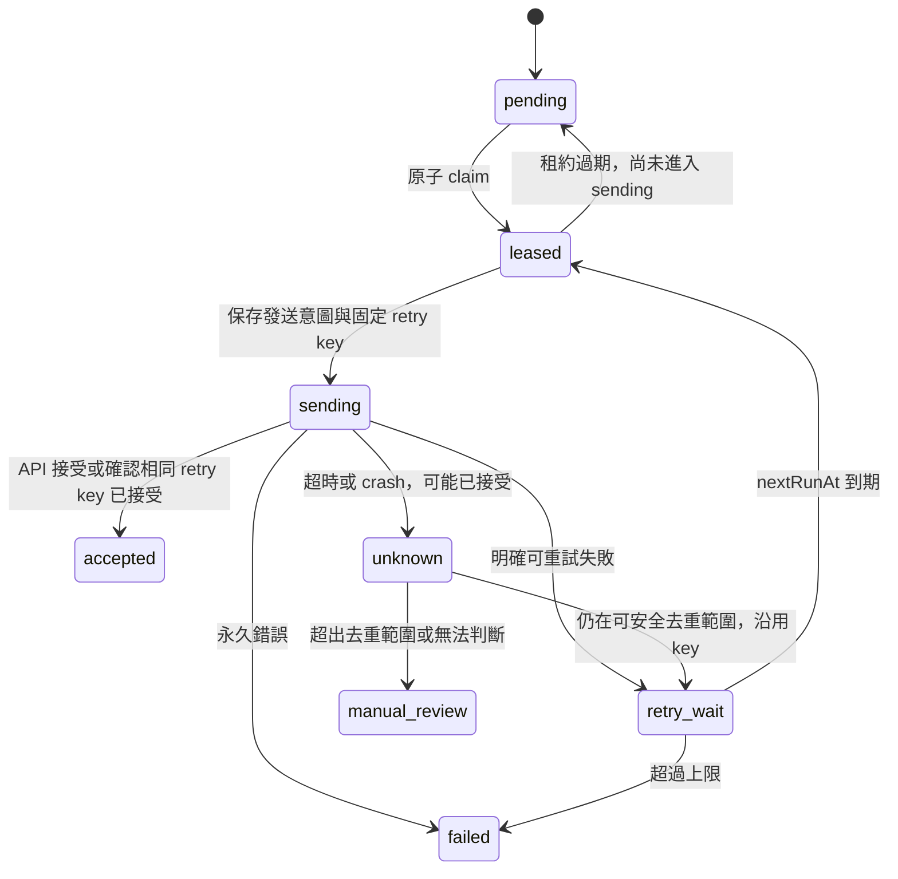
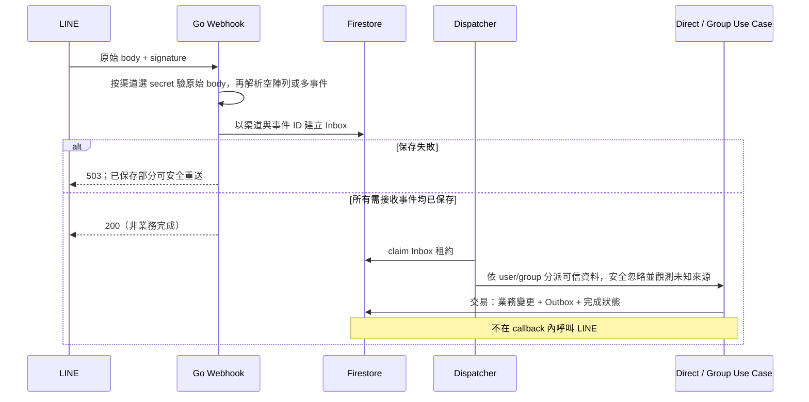

# 事件與發送狀態機

> 狀態：LINE、Firestore 與 Garr 的後續平台提案。現行 Webhook 見 [HTTP 契約](../api/http-contracts.md#基礎入口)。外部 API 不提供與 Firestore 跨系統原子交易，不保證 exactly-once。

## Inbox

所有交易先讀後寫；callback 無 LINE 呼叫。重複 event ID 回接收成功，不重設既有狀態。
以渠道和 webhookEventId 共同去重，isRedelivery 僅供參考。重複與亂序分開處理，重要狀態依版本與事件時間判斷。Unsend 依保存政策移除或停止使用內容。
Inbox completed 只表示處理與通知意圖已提交，不表示通知已送達；Reply 記錄另有狀態。

## Outbox

sending 過期不得當成未發送的 pending。先持久化 sending 再呼叫 API；租約版本只保護資料更新，不能取消已在外部執行的請求。
避免 lease 在呼叫期間失效：外部 timeout 小於剩餘租約，必要時續租；失去租約者不得提交完成。
409 只有在 endpoint 的重複 retry key 語義確認後才能視為 accepted；保存 accepted request ID，不把所有 409 當成功。
Reply 沒有 Push retry key 的同等保障：not_attempted → attempting → accepted/rejected/unknown；unknown 不自動重送或改 Push。
Push 工作保存 typed target、內容快照或不可變模板版本、retry key、attempt、nextRunAt、leaseOwner、leaseUntil 與 leaseVersion。續租與完成均驗證租約版本。Reply token 短效且單次使用，限制嘗試次數。API 接受只表示供應商已接收請求。
具體 retry 次數、延遲、去重期限由 endpoint 現行規則與 P05 確認，未確認不得開正式自動重送。

## Webhook 時序

Reply 由獨立優先路徑處理，受 token 期限約束；不能用定期慢掃描保證即時 Reply。實作時以延遲測試選定喚醒／掃描策略。

## Firestore

- server SDK 透過 ADC/IAM，繞過 Security Rules；Go Use Case 做資源授權。
- 依 channel 隔離 users、groups/roles、webhookEvents、outbox、templates/versions、richMenus、auditLogs。
- 個人與群組資料分開；查詢明確帶渠道／資源範圍，不能只靠客戶端傳來的 ID。
- 為 status＋nextRunAt 等工作查詢建立索引；payload 視需求排除索引；避免單文件熱點。
- TTL 只負責最終清理，不能做精準排程；去重保存期需覆蓋產品重試政策。
- 圖片不存 Firestore 文件：需另外選 HTTPS 靜態檔／物件儲存方案；此項尚未選定。

## Worker 與 Garr

Go Worker 持續運行，定期掃描到期工作；限制領取數、程序內 queue 與併發，處理背壓。
Garr 僅包裝 pool、退避與 breaker；自行實作 context 取消、錯誤分類、重試上限與終止狀態。
400／權限等永久錯誤停止重試；429 區分限流與額度，不盲目重試；暫時錯誤有界退避。
多副本共用的渠道／endpoint 限流需另行協調；Garr queue 不取代 Firestore。
SIGTERM 停止領取、限制關閉等待，未完成工作到期可恢復。斷路器開啟時延後工作，不占住 Worker 忙等。

## 安全與觀測

MINI App 使用 LIFF token 後端驗證，不信任 profile；session 使用安全 cookie 與 CSRF 防護。Provider／channel 身分關聯須明確核對。
群組管理角色需驗證綁定，不以首次操作自動授予。日誌不記 secret、token、完整私人訊息。
觀測 Inbox/Outbox 積壓、最老工作時間、Reply 延遲、重試、失敗、breaker 狀態；記錄渠道與追蹤 ID。
Cloud Run 是部署目標（ADR 0003）。若後續需要 Worker，必須重新確認執行模型、
租約、Google ADC/IAM 與區域；現有 HTTP 配置不代表 Worker 已可運行。

依據：[Firestore 交易](https://docs.cloud.google.com/firestore/native/docs/manage-data/transactions)、[IAM](https://docs.cloud.google.com/firestore/native/docs/security/iam)、[Garr](https://github.com/line/garr)、[LINE 能力矩陣](../integrations/line.md)。
