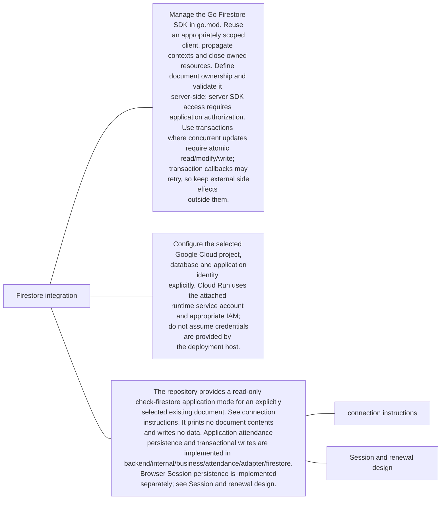
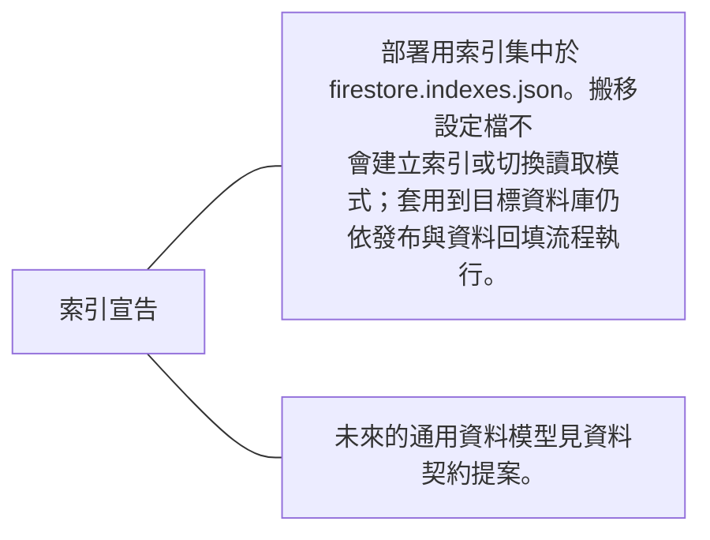

# Firestore 整合

連線、執行身分與 client 生命週期在此維護。資料內容見[儲存模型](data-model.md)，原子提交見[交易與一致性](consistency.md)，分頁與索引見[查詢](querying.md)，過期與清除見[生命週期](lifecycle.md)。

## 執行身分與驗證

Go server SDK 使用應用身分及 IAM，不能依賴瀏覽器 Security Rules 代替後端資源授權；依[官方權限說明](https://firebase.google.com/docs/firestore/security/rules-conditions)與[業務操作模型](../../contracts/business-operations.md)核對。專案 Go Firestore SDK 依 [go.mod](../../../backend/go.mod)固定，目前為 `v1.29.2`。

每個程序明確選擇專案與 database，沿組裝入口共用適當作用域的 client，傳遞取消及期限，由建立者負責關閉。唯讀連線檢查只能證明指定讀取路徑，不能證明寫入權限、交易、索引或恢復能力。

## 既有整合說明

現行實作與設定指引

## 官方來源與驗證範圍

2026-11-22 查閱官方 Standard Firestore 的[交易](https://firebase.google.com/docs/firestore/manage-data/transactions)、[Server SDK 權限](https://firebase.google.com/docs/firestore/security/rules-conditions)、[TTL](https://firebase.google.com/docs/firestore/ttl)及[刪除](https://firebase.google.com/docs/firestore/manage-data/delete-data)文件，對照本庫 Adapter 與 SDK 版本。這些是線上文件，未固定官方文件提交版本；本次未執行雲端設定查詢或整合測試。

[儲存索引](README.md) · [資料契約演進](../../references/ddd/model-evolution.md)
