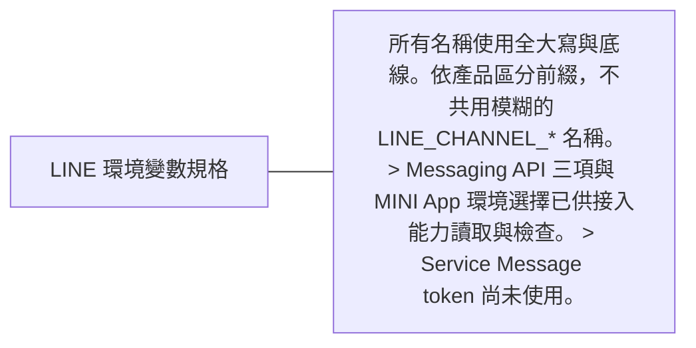
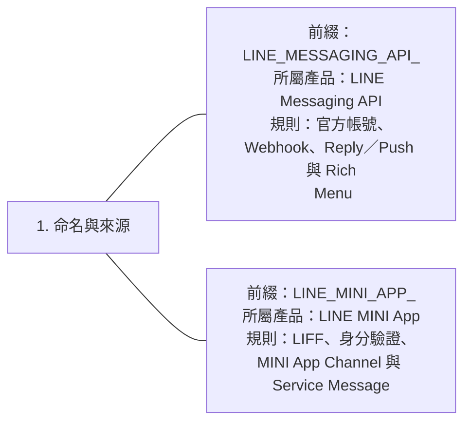
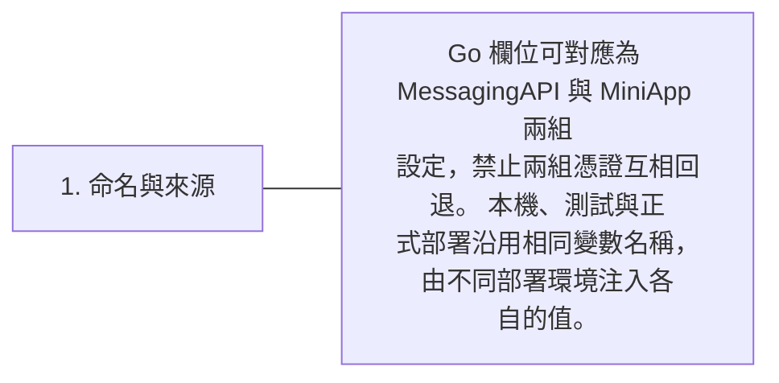
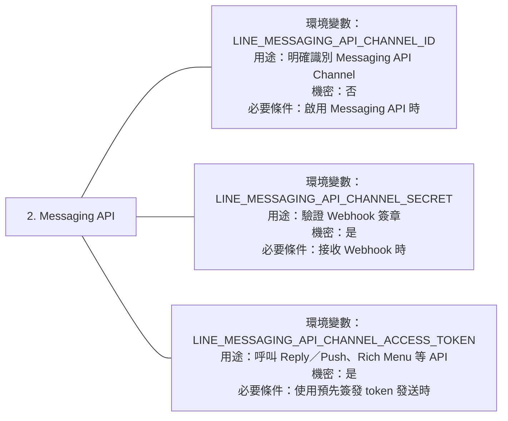
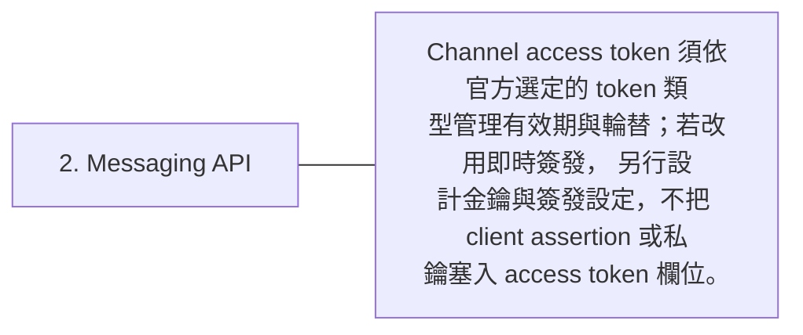
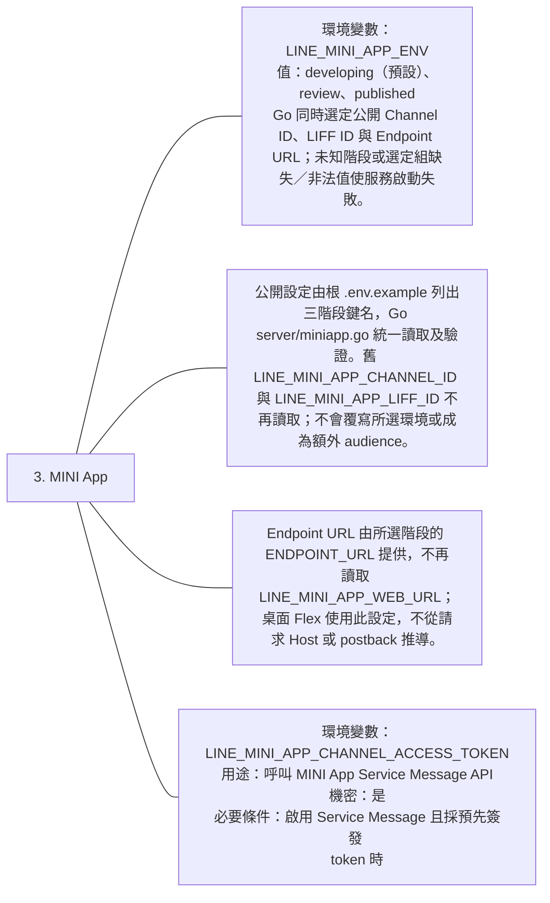
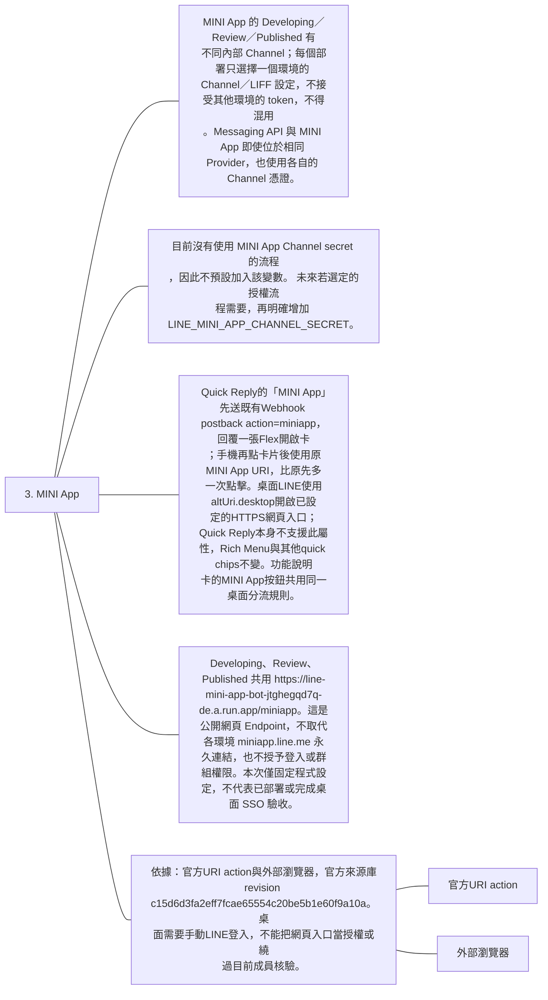
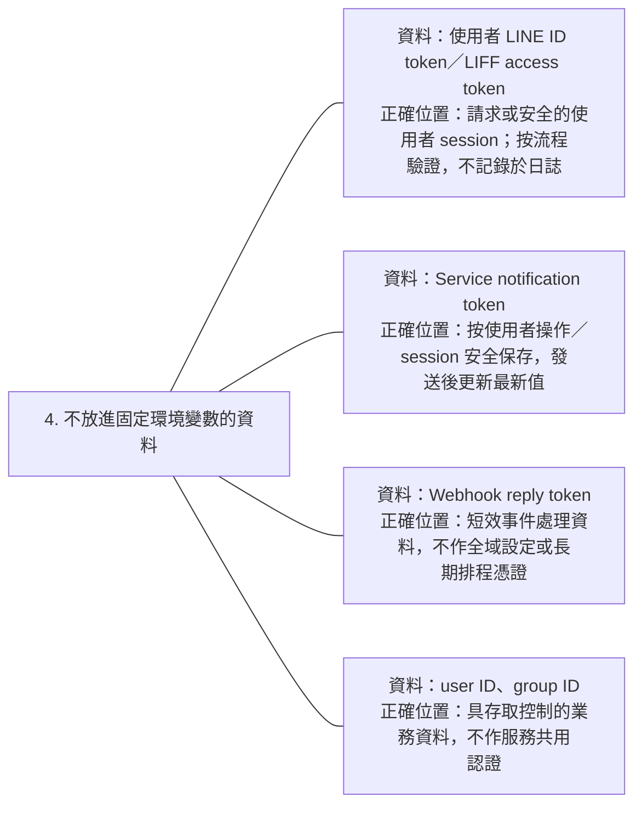
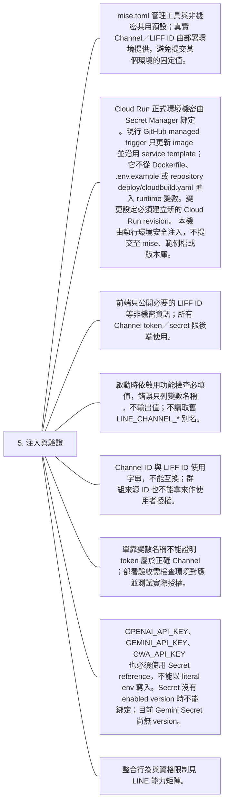

# LINE 環境變數規格

## 公開環境設定

根目錄 [.env.example](../../../.env.example) 列出十個公開設定變數；[Go MINI App 設定](../../../backend/internal/bootstrap/miniapp.go) 是唯一讀取與驗證入口。範例值可替換為其他產品的 Channel、LIFF 與 Endpoint，程式不內建個人 ID 或主機。

| LINE_MINI_APP_ENV | 所選變數前綴 |
| --- | --- |
| developing（預設） | LINE_MINI_APP_DEVELOPING_ |
| review | LINE_MINI_APP_REVIEW_ |
| published | LINE_MINI_APP_PUBLISHED_ |

每個前綴包含 `CHANNEL_ID`、`LIFF_ID`、`ENDPOINT_URL`。僅所選組必填：Channel ID 為數字字串；LIFF ID 非空且與 Channel ID 前綴配對；Endpoint 必須是無 credentials／fragment 的絕對 HTTPS URL，可保留路徑與 query。未知階段或所選組缺失／非法值會在啟動時回報變數名稱，不輸出設定內容。未選組不影響啟動。

公開 config API、ID token verifier 與 Session Channel 使用同一選擇，不接受其他環境 audience。手機永久連結仍由所選 LIFF ID 產生 `https://miniapp.line.me/<LIFF ID>`；桌面 Flex 使用該組 Endpoint，不能從請求 Host 或 postback 改寫。Messaging API 設定獨立。

`.env` 不自動載入；本機由 shell／執行環境安全注入。舊 `LINE_MINI_APP_CHANNEL_ID`、`LINE_MINI_APP_LIFF_ID`、`LINE_MINI_APP_WEB_URL` 不再生效，也不作 fallback。公開設定不表示已完成 LINE Console、openid、HTTPS、ADC 或 Firestore 權限驗收。

Cloud Build 範例將十項設定映射為 runtime env；現行 managed trigger 僅更新 image，**合併此變更前必須先補齊 Cloud Run 所選組環境變數**，否則新 revision 會因缺少設定而啟動失敗。變更範例或推送程式不會遷移遠端設定；操作依 [Cloud Run 指南](../../operations/cloud-run.md)。
