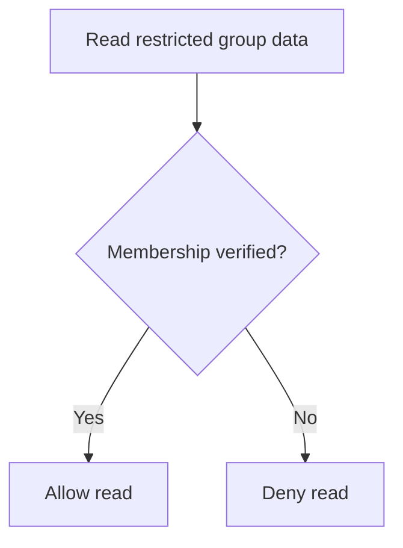

# LINE 群組相容整合

本模組維護既有群組查詢 API，並從已驗簽的 LINE Webhook 記錄群組及成員候選。候選索引用於探索群組。讀取受限群組資料時，後端仍須核實使用者當下的 LINE 群組成員身分。[公開 API 契約](../../../api/contract/group/) · [查詢實作](../../../backend/internal/linegroup/application/query/group.go)

團隊狀態及管理歸屬由 [Team](../../domains/team/design.md) 負責，正式成員資格由 [Membership](../../../backend/internal/business/membership/) 負責。

## Restricted group read decision flow

[HTTP 入口](../../../backend/internal/linegroup/adapter/http/routes.go) · [成員資格測試](../../../backend/internal/linegroup/application/query/group_test.go) · [後端模組與檔案樹](../../../backend/internal/linegroup/)
