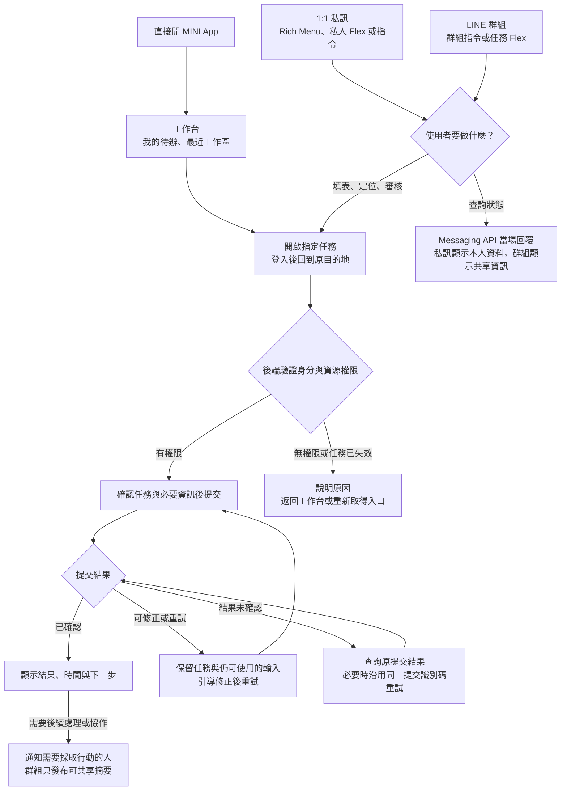
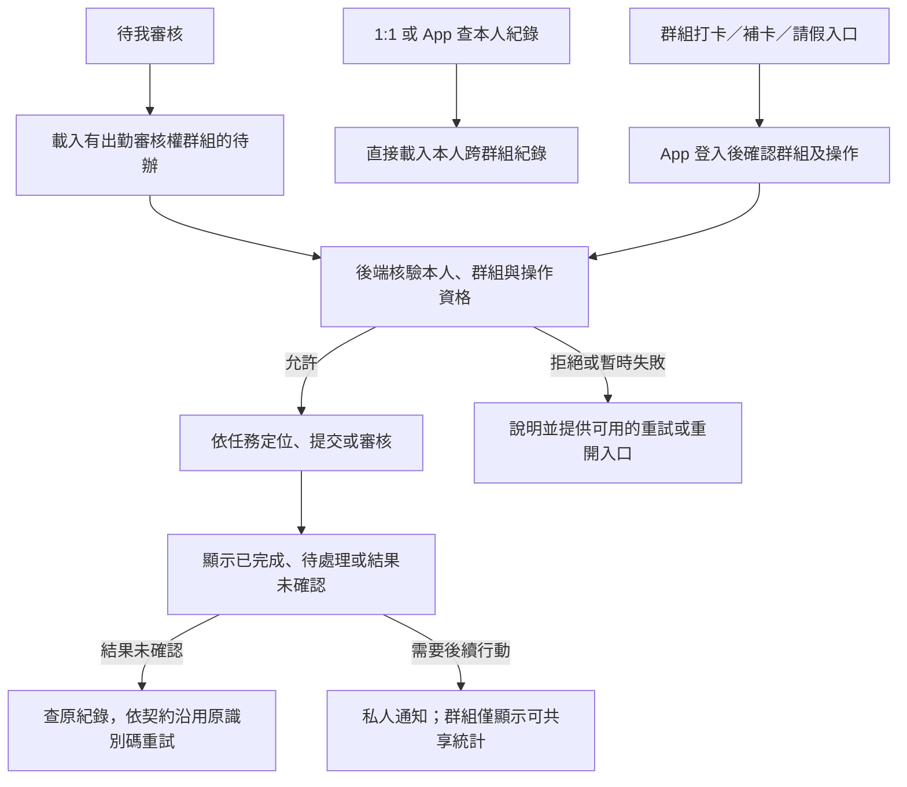
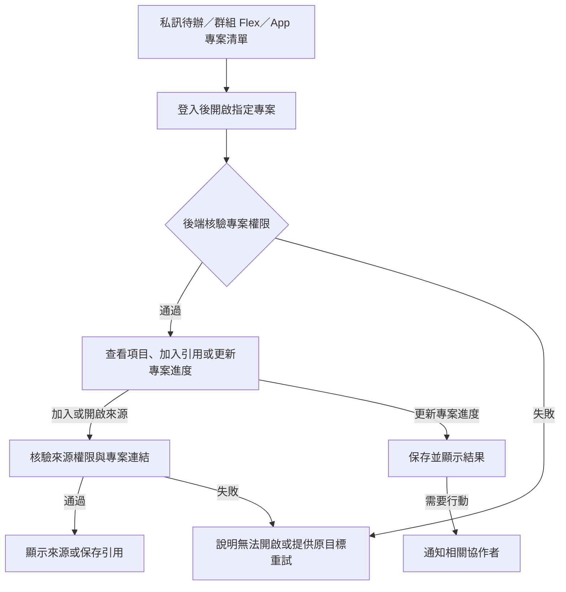
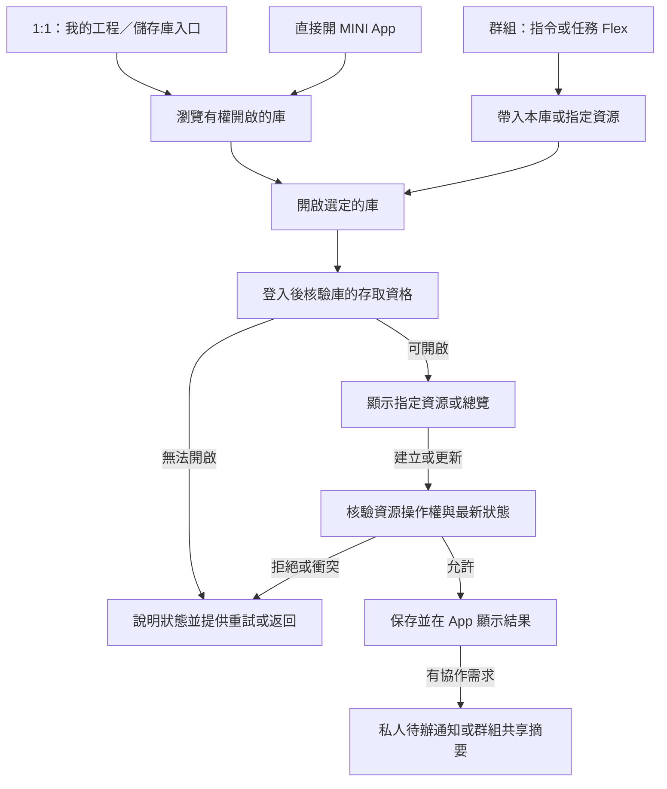
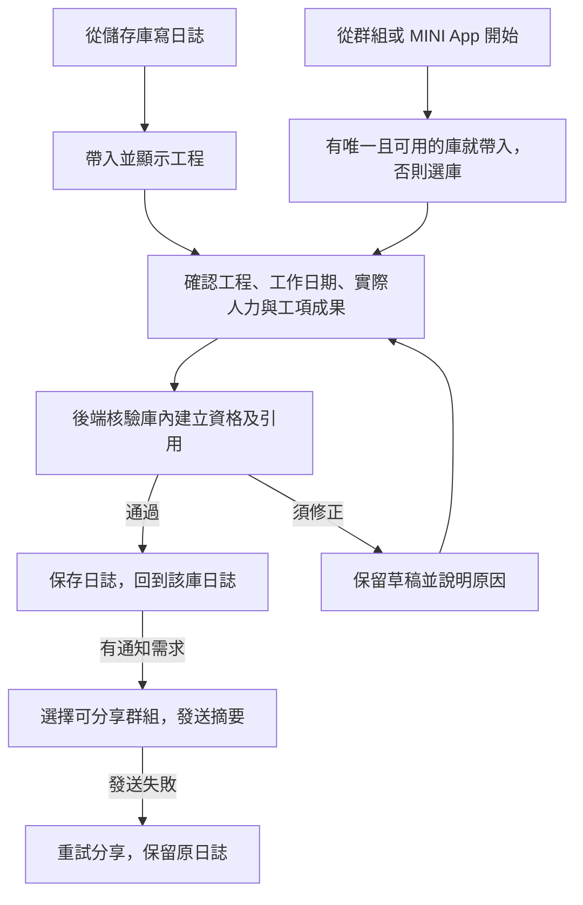

# LINE 使用者旅程目標

使用者可以從目前所在的 LINE 私訊、群組或 MINI App 找到對的任務，確認結果，並在中斷後知道怎麼繼續。Rich Menu 提供可反覆找到的個人入口，Flex Message 說明當下的下一步，MINI App 承接需要表單、定位或審核的操作。

各任務的入口、Action 與 Webhook 對照見 [LINE 任務接線表](wiring.md)。

本頁集中跨領域入口與目標旅程：[出勤](#attendance-journey)、[專案](#project-journey)、[儲存庫](#repository-journey)、[日誌](#journal-journey)。業務判定分別以[出勤查詢](../../domains/attendance/queries.md)、[Project](../../domains/project/project.md)、[Repository](../../domains/repository/design.md)及[Journal](../../domains/journal/journal.md)規格為準。

未來設計。此圖描述目標體驗，現有接線與待驗收項目見下表。

## 核心情境與驗收

| 情境           | 現有接線                                                                                                                             | 目標與驗收                                                                                                         |
| -------------- | ------------------------------------------------------------------------------------------------------------------------------------ | ------------------------------------------------------------------------------------------------------------------ |
| 群組打卡       | 群組選打卡動作後開 App，進行預檢、必要時定位並顯示結果。[打卡介面](../../../frontend/miniapp/src/business/attendance/punch/View.tsx) | 使用者不用重選群組。定位被拒時知道如何恢復。結果未確認時可查原紀錄，沿用識別碼重試只產生一筆紀錄。                 |
| 私訊查本人出勤 | 私訊指令與 Rich Menu 有出勤紀錄入口。[LINE 指令](commands.md)                                                                        | 在私訊看懂狀態，有需要再開 App 查明細。桌面使用者可用指令找到入口。                                                |
| 補卡與審核     | 已有補卡申請入口。[出勤規格](../../domains/attendance/design.md)                                                                     | 主管從待辦或私人通知開指定申請，登入後回到原申請。審核時核對權限與最新狀態，申請人可查結果，補卡原因留在私人介面。 |
| 回到工作區     | App 首頁有動態、儲存庫、專案與出勤紀錄入口。[首頁實作](../../../frontend/miniapp/src/navigation/home/View.tsx)                       | 群組 Flex 直達指定工作區，或從 App 回到最近工作區。有多個候選時只顯示有權限的選項。首頁新增待辦與最近工作區。      |

打卡已有結果未確認及重試提示。其他任務的直達、登入後恢復及完成後通知須逐條驗收。正式 LINE 渠道的發布與裝置行為也須實測。接線細節沿用[呈現方式選型](presentation.md)、[MINI App 啟動與登入](mini-app-setup.md)與 [Rich Menu 發布規格](../../operations/rich-menu.md)。

## 如何衡量改善

第一輪優先驗證群組打卡、私訊查出勤及群組開啟指定工作區。用相同的手機與桌面情境比較改版前後的首次完成率、完成時間、重選次數和錯誤恢復率。實測也確認使用者能自行說出目前所在位置、操作是否完成及下一步，並檢查窄螢幕、清楚的按鈕文案與 Flex 替代文字。

## 出勤、各業務與 LINE 旅程

讓員工在正確群組完成打卡，清楚知道是否已記錄，並能私下處理缺漏。讓審核者找到需要處理的申請，讓團隊掌握可共享的出勤概況。業務規則以[出勤上下文與整合契約](../../architecture/runtime/dependencies.md#attendance-context-map)為準。

| 業務                  | 與出勤的邊界                                                                                                                                                    |
| --------------------- | --------------------------------------------------------------------------------------------------------------------------------------------------------------- |
| 打卡與工時            | 依本人、群組、班次與必要證據判定。已確認工時與暫估工時分開顯示。[工時規格](../../domains/attendance/worktime.md)                                                |
| 補卡與請假            | 顯示送出、待處理與已決定的差異；補卡核准前維持原有效紀錄。[補正審核](../../domains/attendance/correction-design.md) · [請假](../../domains/attendance/leave.md) |
| Repository 與 Project | 工程入口可帶群組情境；庫與專案權限不會授予出勤查閱或審核權。                                                                                                    |
| Journal、排班與薪資   | 日誌記錄作業，出勤記錄群組班次。排班、加班核定和薪資依各自契約處理。                                                                                            |

### 現況與目標

群組已有打卡、出勤統計、補卡及請假入口，1:1 可查本人紀錄。MINI App 承接打卡預檢、必要定位、提交與申請。目標是保留原群組與動作，登入後直達指定表單或申請，讓審核者從私人待辦返回原申請。自動通知與實機行為須另外驗收。[LINE 指令](commands.md)

未來設計

驗收先測群組打卡與私訊查本人紀錄，再測補卡審核。覆蓋定位拒絕、重送、登入中斷、結果未知及無審核資格。確認不重複寫入、群組不顯示私人資料，並記錄首次完成率、任務時間、重選群組次數及錯誤恢復率。

## Repository 業務容器、專案與 LINE 旅程

專案讓負責人追蹤跨庫工作，並讓協作者回到有權開啟的來源。使用者應能分辨「這項專案工作進度如何」和「來源資料目前是什麼狀態」。以[專案契約](../../domains/project/project.md)和[儲存庫旅程](#repository-journey)為準。

| 業務       | 責任                                                                             |
| ---------- | -------------------------------------------------------------------------------- |
| Repository | 定義來源庫的存取範圍。Object、Issue、Discussion 各自管理內容、狀態及操作規則。   |
| Project    | 管理專案、可選來源與具體引用，以及專案內進度和巡檢。專案資格與來源資格分開核驗。 |
| LINE       | 讓協作者找到指定專案或待辦。群組卡片只傳達可共享的進度或下一步。                 |

### 現況與目標

MINI App 已有獨立專案工作區及跨庫引用。目標是在 1:1 提供個人專案待辦，群組 Flex 直達指定專案或項目，直接開 App 時從專案清單進入。登入後保留原目標。使用者從專案開來源時，後端再次核驗來源可見性。失去來源權限時，保留依法可讀的專案工作資訊，依契約處理來源欄位。

#### 專案入口驗收（目標行為）

- 直接開啟專案頁時，預設列出個人專案。切換到有權存取的組織後，顯示該組織的專案。從 LINE 深連結進入時，登入後開啟原指定專案或項目。
- 使用者沒有組織但已有個人專案時，仍能直接看到並開啟個人專案。Owner 選擇器僅列出使用者與可存取的組織。成功讀完目前範圍且沒有專案時，清單才顯示「目前沒有專案」。讀取失敗時顯示錯誤與重試操作。
- 建立空白專案後，分別從有讀取權的 A、B 儲存庫加入項目，同一看板應顯示兩者。撤銷 B 的來源讀取權後，仍可查看已授權的專案內容與 A 的項目，B 的受限來源內容不再顯示。
- 從個人專案選擇「複製到另一個 Owner」，指定有建立權的組織與新名稱。來源看板準備自訂欄位、使用該欄位的檢視及跨庫項目。驗證副本使用指定名稱，檢視能操作副本自己的欄位，項目及來源庫清單皆為空。完成後兩個 Owner 各有獨立專案，修改副本不影響原件。對缺少來源讀權或目的地建立權的請求，後端拒絕且不產生副本。

未來設計。LINE 任務卡片及通知須另外接線與驗收。

驗收先選一個包含兩個庫的專案，測試開啟指定項目、加入有效來源、來源失權與版本衝突。確認更新專案進度不改寫來源狀態，並量測首次完成率、找到指定項目時間與重選次數。

## Repository 業務容器與 LINE 旅程

Repository 是個人或群組的工程工作容器。使用者要能辨識自己正在操作哪個庫，找到工項、回報異常或查閱團隊知識，並確認操作結果。以既有領域與 API 為基礎，先改善導覽和 LINE 入口，再以實測決定是否需要新增關聯資料模型。

本頁記錄目標體驗及現況對照。擁有者綁定、生命週期及存取判定以 [Repository 領域設計](../../domains/repository/design.md)為準。共用的 LINE 入口與訊息選型見 [LINE 整合](./)。

### 依使用者任務組織 MINI App

現行導覽可在[頁籤設定](../../../frontend/miniapp/src/business/repository/navigation.ts)核對。目標是用「總覽」交代所在庫與下一步，「物件」找工項、工區及範本，「問題」追蹤 Issue 與里程碑，「協作」集中討論與 Wiki，「洞察」查看統計。共用目錄的管理操作依資格出現在「設定」。在手機畫面清楚標示個人庫或群組庫及其名稱，避免在相似名稱間誤寫。

例如從「配電盤安裝」工項回報規格不符，建立 Issue 時可帶原工項連結；團隊可從 Issue 開啟相關討論，確認後再整理成 Wiki。先用可存取的連結驗證導覽價值。雙向索引、正式關聯及跨能力自動更新須另有需求與契約。Issue 關閉、工項完成與 Project 進度各自維護。

### LINE 旅程

未來設計。群組直達本庫和私訊查找本人可用庫已有基礎。直達指定工項或表單、登入後恢復以及任務通知依個別路徑驗收。

| 入口       | 現行接線與目標                                                                                                                                         |
| ---------- | ------------------------------------------------------------------------------------------------------------------------------------------------------ |
| 1:1        | 已有「我的工程」與空間入口可查找有權開啟的庫。目標是讓「儲存庫」成為 Rich Menu 可找回的入口，並保留文字指令。[聊天指令](commands.md)                   |
| 群組       | 「空間」已有指定 Repository 路徑。目標是讓 Flex 針對單一工作情境顯示一個主要動作，直接到對應資源或表單。驗證失敗時保留目標，避免自動切換到別的群組庫。 |
| MINI App   | 現行可從側欄或頁面選庫。目標是從已授權的最近工作區回到原任務，登入後保持目的地並重新核驗資格。                                                         |
| 結果與回饋 | App 依保存結果顯示成功、可修正或結果未確認。結果未確認時依該資源契約查詢或重試。通知是目標行為，私人通知給需要行動的人，群組摘要只包含可共享資料。     |

連結識別操作目標。後端依契約核驗本人或當下群組成員資格，寫入時再核驗資源權限及最新狀態。不可開啟的入口依既有 API 語義顯示通用提示，避免揭露不可見庫。暫時無法核驗時可重試原目標。Bot 離群及重入的資料保留規則沿用[容器契約](../../domains/repository/design.md)。

### 優先順序與驗收

1. **先驗證找庫與辨識情境。** 讓使用者分別從私訊找到本人可用庫、從群組直達本庫。記錄首次完成率、找到正確庫的時間、重選次數及誤入另一庫的次數。
2. **再驗證一條庫內工作。** 從工項回報 Issue 並確認保存結果。測試登入後回原目標、無權操作、過期版本及提交中斷。確認使用者能說出位於哪個庫、是否已保存和下一步。
3. **驗證後再擴展通知與引用。** 用手機與桌面入口測試；確認窄螢幕按鈕文案、鍵盤操作與 Flex 替代文字可辨識。比較錯誤恢復率及新增流程所需維護的卡片與路由數。正式 LINE 渠道需另做實機驗收。

## 日誌、各業務與 LINE 旅程

現場人員需要記錄某個工程當日做了什麼、完成多少、有哪些人實際參與。新版以 **Repository → 工作日期 → 日誌** 查閱。LINE 提供進入與分享的途徑，Attendance 提供可選的人力參考。業務邊界與舊資料處理以[日誌目標規格](../../domains/journal/journal.md#目標規格日誌歸屬儲存庫)為準。

現行群組選單、MINI App 寫日誌、Feed 與 Dashboard 已有入口。日誌建立全面使用主儲存庫；舊群組日誌僅供歷史查閱。Feed 與 Dashboard 可選庫及工作日期。群組選單有唯一已知庫時帶入，打開後核驗庫資格；也可改選。應用可複製日誌連結及查詢出勤參考。直接發送群組摘要仍待接線。

### 目標時序

未來設計

### 驗收情境

- **A 出勤、B 支援**：選 B 庫記施工成果並確認實際作業人力。A 班次不變。日誌可分享至有權分享的群組，換群後仍能在 B 庫查閱。
- **一群多工程**：群組進入不擅自選庫。從 B 庫進入不必重選。未授權的庫與工項無法讀取或寫入。
- **送出不確定或分享失敗**：可查原提交結果或依契約重試。同一提交只保存一篇日誌。分享失敗時 App 顯示已保存，並提供重送。
- **舊群組日誌**：跨庫工作列和原查閱範圍可重現。新版彙整不因分享連結揭露無權查看的日誌。
- **理解與效率**：實測使用者能不靠提示區分工程歸屬、出勤來源及分享對象。比較找到正確工程的時間、重選次數、誤歸庫次數及錯誤恢復率。
