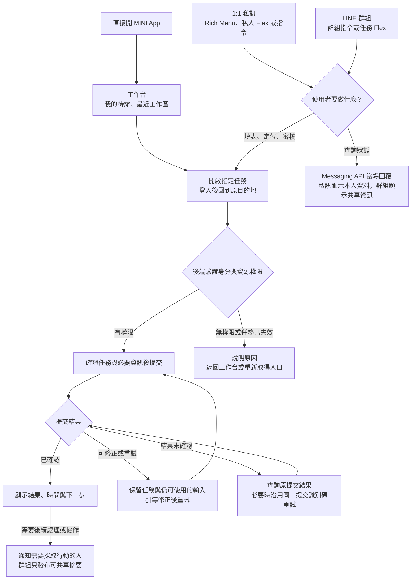

# LINE 使用者旅程目標

使用者可以從目前所在的 LINE 私訊、群組或 MINI App 找到對的任務，確認結果，並在中斷後知道怎麼繼續。Rich Menu 提供可反覆找到的個人入口，Flex Message 說明當下的下一步，MINI App 承接需要表單、定位或審核的操作。

各任務的入口、Action 與 Webhook 對照見 [LINE 任務接線表](wiring.md)。

未來設計。此圖描述目標體驗，現有接線與待驗收項目見下表。

## 核心情境與驗收

| 情境           | 現有接線                                                                                                                             | 目標與驗收                                                                                                         |
| -------------- | ------------------------------------------------------------------------------------------------------------------------------------ | ------------------------------------------------------------------------------------------------------------------ |
| 群組打卡       | 群組選打卡動作後開 App，進行預檢、必要時定位並顯示結果。[打卡介面](../../../frontend/miniapp/src/business/attendance/punch/View.tsx) | 使用者不用重選群組。定位被拒時知道如何恢復。結果未確認時可查原紀錄，沿用識別碼重試只產生一筆紀錄。                 |
| 私訊查本人出勤 | 私訊指令與 Rich Menu 有出勤紀錄入口。[LINE 指令](commands.md)                                                                        | 在私訊看懂狀態，有需要再開 App 查明細。桌面使用者可用指令找到入口。                                                |
| 補卡與審核     | 已有補卡申請入口。[出勤規格](../../domains/attendance/design.md)                                                                     | 主管從待辦或私人通知開指定申請，登入後回到原申請。審核時核對權限與最新狀態，申請人可查結果，補卡原因留在私人介面。 |
| 回到工作區     | App 首頁有動態、儲存庫、專案與出勤紀錄入口。[首頁實作](../../../frontend/miniapp/src/navigation/home/View.tsx)                       | 群組 Flex 直達指定工作區，或從 App 回到最近工作區。有多個候選時只顯示有權限的選項。首頁新增待辦與最近工作區。      |

打卡已有結果未確認及重試提示。其他任務的直達、登入後恢復及完成後通知須逐條驗收。正式 LINE 渠道的發布與裝置行為也須實測。接線細節沿用[呈現方式選型](presentation.md)、[MINI App 啟動與登入](mini-app-setup.md)與 [Rich Menu 發布規格](../../operations/rich-menu.md)。

## 如何衡量改善

第一輪優先驗證群組打卡、私訊查出勤及群組開啟指定工作區。用相同的手機與桌面情境比較改版前後的首次完成率、完成時間、重選次數和錯誤恢復率。實測也確認使用者能自行說出目前所在位置、操作是否完成及下一步，並檢查窄螢幕、清楚的按鈕文案與 Flex 替代文字。
