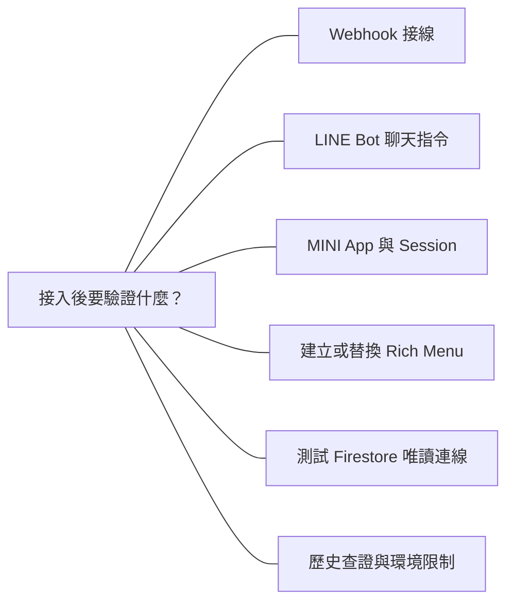

# LINE 接入設定

保存 LINE 平台與 MINI App 的設定步驟。

此處說明外部平台設定；平台能力、設定契約與呈現方式見 [LINE 整合索引](README.md)。

## 閱讀與修改入口

先查閱[sources.md](sources.md)、[../../operations/rich-menu.md](../../operations/rich-menu.md)、[mini-app-setup.md](mini-app-setup.md)。

## 相關規格

[本層規格與指引](../../README.md)

## Go LINE 接入：啟動

- 官方 Go SDK；版本見 backend/go.mod。已接入 Webhook、MINI App Session、Firestore 出勤／請假及 Cloud Tasks 摘要。群組角色管理、Service Message 與常駐 Worker 不在此範圍。

- bash scripts/tooling/tool-exec.sh mise run dev

- PORT 預設 8080，不自動讀 .env。保留 /location定位示範，沒有健康檢查路由。 Messaging API 三項全缺時停用、部分缺失時啟動失敗。MINI App 以 LINE_MINI_APP_ENV 選環境，預設 developing；未知值或選定三元組缺失／非法時啟動失敗。 設定名稱與 Channel 分離規則見 LINE環境變數（configuration.md）。

[適用工作指引](../../AGENTS.md)
