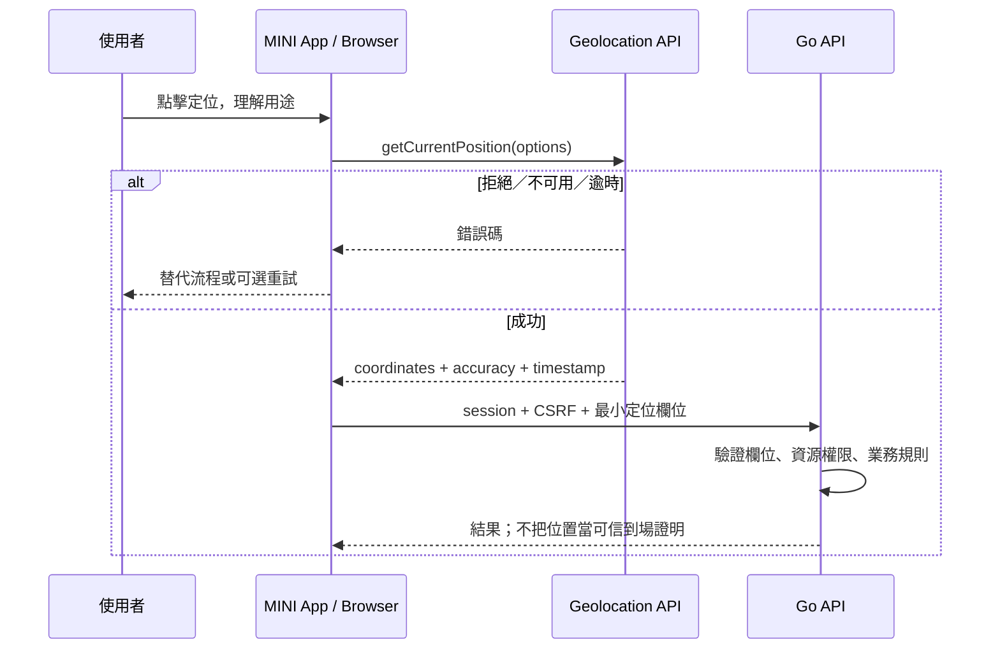

# Web Geolocation API 整合契約

範圍：保留 Go + Next.js／React 的獨立定位示範，另由 MINI App 接入 [基礎出勤](../features/attendance.md)。
出勤使用單次定位，驗證 LINE 身分與原群組打卡請求後保存位置、精度及採樣時間；不做工作半徑判斷或持續追蹤。以下示範 API 仍不寫入資料，出勤契約以功能頁為準。

> 狀態：示範已實作，尚待 LINE／手機實機確認。透過 Context7 `/mdn/content` 核對
> getCurrentPosition、secure context、權限與錯誤碼；具體定位業務、精度、保存期仍需功能契約。

## 執行示範

```bash
bash scripts/tooling/tool-exec.sh mise run dev
```

開啟 `http://localhost:8080/location`。正式環境使用 Cloud Run HTTPS 網址加 `/location`。
先以 `pnpm build` 建置 Next.js 靜態輸出，再由 Go 透過 FRONTEND_DIR 供應；runtime 不需要 Node.js 服務、Google Maps key 或 LINE 憑證。Dockerfile 包含前端建置。

按下「取得位置並驗證」後才請求瀏覽器權限。成功時顯示座標、精度與採樣時間，
並傳送 `POST /api/location/validate`；取消、離開頁面或伺服器逾時後忽略遲到 callback，
並中止尚在等待的 fetch。已送出的資料無法撤回。

此公開端點只檢查資料，不讀寫資料庫、不關聯使用者、不賦予出勤或資源權限。
不將座標寫入一般應用日誌，回應只包含 `valid` 與伺服器 `receivedAt`；設定 `no-store`。
若日後加入業務操作，必須另接可信身分、CSRF 與資源授權。

## 示範 API

`POST /api/location/validate`，Content-Type 為 `application/json`，body 上限 2 KiB。
不啟用跨來源 CORS，使用 Go `CrossOriginProtection` 拒絕瀏覽器跨來源寫入請求。

```json
{
  "latitude": 25.033,
  "longitude": 121.5654,
  "accuracyMeters": 20,
  "capturedAt": "2026-11-08T00:00:00Z"
}
```

範例時間請替換為目前時間。四欄皆必填，不接受 null、額外欄位或多個 JSON 值。
示範僅接受採樣時間在伺服器時間前 5 分鐘至後 1 分鐘之間；這是輸入新鮮度檢查，
不是出勤業務規則，不限制定位精度上限。`0,0` 是合法座標，缺欄不視為 0。
成功回應 `200 {"valid":true,"receivedAt":"..."}`；錯誤回應為 `{"error":"..."}`。
無效欄位／JSON 為 400、body 過大為 413、不支援的 Content-Type 為 415。
跨來源拒絕由 Go middleware 回應 403 純文字，錯誤 method 為 405。

實作位於 `backend/internal/diagnostics/geolocation/geolocation.go` 與 `internal/web/pages/geolocation.html、internal/web/static/{js,css}/geolocation.*`。
以下為加入定位業務時的完整邊界；不是示範已完成登入或出勤的宣告。

## 邊界

瀏覽器以 `navigator.geolocation` 取得裝置提供的位置，Go 無法直接存取使用者 GPS。
MINI App 用少量 JavaScript 呼叫 API，再將必要欄位提交 Go HTTPS API；不需要 Node.js 服務。
這不是 Google Maps API，不需要 Google Maps key，也不提供地圖、地址反查或可信到場證明。
LINE 訊息的 location／位置 action 與 Web Geolocation 是不同輸入，不混用同意或可信度。

## 啟用與同意

- 正式環境 HTTPS secure context；檢查 `window.isSecureContext` 與 `navigator.geolocation`，不支援時提供手動替代流程。
- 使用者點擊明確定位按鈕才請求，先說明用途；拒絕後不循環彈窗、不偷偷用 IP 代替精確定位。
- 頁面基線 header：`Permissions-Policy: geolocation=(self)`；跨 origin iframe 必須同時評估父頁 policy 與 iframe allow，不能假設 LIFF WebView 一定放行。
- Permissions API 的查詢是可選改善，不支援／查詢失敗不能讓整個流程崩潰；實際 callback 為最終結果。
- iOS/Android LINE 內嵌瀏覽器、OS 權限與外部瀏覽器分開實測；不保證背景定位。

## 取得位置

預設單次 `getCurrentPosition`；獨立示範使用 `enableHighAccuracy:false, timeout:10000, maximumAge:0`；出勤打卡使用 `enableHighAccuracy:false, timeout:10000, maximumAge:0`，前端另有 15 秒等待保護；每次要求新的位置，不使用瀏覽器快取。前端只檢查時間格式，後端驗證座標、精度與採樣時間。這些設定不是官方保證或產品精度門檻。
定位示範頁也在等待權限時保留取消按鈕，不因頁面暫時隱藏而取消（系統權限介面可能使頁面隱藏）。伺服器送出階段另設逾時。
出勤頁先做[後端預檢](../features/attendance.md#定位前預檢狀態與時序)，僅需要新增操作時才使用 `watchPosition`，取得第一筆合法位置後立即 `clearWatch`，並有 15 秒前端逾時；離頁或登出後忽略遲到的定位 callback，已送出的請求仍須查詢紀錄確認結果。
高精度可能耗電／變慢，也不保證 GPS。只有明確連續定位需求才用 watchPosition；離開、取消、隱藏／登出時依生命週期 clearWatch。
getCurrentPosition 沒有 AbortSignal 取消介面；取消頁面操作後忽略遲到 callback，不再送 API。
錯誤碼 1=PERMISSION_DENIED、2=POSITION_UNAVAILABLE、3=TIMEOUT；分別顯示可理解的拒絕／不可用／重試提示，不顯示原始敏感錯誤。

## Go 接收契約（示範與出勤 route 均已實作）

| 欄位 | JSON／Go | 驗證 |
| --- | --- | --- |
| 緯度 | latitude／Latitude float64 | 有限數，[-90,90] |
| 經度 | longitude／Longitude float64 | 有限數，[-180,180] |
| 精度 | accuracyMeters／AccuracyMeters float64 | 有限、非負，公尺；不是可信證明 |
| 採樣時間 | capturedAt／CapturedAt time.Time | JS timestamp 轉 RFC3339 UTC；過舊／未來門檻依業務契約 |

Go 另產生 receivedAt，不信任客戶端時間；必填數值用 pointer／存在性檢查，不能把缺欄誤當合法 0。
不收集不必要的 altitude、heading、speed。出勤 route 依功能契約驗證定位新鮮度；目前只保存單次打卡位置，不設定精度上限或地理圍欄，也不宣稱到場判定。
驗證 session、CSRF、資源權限與 body limit；不接受任意 userId/groupId 作身分。
位置可偽造，不能作付款、身分或高風險授權唯一條件。精確位置不寫一般日誌、不自動推到群組。
出勤只把單次定位附在該次打卡紀錄，不建立持續定位歷史 collection。保存期與刪除政策仍須在正式營運前確立。

## 現有出勤整合檔案與責任

- `backend/internal/business/attendance/http/attendance_http.go`：註冊 `POST /api/v1/attendance/punches`，驗證 LINE 身分、請求內容與原群組打卡請求。
- `internal/web/static/js/punch.js`：由 MINI App 取得單次定位並提交；只負責採樣、UI 與請求，不決定授權。
- `backend/internal/identity/http/identity.go`：提供可共用的 LINE 身分驗證；後端不信任前端自行傳入的 user ID。
- `backend/internal/business/attendance/firestore/attendance.go`：在交易中驗證短效打卡請求，隔離群組狀態並保存單次定位。
- `backend/internal/diagnostics/geolocation/geolocation.go` 與 `internal/web/pages/geolocation.html、internal/web/static/{js,css}/geolocation.*`：保留獨立定位示範，不寫入出勤資料。



## 驗收

HTTPS／不安全來源、不支援 API、權限拒絕、OS 關閉定位、逾時、低精度、過舊／未來時間、缺欄／越界、離頁後 callback、跨群組越權。
受控測試使用 mock position；定位成功必須另有 LINE iOS/Android 與外部瀏覽器實機證據，不以桌面模擬取代。

來源：[Geolocation API](https://developer.mozilla.org/en-US/docs/Web/API/Geolocation_API)、[getCurrentPosition](https://developer.mozilla.org/en-US/docs/Web/API/Geolocation/getCurrentPosition)、[watchPosition](https://developer.mozilla.org/en-US/docs/Web/API/Geolocation/watchPosition)、[Permissions Policy](https://developer.mozilla.org/en-US/docs/Web/HTTP/Reference/Headers/Permissions-Policy/geolocation)。
