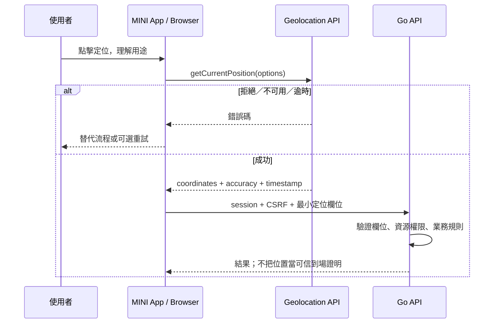

# Web Geolocation API 整合契約

範圍：定位不納入首版 [基礎出勤](../features/attendance.md)。本頁保留為後續需求成立時的參考，
不構成目前基礎設施、功能或測試工作的前置要求。

> 狀態：已選技術、尚未實作。2026-11-07 透過 Context7 `/mdn/content` 核對；具體定位業務、精度、保存期仍需功能契約。

## 邊界

瀏覽器以 `navigator.geolocation` 取得裝置提供的位置，Go 無法直接存取使用者 GPS。
MINI App 用少量 JavaScript 呼叫 API，再將必要欄位提交 Go HTTPS API；不需要 Node.js 服務。
這不是 Google Maps API，不需要 Google Maps key，也不提供地圖、地址反查或可信到場證明。
LINE 訊息的 location／位置 action 與 Web Geolocation 是不同輸入，不混用同意或可信度。

## 啟用與同意

- 正式環境 HTTPS secure context；檢查 `window.isSecureContext` 與 `navigator.geolocation`，不支援時提供手動替代流程。
- 使用者點擊明確定位按鈕才請求，先說明用途；拒絕後不循環彈窗、不偷偷用 IP 代替精確定位。
- 頁面基線 header：`Permissions-Policy: geolocation=(self)`；跨 origin iframe 必須同時評估父頁 policy 與 iframe allow，不能假設 LIFF WebView 一定放行。
- Permissions API 的查詢是可選改善，不支援／查詢失敗不能讓整個流程崩潰；實際 callback 為最終結果。
- iOS/Android LINE 內嵌瀏覽器、OS 權限與外部瀏覽器分開實測；不保證背景定位。

## 取得位置

預設單次 `getCurrentPosition`；專案初始選項 `enableHighAccuracy:false, timeout:10000, maximumAge:0`，不是官方保證或產品精度門檻。
高精度可能耗電／變慢，也不保證 GPS。只有明確連續定位需求才用 watchPosition；離開、取消、隱藏／登出時依生命週期 clearWatch。
getCurrentPosition 沒有 AbortSignal 取消介面；取消頁面操作後忽略遲到 callback，不再送 API。
錯誤碼 1=PERMISSION_DENIED、2=POSITION_UNAVAILABLE、3=TIMEOUT；分別顯示可理解的拒絕／不可用／重試提示，不顯示原始敏感錯誤。

## Go 接收契約（業務 route 尚未選定）

| 欄位 | JSON／Go | 驗證 |
| --- | --- | --- |
| 緯度 | latitude／Latitude float64 | 有限數，[-90,90] |
| 經度 | longitude／Longitude float64 | 有限數，[-180,180] |
| 精度 | accuracyMeters／AccuracyMeters float64 | 有限、非負，公尺；不是可信證明 |
| 採樣時間 | capturedAt／CapturedAt time.Time | JS timestamp 轉 RFC3339 UTC；過舊／未來門檻依業務契約 |

Go 另產生 receivedAt，不信任客戶端時間；必填數值用 pointer／存在性檢查，不能把缺欄誤當合法 0。
不收集不必要的 altitude、heading、speed。精度／新鮮度上限與地理圍欄半徑先由功能契約決定；未決定時不能啟用打卡／到場判定。
驗證 session、CSRF、資源權限與 body limit；不接受任意 userId/groupId 作身分。
位置可偽造，不能作付款、身分或高風險授權唯一條件。精確位置不寫一般日誌、不自動推到群組。
保存僅在產品明確需要時啟用；預設不建立定位歷史 collection。保存期、同意、刪除與目的確立後才更新 schema。

## 規劃檔案與函數

- `internal/web/static/geolocation.js`：`requestCurrentPosition`、`stopPositionWatch`；只採樣與 UI，無授權。
- `internal/adapters/http/miniapi/location.go`：`Handler.SubmitLocation`；僅在定位功能契約確定後建立 route。
- 對應業務 application：`SubmitLocation`；檢查資源權限與定位規則，adapter DTO 不進領域。
- 純驗證 helper 使用 `validateCoordinates`；距離計算單位寫進名稱如 `distanceMeters`，座標系 WGS84。

## 驗收

HTTPS／不安全來源、不支援 API、權限拒絕、OS 關閉定位、逾時、低精度、過舊／未來時間、缺欄／越界、取消後 callback、watch 清理、跨群組越權。
受控測試使用 mock position；定位成功必須另有 LINE iOS/Android 與外部瀏覽器實機證據，不以桌面模擬取代。

來源：[Geolocation API](https://developer.mozilla.org/en-US/docs/Web/API/Geolocation_API)、[getCurrentPosition](https://developer.mozilla.org/en-US/docs/Web/API/Geolocation/getCurrentPosition)、[watchPosition](https://developer.mozilla.org/en-US/docs/Web/API/Geolocation/watchPosition)、[Permissions Policy](https://developer.mozilla.org/en-US/docs/Web/HTTP/Reference/Headers/Permissions-Policy/geolocation)。
