# Cloud Run 部署

出勤查詢需要三個複合索引，定義在 [Firestore 索引清單](../../firestore.indexes.json)。自訂 Cloud Build 流程在發布前建立缺少的出勤索引，等待全部達到 `READY`。建置身分需要 Firestore 索引管理權限。使用 inline trigger 或其他部署平台時，在部署步驟前執行同一個檢查：

```sh
python3 scripts/db/ensure-attendance-indexes.py "$PROJECT_ID"
```

指令預設使用 `(default)` 資料庫，可用第二個參數指定資料庫。它從 Cloud Build 執行身分或環境變數 `GOOGLE_OAUTH_ACCESS_TOKEN` 取得授權，只建立出勤索引並檢查狀態。Firebase CLI 也可從根目錄的 `firebase.json` 取得完整索引與欄位設定。

<a id="cloud-run-部署"></a>

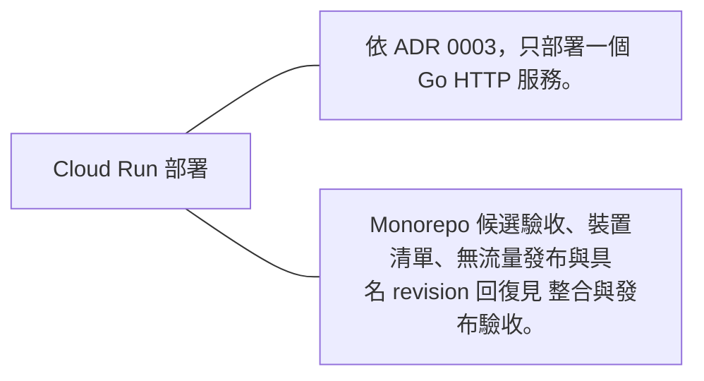

## 觸發條件

Managed Trigger 的 `includedFiles`／`ignoredFiles` 在 Cloud Build 維護。文件專用變更可依線上規則略過；根目錄 `firestore.indexes.json` 與 `scripts/generate/prepare-miniapp-assets.mts` 已列為觸發輸入。若要讓單改根目錄 `cloudbuild.yaml` 也觸發建置，需另外更新雲端篩選。自訂 Trigger 若指定舊位置，須改指向根目錄的 YAML。

建置不查詢或自動取消其他建置；現行流程不需要額外的查詢或取消權限。映像輸入與本機驗收見[容器建置契約](container-build.md#容器建置契約)。

<a id="建置入口"></a>

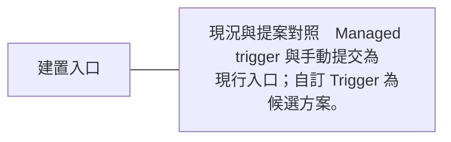

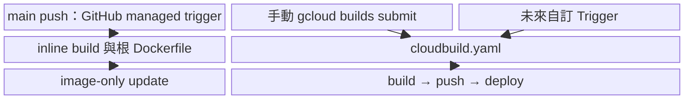

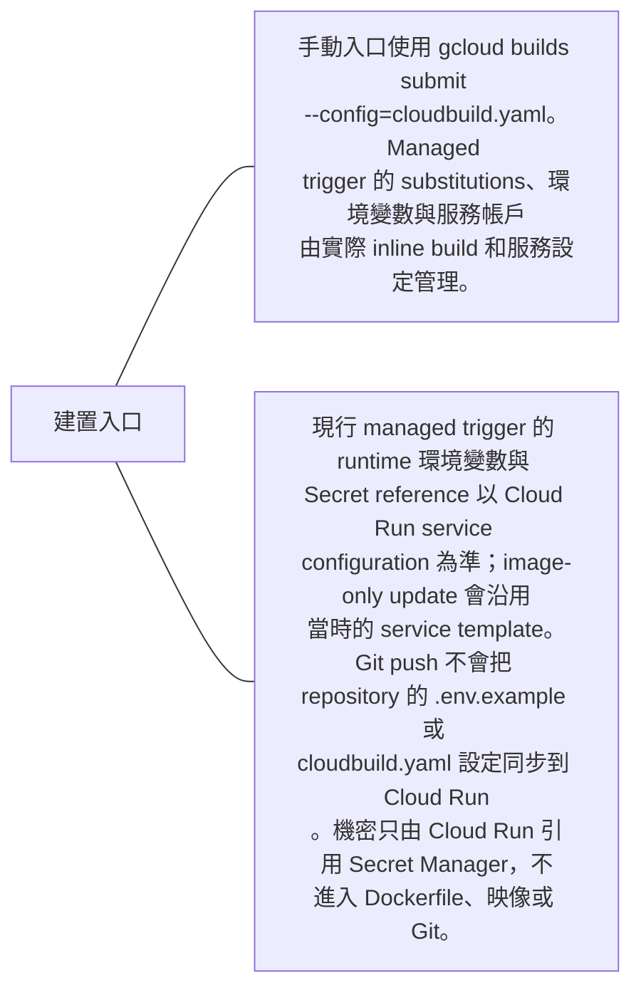

<a id="managed-trigger-的-rich-menu-圖片路徑"></a>

## Managed trigger 的 Rich Menu 自動同步遷移

原 inline Trigger 使用 /richmenu；新映像已移除此獨立執行檔，改由單一 /server 的部署工作模式執行。**先遷移 Trigger，再部署新映像。** Repository YAML 已包含部署前的單次 Job，不能假設修改 YAML 就會更新線上 inline 設定。接線、租約、權限與尚未完成的雲端驗收見 [Rich Menu 自動發布](rich-menu.md)。

圖片仍位於映像的 /assets/line/richmenu/，目錄可穿越、JPEG 0644，供 nonroot Job 讀取。保留 Dockerfile 的權限整理，不將圖片載入失敗誤判成 LINE 平台問題。

<a id="repository-deploycloudbuildyaml-預設配置"></a>

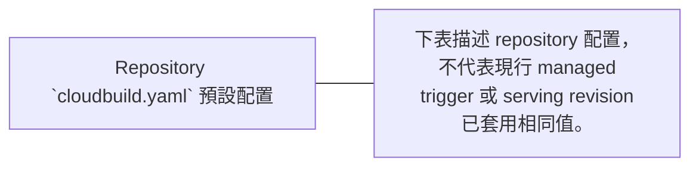

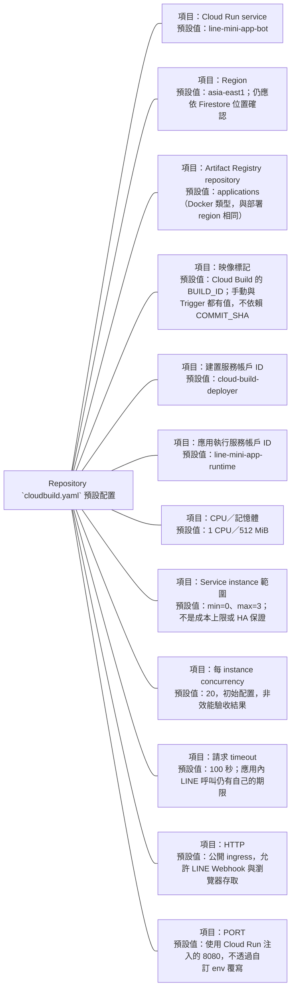

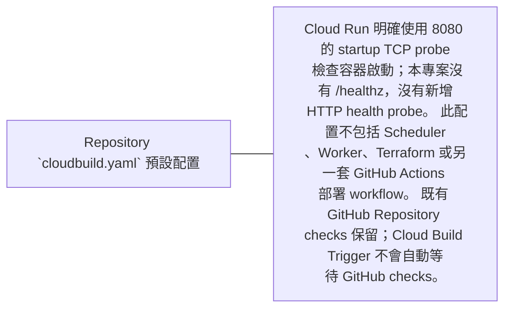

<a id="一次性準備"></a>

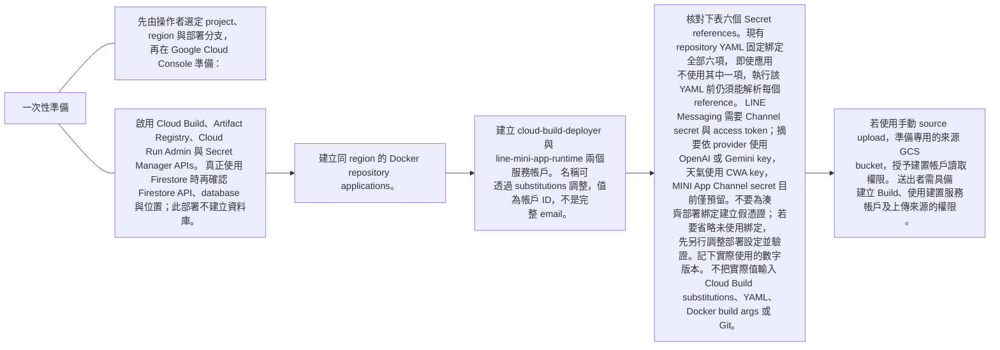

<a id="兩種服務帳戶的權限"></a>

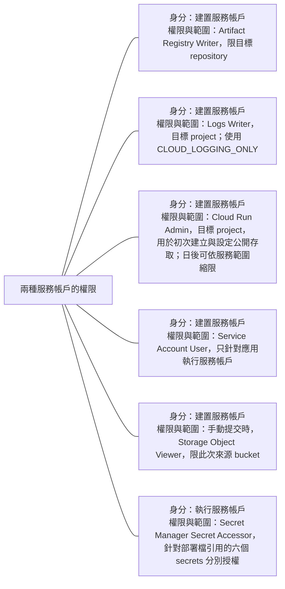

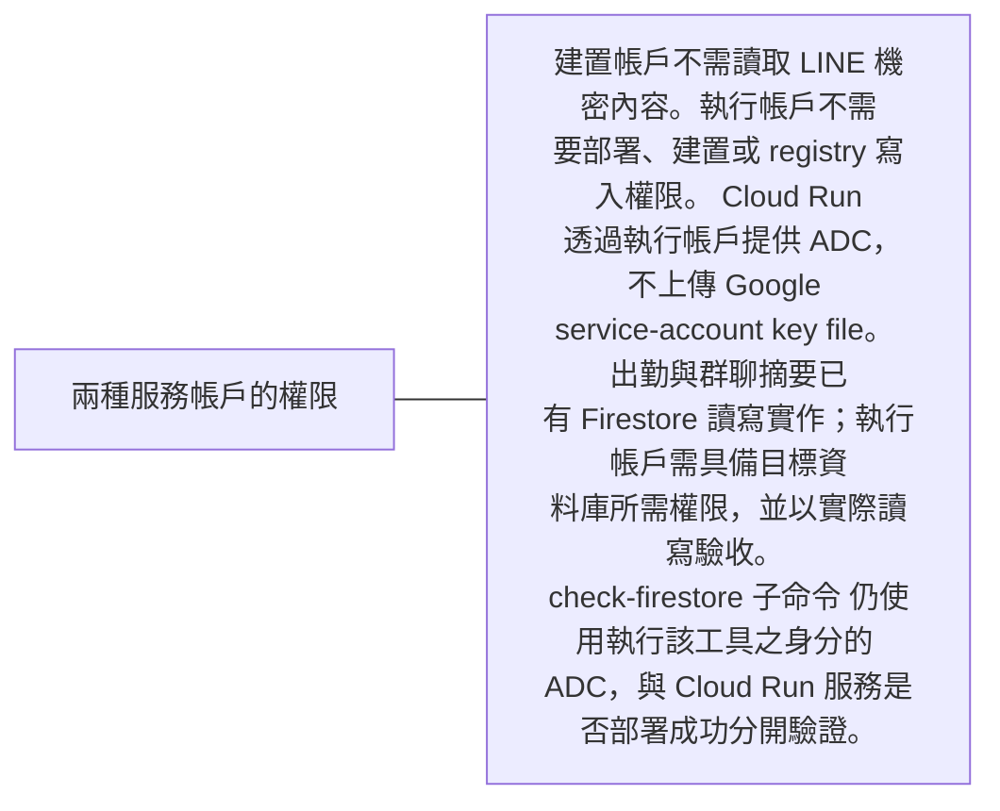

<a id="設定契約"></a>
<a id="secret-manager-與環境變數"></a>
<a id="mini-app-公開設定遷移"></a>

## 執行環境設定

Secret Manager 綁定、建置參數與 MINI App 公開設定遷移見[正式環境設定](configuration.md)。

<a id="首次手動部署"></a>

## 首次手動部署

先檢查上傳範圍；此命令只列本機檔案：

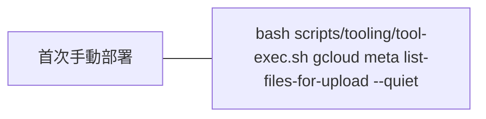

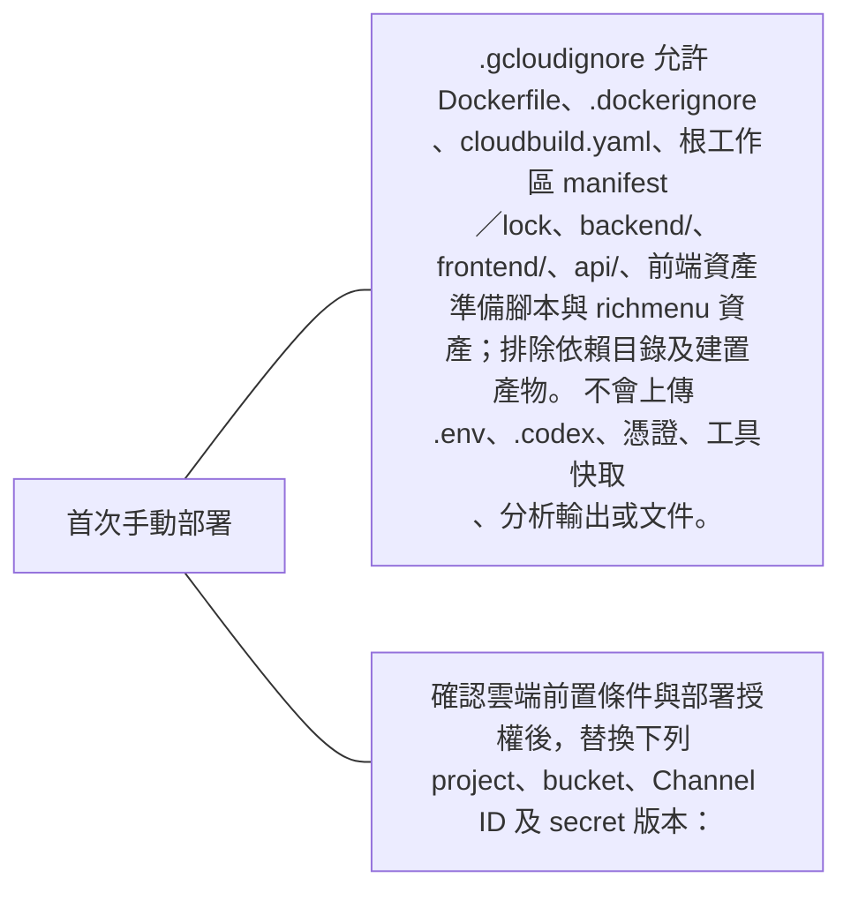

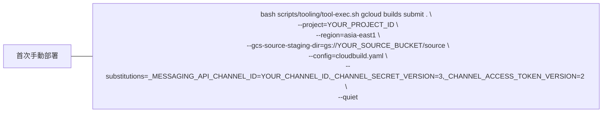

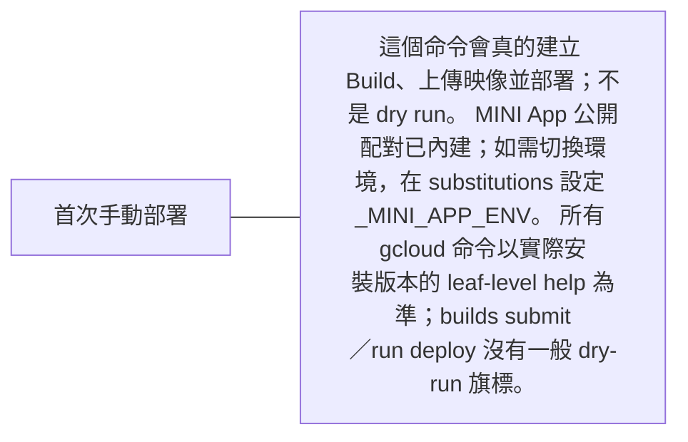

<a id="現行-github-managed-trigger"></a>

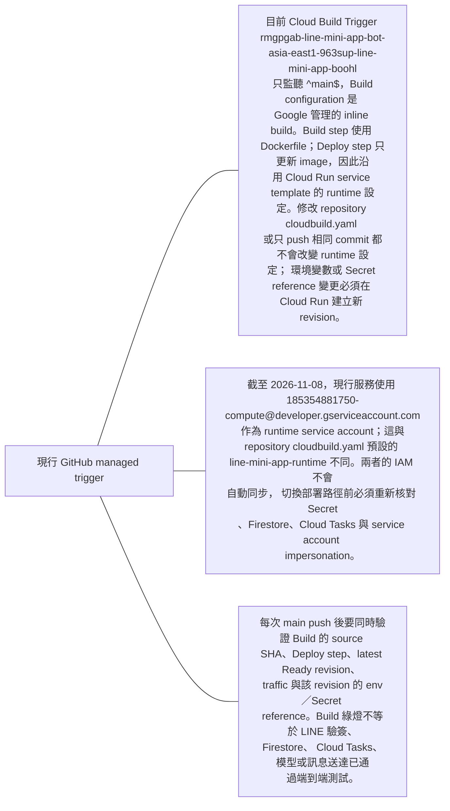

<a id="docker-buildkit-建置契約"></a>

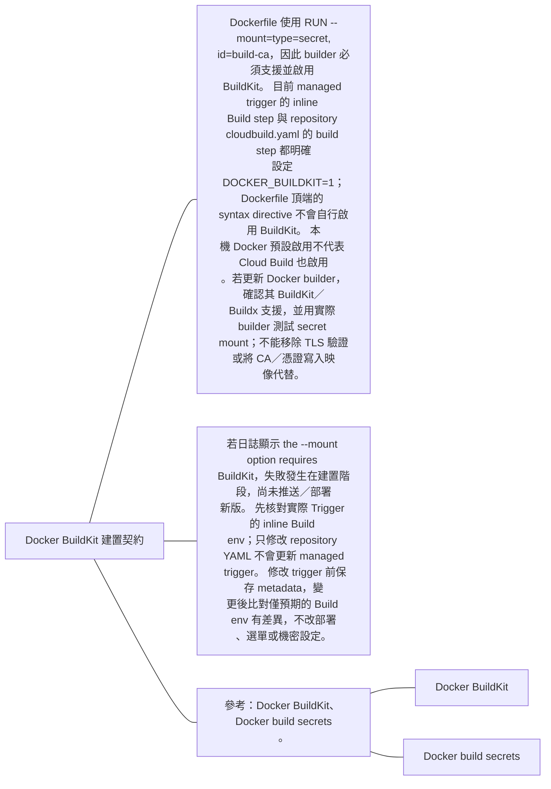

<a id="改用-repository-deploycloudbuildyaml-的自訂-trigger"></a>

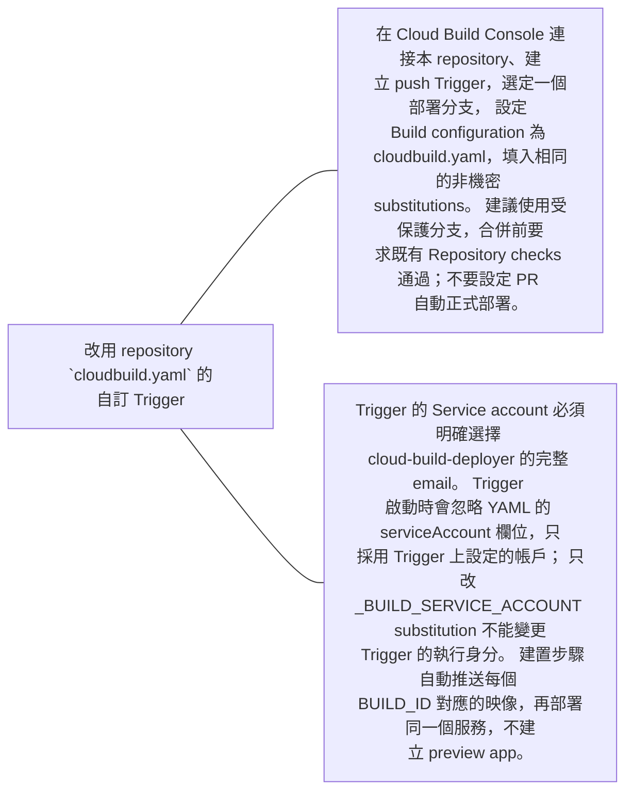

<a id="部署後確認與回滾"></a>

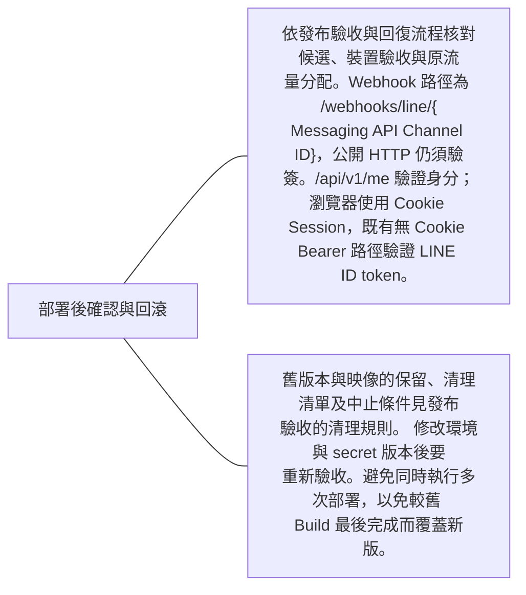

<a id="配置驗證狀態與來源"></a>

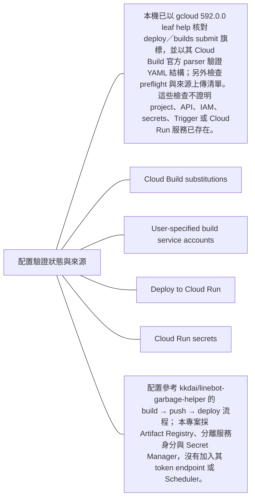
