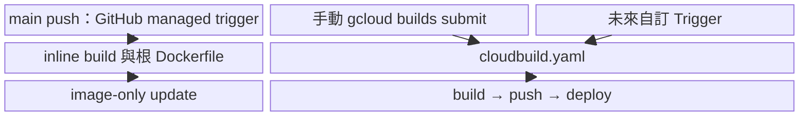
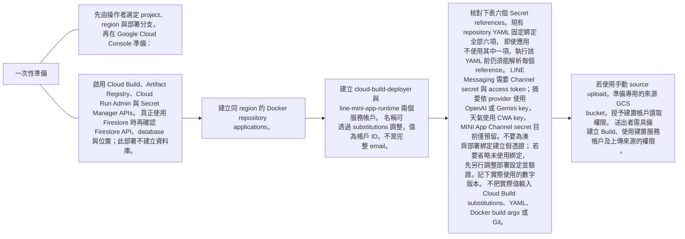

# Cloud Run 部署

出勤與物件數量歷史查詢所需的複合索引統一定義在 [Firestore 索引清單](../../firestore.indexes.json)。自訂 Cloud Build 流程在發布前建立缺少的 Firestore 複合索引，等待全部達到 `READY`。建置身分需要 Firestore 索引管理權限。使用 inline trigger 或其他部署平台時，在部署步驟前執行同一個檢查：

```sh
python3 scripts/db/ensure-firestore-indexes.py "$PROJECT_ID"
```

指令預設使用 `(default)` 資料庫，可用第二個參數指定資料庫。它從 Cloud Build 執行身分或環境變數 `GOOGLE_OAUTH_ACCESS_TOKEN` 取得授權，依 `firestore.indexes.json` 建立全部 collection group 缺少的複合索引並檢查狀態；已存在的索引不重建，不刪除額外索引，失敗或等待逾時會中止發布。Firebase CLI 也可從根目錄的 `firebase.json` 取得完整索引與欄位設定。

<a id="cloud-run-部署"></a>

- [依 ADR 0003，只部署一個 Go HTTP 服務。](../decisions/0003-cloud-run-primary.md)

- [Monorepo 候選驗收、裝置清單、無流量發布與具名 revision 回復見 整合與發布驗收。](release-acceptance.md)

## 觸發條件

Managed Trigger 的 `includedFiles`／`ignoredFiles` 在 Cloud Build 維護。文件專用變更可依線上規則略過；根目錄 `firestore.indexes.json` 與 `scripts/generate/prepare-miniapp-assets.mts` 已列為觸發輸入。若要讓單改根目錄 `cloudbuild.yaml` 也觸發建置，需另外更新雲端篩選。自訂 Trigger 若指定舊位置，須改指向根目錄的 YAML。

建置不查詢或自動取消其他建置；現行流程不需要額外的查詢或取消權限。映像輸入與本機驗收見[容器建置契約](container-build.md#容器建置契約)。

<a id="建置入口"></a>

## 建置入口

現況與提案對照　Managed trigger 與手動提交為現行入口；自訂 Trigger 為候選方案。



- 手動入口使用 gcloud builds submit --config=cloudbuild.yaml。Managed trigger 的 substitutions、環境變數與服務帳戶由實際 inline build 和服務設定管理。

- 現行 managed trigger 的 runtime 環境變數與 Secret reference 以 Cloud Run service configuration 為準；image-only update 會沿用當時的 service template。Git push 不會把 repository 的 .env.example 或 cloudbuild.yaml 設定同步到 Cloud Run。機密只由 Cloud Run 引用 Secret Manager，不進入 Dockerfile、映像或 Git。

<a id="managed-trigger-的-rich-menu-圖片路徑"></a>

## Managed trigger 的 Rich Menu 自動同步遷移

原 inline Trigger 使用 /richmenu；新映像已移除此獨立執行檔，改由單一 /server 的部署工作模式執行。**先遷移 Trigger，再部署新映像。** Repository YAML 已包含部署前的單次 Job，不能假設修改 YAML 就會更新線上 inline 設定。接線、租約、權限與尚未完成的雲端驗收見 [Rich Menu 自動發布](rich-menu.md)。

圖片仍位於映像的 /assets/line/richmenu/，目錄可穿越、JPEG 0644，供 nonroot Job 讀取。保留 Dockerfile 的權限整理，不將圖片載入失敗誤判成 LINE 平台問題。

<a id="repository-deploycloudbuildyaml-預設配置"></a>

## Repository #96;cloudbuild.yaml#96; 預設配置

下表描述 repository 配置，不代表現行 managed trigger 或 serving revision 已套用相同值。

| 項目                         | 預設值                                                            |
| ---------------------------- | ----------------------------------------------------------------- |
| Cloud Run service            | line-mini-app-bot                                                 |
| Region                       | asia-east1；仍應依 Firestore 位置確認                             |
| Artifact Registry repository | applications（Docker 類型，與部署 region 相同）                   |
| 映像標記                     | Cloud Build 的 BUILD_ID；手動與 Trigger 都有值，不依賴 COMMIT_SHA |
| 建置服務帳戶 ID              | cloud-build-deployer                                              |
| 應用執行服務帳戶 ID          | line-mini-app-runtime                                             |
| CPU／記憶體                  | 1 CPU／512 MiB                                                    |
| Service instance 範圍        | min=0、max=3；不是成本上限或 HA 保證                              |
| 每 instance concurrency      | 20，初始配置，非效能驗收結果                                      |
| 請求 timeout                 | 100 秒；應用內 LINE 呼叫仍有自己的期限                            |
| HTTP                         | 公開 ingress，允許 LINE Webhook 與瀏覽器存取                      |
| PORT                         | 使用 Cloud Run 注入的 8080，不透過自訂 env 覆寫                   |

Cloud Run 明確使用 8080 的 startup TCP probe 檢查容器啟動；本專案沒有 /healthz，沒有新增 HTTP health probe。 此配置不包括 Scheduler、Worker、Terraform 或另一套 GitHub Actions 部署 workflow。 既有 GitHub Repository checks 保留；Cloud Build Trigger 不會自動等待 GitHub checks。

<a id="一次性準備"></a>



<a id="兩種服務帳戶的權限"></a>

## 兩種服務帳戶的權限

| 身分         | 權限與範圍                                                                      |
| ------------ | ------------------------------------------------------------------------------- |
| 建置服務帳戶 | Artifact Registry Writer，限目標 repository                                     |
| 建置服務帳戶 | Logs Writer，目標 project；使用 CLOUD_LOGGING_ONLY                              |
| 建置服務帳戶 | Cloud Run Admin，目標 project，用於初次建立與設定公開存取；日後可依服務範圍縮限 |
| 建置服務帳戶 | Service Account User，只針對應用執行服務帳戶                                    |
| 建置服務帳戶 | 手動提交時，Storage Object Viewer，限此次來源 bucket                            |
| 執行服務帳戶 | Secret Manager Secret Accessor，針對部署檔引用的六個 secrets 分別授權           |

建置帳戶不需讀取 LINE 機密內容。執行帳戶不需要部署、建置或 registry 寫入權限。 Cloud Run 透過執行帳戶提供 ADC，不上傳 Google service-account key file。 出勤與群聊摘要已有 Firestore 讀寫實作；執行帳戶需具備目標資料庫所需權限，並以實際讀寫驗收。 check-firestore 子命令 仍使用執行該工具之身分的 ADC，與 Cloud Run 服務是否部署成功分開驗證。

<a id="設定契約"></a>
<a id="secret-manager-與環境變數"></a>
<a id="mini-app-公開設定遷移"></a>

## 執行環境設定

Secret Manager 綁定、建置參數與 MINI App 公開設定遷移見[正式環境設定](configuration.md)。

<a id="首次手動部署"></a>

## 首次手動部署

先檢查上傳範圍；此命令只列本機檔案：

bash scripts/tooling/tool-exec.sh gcloud meta list-files-for-upload --quiet

- .gcloudignore 允許 Dockerfile、.dockerignore、cloudbuild.yaml、根工作區 manifest／lock、backend/、frontend/、api/、前端資產準備腳本與 richmenu 資產；排除依賴目錄及建置產物。 不會上傳 .env、.codex、憑證、工具快取、分析輸出或文件。

- 確認雲端前置條件與部署授權後，替換下列 project、bucket、Channel ID 及 secret 版本：

```bash
bash scripts/tooling/tool-exec.sh gcloud builds submit . \
  --project=YOUR_PROJECT_ID \
  --region=asia-east1 \
  --gcs-source-staging-dir=gs://YOUR_SOURCE_BUCKET/source \
  --config=cloudbuild.yaml \
  --substitutions=_MESSAGING_API_CHANNEL_ID=YOUR_CHANNEL_ID,_CHANNEL_SECRET_VERSION=3,_CHANNEL_ACCESS_TOKEN_VERSION=2 \
  --quiet
```

這個命令會真的建立 Build、上傳映像並部署；不是 dry run。 MINI App 公開配對已內建；如需切換環境，在 substitutions 設定 _MINI_APP_ENV。 所有 gcloud 命令以實際安裝版本的 leaf-level help 為準；builds submit／run deploy 沒有一般 dry-run 旗標。

<a id="現行-github-managed-trigger"></a>

## 現行 GitHub managed trigger

- 目前 Cloud Build Trigger rmgpgab-line-mini-app-bot-asia-east1-963sup-line-mini-app-boohl 只監聽 ^main$，Build configuration 是 Google 管理的 inline build。Build step 使用 Dockerfile；Deploy step 只更新 image，因此沿用 Cloud Run service template 的 runtime 設定。修改 repository cloudbuild.yaml 或只 push 相同 commit 都不會改變 runtime 設定； 環境變數或 Secret reference 變更必須在 Cloud Run 建立新 revision。

- 截至 2026-11-08，現行服務使用 185354881750-compute@developer.gserviceaccount.com 作為 runtime service account；這與 repository cloudbuild.yaml 預設的 line-mini-app-runtime 不同。兩者的 IAM 不會自動同步， 切換部署路徑前必須重新核對 Secret、Firestore、Cloud Tasks 與 service account impersonation。

- 每次 main push 後要同時驗證 Build 的 source SHA、Deploy step、latest Ready revision、 traffic 與該 revision 的 env／Secret reference。Build 綠燈不等於 LINE 驗簽、Firestore、 Cloud Tasks、模型或訊息送達已通過端到端測試。

<a id="docker-buildkit-建置契約"></a>

## 建置器設定

Managed Trigger 的 inline Build 和儲存庫的 `cloudbuild.yaml` 各自在 Build step 設定 `DOCKER_BUILDKIT=1`。更新前核對實際執行的入口；儲存庫的 YAML 不會同步到 managed Trigger。建置器與機密掛載要求見 [BuildKit 與建置機密](container-build.md#buildkit-與建置機密)。

<a id="改用-repository-deploycloudbuildyaml-的自訂-trigger"></a>

## 改用 repository #96;cloudbuild.yaml#96; 的<br/>自訂 Trigger

- 在 Cloud Build Console 連接本 repository、建立 push Trigger，選定一個部署分支， 設定 Build configuration 為 cloudbuild.yaml，填入相同的非機密 substitutions。 建議使用受保護分支，合併前要求既有 Repository checks 通過；不要設定 PR 自動正式部署。

- Trigger 的 Service account 必須明確選擇 cloud-build-deployer 的完整 email。 Trigger 啟動時會忽略 YAML 的 serviceAccount 欄位，只採用 Trigger 上設定的帳戶； 只改 _BUILD_SERVICE_ACCOUNT substitution 不能變更 Trigger 的執行身分。 建置步驟自動推送每個 BUILD_ID 對應的映像，再部署同一個服務，不建立 preview app。

<a id="部署後確認與回滾"></a>

## 部署後確認與回滾

- [依發布驗收與回復流程核對候選、裝置驗收與原流量分配。Webhook 路徑為 /webhooks/line/{Messaging API Channel ID}，公開 HTTP 仍須驗簽。/api/v1/me 驗證身分；瀏覽器使用 Cookie Session，既有無 Cookie Bearer 路徑驗證 LINE ID token。](release-acceptance.md#切換觀察回復)

- [舊版本與映像的保留、清理清單及中止條件見發布驗收的清理規則。 修改環境與 secret 版本後要重新驗收。避免同時執行多次部署，以免較舊 Build 最後完成而覆蓋新版。](release-acceptance.md#舊版本與映像清理)

<a id="配置驗證狀態與來源"></a>

## 配置驗證狀態與來源

- 本機已以 gcloud 592.0.0 leaf help 核對 deploy／builds submit 旗標，並以其 Cloud Build 官方 parser 驗證 YAML 結構；另外檢查 preflight 與來源上傳清單。 這些檢查不證明 project、API、IAM、secrets、Trigger 或 Cloud Run 服務已存在。

- [Cloud Build substitutions](https://docs.cloud.google.com/build/docs/configuring-builds/substitute-variable-values)

- [User-specified build service accounts](https://docs.cloud.google.com/build/docs/securing-builds/configure-user-specified-service-accounts)

- [Deploy to Cloud Run](https://docs.cloud.google.com/build/docs/deploying-builds/deploy-cloud-run)

- [Cloud Run secrets](https://docs.cloud.google.com/run/docs/configuring/services/secrets)

- 配置參考 kkdai/linebot-garbage-helper 的 build → push → deploy 流程； 本專案採 Artifact Registry、分離服務身分與 Secret Manager，沒有加入其 token endpoint 或 Scheduler。
