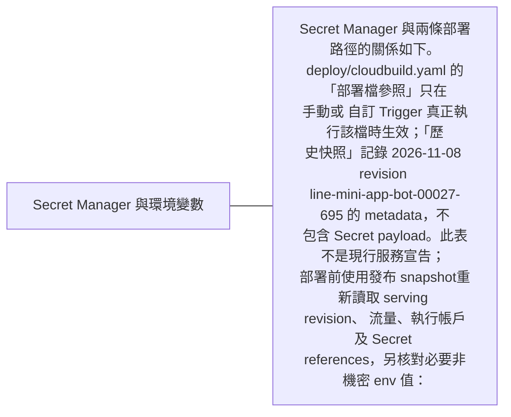
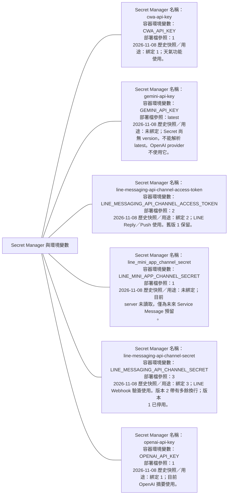
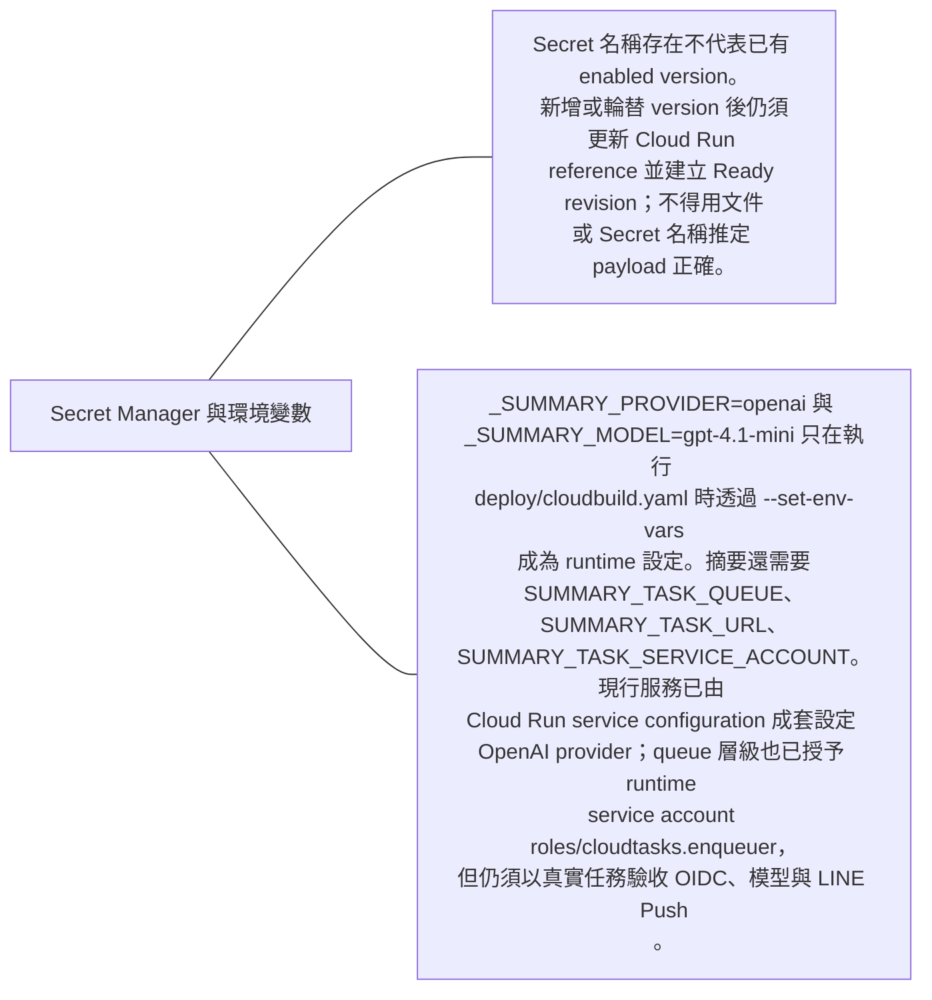
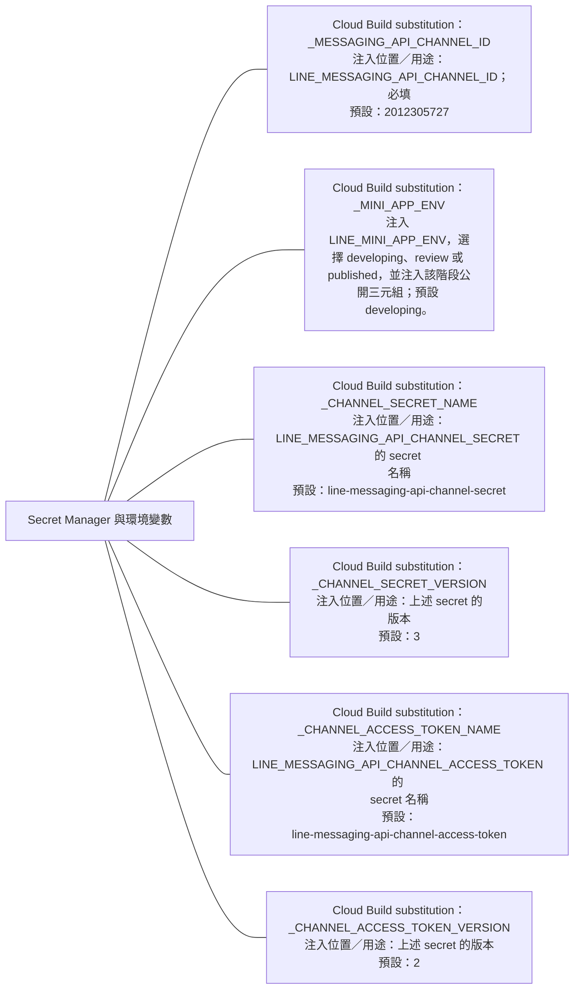
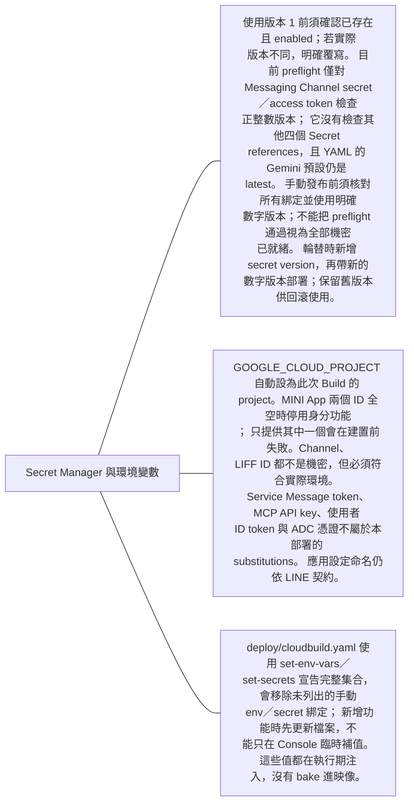

# 正式環境設定

此頁維護 Cloud Run runtime 設定、Secret Manager 綁定與公開設定遷移。[部署步驟](cloud-run.md)與[發布驗收](release-acceptance.md)另列。

## MINI App 公開設定遷移

公開鍵名與驗證規則見 [LINE 環境設定](../integrations/line/configuration.md#公開環境設定)。根 `.env.example` 與手動 Cloud Build substitutions 不會由 managed image-only trigger 自動匯入服務。切換至不含硬編碼 fallback 的映像前，先以 Cloud Run `--update-env-vars` 補齊所選組三元組及 selector；不要使用會覆蓋其他環境變數的 `--set-env-vars`，也不要更動現有 Secret references。此遷移會建立 revision，必須在取得部署授權後另行執行及驗收；本機測試或 PR CI 不代表遠端已遷移。

手動 Cloud Build 範例以 `^|^` 切換 gcloud dictionary 分隔符，因此 Endpoint query 中的逗號不會被拆為其他變數；URL 若需要 pipe 字元，使用 URL 編碼 `%7C`。一般命令的逗號分隔規則與替代 delimiter 語法以 `gcloud topic escaping` 為準。
