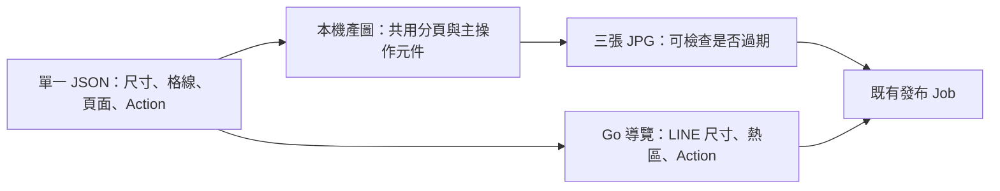

# Rich Menu 元件化與產生器設計

全高版素材、產生器與發布接線已實作。產生器從同一份選單定義輸出三張 **2500 × 1686 px JPG**，同時提供發布所需的 LINE 熱區與 Action。發布端在同步前核對 JPG 尺寸與請求尺寸。發布操作見 [Rich Menu 自動發布](rich-menu.md)，任務行為見 [LINE 任務接線表](../integrations/line/commands.md)。

## 版面與按鈕

三張圖共用 **2 排 × 3 欄**的六格網格。座標原點在左上，每排高 843 px，三欄寬 833、834、833 px。中央欄左右對稱，六格完整覆蓋畫布。

| 格位 | x | y | 寬 | 高 | 版位 |
| --- | ---: | ---: | ---: | ---: | --- |
| 上左 | 0 | 0 | 833 | 843 | 上班分頁 |
| 上中 | 833 | 0 | 834 | 843 | 轉場支援分頁 |
| 上右 | 1667 | 0 | 833 | 843 | 下班分頁 |
| 下左 | 0 | 843 | 833 | 843 | 主操作 |
| 下中 | 833 | 843 | 834 | 843 | 主操作 |
| 下右 | 1667 | 843 | 833 | 843 | 主操作 |

上排三個分頁位置固定。當前分頁顯示選中樣式，另外兩格可切到對應 alias。下排三格合併成主操作，矩形為 `(0, 843, 2500, 843)`。

| 順序 | 檔名 | 主操作與 Action |
| --- | --- | --- |
| 1（預設） | `rich-menu-clock-in.JPG` | 上班 · 前往上班群組打卡 · Postback `action=clock-in` |
| 2 | `rich-menu-transfer.JPG` | 轉場支援 · 先確認原班次 · Postback `action=transfer` |
| 3 | `rich-menu-clock-out.JPG` | 下班 · 回原班次群組打卡 · Postback `action=clock-out` |

主操作維持私訊指引。轉場支援不會結束 A 班次或新增 B 班次；實際班次操作依[出勤旅程](../domains/attendance/README.md)。

## 共用定義與產生原理

現行實作



[共用定義](../../backend/internal/transport/line/navigation/attendance-rich-menu.json)同時供 [Go 導覽](../../backend/internal/transport/line/navigation/rich_menu.go)與 [圖片產生器](../../scripts/generate/rich-menu.py)讀取。分頁位置由欄寬累加，主操作從分頁高度以下開始。同一頁的 alias、主文案與 Postback 都在同一筆定義。第一頁是預設頁。

## 本機操作

使用具備 Pillow 13.0.0 的 Python，以及 Noto Sans CJK 字型集合 `NotoSansCJK-Regular.ttc`。預設字型位置為 `/usr/share/fonts/opentype/noto/NotoSansCJK-Regular.ttc`。其他位置可用 `--font` 指定。程式要求字型 SHA-256 與專案使用版本一致，避免相同文案換字型後造成版面漂移。JPEG 位元組比對使用相同的 FreeType／JPEG 環境。

```sh
python3 scripts/generate/rich-menu.py generate
python3 scripts/generate/rich-menu.py check
```

`generate` 先渲染並驗證全部圖片，再替換素材。`check` 在記憶體重畫，若任一檔案缺少或內容過期，列出檔名並退出失敗。可使用 `--output-dir` 在暫存目錄預覽或驗證。修改定義後，先跑 `generate` 和 `check`，再跑導覽測試，確認只對其他分頁配置切換熱區，中央 Postback 有可用的 handler。

正式發布流程仍讀取提交的 JPG。生成器不呼叫 LINE 或部署；正式預設頁、三頁切換和私訊指引須在手機另行驗收。[LINE 圖片規格](https://developers.line.biz/en/reference/messaging-api/#upload-rich-menu-image)
