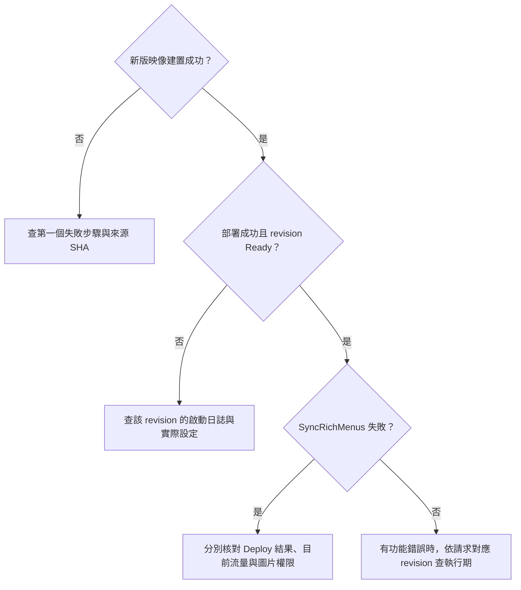

# 正式環境故障排查

依下列流程定位正式建置、部署與同步失敗。工具安裝、Go 及 MCP 問題見[開發環境排查](../development/environment/troubleshooting.md)。

| 失敗位置      | 先查證的內容                                                         |
| ------------- | -------------------------------------------------------------------- |
| 建置或推送    | build ID、commit、第一個失敗步驟、映像、entrypoint、實際建置身分     |
| 部署          | 映像 digest、目標服務、revision 建立狀態、身分、IAM 與必要機密的引用 |
| 執行          | 最新 revision 的 Ready 狀態、目前流量、受影響路由與應用日誌          |
| LINE 導航同步 | 實際執行入口、目標渠道及同步前置條件                                 |

## Cloud Build、Cloud Run 與部署後同步

- [先記錄 project、region、build ID、來源 commit 與查詢時間，再依下圖定位。 部署前後 metadata 的取得方式見發布證據。 只保存必要 metadata 與匿名化錯誤，不輸出 Secret payload 或登入 token。](release-acceptance.md#發布證據與前置條件)

- 開發與維運指引

- [建置失敗：遇到 --mount option requires BuildKit 表示新版尚未推送或部署。核對實際 Build step 的 DOCKER_BUILDKIT；若需修正雲端 Trigger，保存前後 metadata 並核對差異。](container-build.md#buildkit-與建置機密)

- 部署失敗或未 Ready：核對映像 digest、PORT、runtime service account 與 Secret references。以實際 revision 與前版 metadata 比對。

- [選單同步失敗：整體 Build 失敗後仍須查流量確認部署結果。核對部署 Job 的圖片目錄 /assets/line/richmenu，確認同一映像內的目錄可穿越且 JPEG 可由 nonroot 讀取。圖片路徑與權限](cloud-run.md#managed-trigger-的-rich-menu-圖片路徑)

- 登入、出勤或摘要失敗：核對 Session、Firestore、Cloud Tasks、模型與 LINE 訊息流程。端到端驗收須以真實功能結果為準。

- managed trigger 使用 inline build；修改 repository YAML 不會修正該 Trigger。 修正後以新 Build 的來源 SHA、每個步驟結果、Ready revision、traffic 及真實功能結果驗收。 Rich Menu 同步會修改 LINE 外部狀態，重跑前先確認既有選單與目標帳號； Cloud Run 回滾不會撤銷已同步的 LINE 選單。

## 歷史快照與查證界線

文件中的 revision、Secret 綁定與 IAM 紀錄只代表其標示日期，不能當作即時現況。執行命令前，依安裝版本的 leaf help 核對語法；回復與清理另參照官方文件：

- [Cloud Run 回滾](https://docs.cloud.google.com/run/docs/rollouts-rollbacks-traffic-migration)
- [Artifact Registry 映像管理](https://docs.cloud.google.com/artifact-registry/docs/docker/manage-images)
