# LINE 工程管理平台目標架構（提案）

以下保存架構討論提出的目標模型。Project 由建立它的個人或工程群組擁有，Space 表示 Repository 內的工區，見[現行 Project 設計](../features/project/projects.md)。平台能力與逐庫授權仍須在實作時驗證。

**建議採用：LINE Group 1:1 對應 Repository、Repository 管理工區、Object 與 SubObject；個人或工程群組擁有 Project，一個 Project 可連結多個 Repository；LINE 1:1 私訊則作為使用者的個人入口，已驗簽的 follow 事件建立個人 Repository。**

底層維持一個 Cloud Run Go 服務、Firestore 資料庫與 Cloud Storage for Firebase（以下簡稱 Firebase Storage）。LINE Messaging API 負責訊息與事件，LINE MINI App 負責操作介面。

以下以這個目標設計重新整理，並區分 LINE 官方能力與應用程式自行管理的資源。

## 一、完整系統總架構

**未來設計**



[編輯 Mermaid 原始檔](diagrams/platform-overview.mermaid)

這是建議的目標架構。Cloud Run 內的方塊代表同一個 Go 程式中的邏輯職責，不代表需要部署多個微服務。LINE MINI App 的靜態頁面由 Go 對外提供，實際 React 程式在使用者瀏覽器執行。

### 各平台的責任

| 平台或元件 | 核心責任 |
|--------|--------|
| LINE Developers | 管理 Provider、Channel、憑證與應用設定 |
| LINE Official Account | 使用者在 LINE 中聊天的官方帳號 |
| LINE Messaging API | 接收 Webhook、Reply、Push、Flex Message |
| LINE MINI App | LINE 內的工程管理操作介面 |
| LIFF SDK | MINI App 初始化、LINE 登入與使用者識別 |
| Next.js / React | 前端 UI、表單、檔案選擇、裝置定位 |
| Cloud Run / Go | API、身分驗證、授權、業務規則與資料操作 |
| Firestore | Repository、Space、Project、使用者、紀錄與狀態 |
| Firebase Storage | PDF、工程圖、照片、附件等檔案內容 |
| Cloud Tasks / Scheduler | 非同步工作與定時執行 |
| Secret Manager | LINE Token、Channel Secret 與其他機密設定 |

Firebase Storage 的底層就是 Google Cloud Storage Bucket，不需要建立兩套檔案儲存系統。

## 二、LINE Developers 的正確設定結構

**未來設計**


[編輯 Mermaid 原始檔](diagrams/line-channels.mermaid)

**關鍵是 Messaging API Channel 與 MINI App Channel 放在同一個 Provider 之下。**

這樣同一位使用者透過 Messaging API 和 MINI App 取得的 LINE UserID 可以一致。不同 Provider 則會產生不同 UserID。官方於 2026 年 6 月的 Provider 設計指南再次確認此原則，但跨服務共同使用個人資料仍必須符合 LINE 的使用者資料政策。

| 識別資訊 | 用途 | 來源 |
|--------|--------|--------|
| ProviderID | LINE 服務提供者 | LINE Developers |
| MessagingChannelID | Bot 的 Messaging API Channel | LINE Developers |
| MiniAppChannelID | MINI App Channel | LINE Developers |
| LIFFID | MINI App 前端初始化 | MINI App Channel |
| UserID | 識別 LINE 使用者 | LINE 平台 |
| GroupID | 識別 LINE 群組 | Messaging API Webhook |
| RepositoryID | 識別工程儲存庫 | Go 後端產生 |
| SpaceID | 識別儲存庫內的空間 | Go 後端產生 |
| SessionID | 識別已登入的應用工作階段 | Go 後端產生 |

這些 ID 不應互相取代。特別是 `ChannelID`、`UserID`、`GroupID` 和 `RepositoryID` 分別代表不同的責任。

## 三、LINE 1:1 私訊與群組的差異

**1:1 私訊**

使用者 ↔ 官方帳號

---

主要識別

`UserID`

個人出勤、待辦、提醒、所屬工程儲存庫清單、個人資料。

**群組聊天**

多位使用者 ↔ 官方帳號

---

主要識別

`GroupID` \+ `UserID`（可取得時）

工程 Repository、群組公告、進度、問題追蹤與協作。

Webhook 的來源格式可理解為：

1:1 私訊事件

```json
{
  "source": {
    "type": "user",
    "userId": "Uxxxxxxxx"
  }
}
```

LINE 群組訊息事件

```json
{
  "source": {
    "type": "group",
    "groupId": "Cxxxxxxxx",
    "userId": "Uxxxxxxxx"
  }
}
```

以上為示意值，非實際 ID。群組事件的 `userId` 並非每種事件都保證存在；無法確認操作者時，不能執行需要個人授權的操作。

**1:1 不等於只有一個人的 LINE 群組。** 它是使用者與官方帳號的直接聊天，沒有對應的 `GroupID`。因此不應為每個人的 1:1 聊天自動建立工程 Repository。

## 四、業務資源的完整階層

工程人員從 LINE 群組進入綁定的工程庫，再依工區瀏覽設備與工序。圖中工程群組直接擁有 Project，「工區」則用於分類庫內物件。

**未來設計**


[編輯 Mermaid 原始檔](diagrams/resource-hierarchy.mermaid)

注意，圖中的 `1:1` 是指 **一個 LINE 群組綁定一個 Repository**，不是指使用者與官方帳號的一對一聊天。

Repository 是工程資料的主要容器。庫內 Space 表示工區，Issue 與 Discussion 歸屬工程庫。個人或工程群組擁有 Project；Project 可引用多個已連結工程庫的資源。解除某個來源庫的連結時，Project 及其他連結繼續保留。

連結 Repository 後，使用者可以逐筆收錄來源；連結本身不會授予來源讀權。上述三類引用共用 `ProjectReference`，以來源庫、類型及資源 ID 定位。Project 畫面依用途呈現操作：

| 顯示區段 | 來源類型 | 操作與狀態 |
|---|---|---|
| 工程對象 | Object／SubObject | 查看來源施工進度，在本專案的引用上提交驗收、查看歷史 |
| 待處理問題 | Issue | 查看問題並追蹤來源庫的處理狀態 |
| 決策討論 | Discussion | 查閱討論；需要執行時可另建 Issue 並關聯原討論 |

例如配線已完成 100%，仍可能驗收未通過且缺失 Issue 尚未結案。畫面應分別呈現施工、驗收與問題狀態。若顯示跨庫統計，應標明涵蓋的庫與可見範圍。

一個使用者可以同時參與多個 LINE 群組，因此與 Repository 的關係是多對多，而不是一個 UserID 永久只對應一個 Repository。

## 五、完整運作流程

### 流程 A：群組首次加入 Bot，自動建立 Repository

**未來設計**



[編輯 Mermaid 原始檔](diagrams/group-join.mermaid)

例如：

`GroupID = C123...` → `RepositoryID = repo_001`

綁定之後，即使 Bot 暫時離開群組，Repository 也應保留，而不是直接刪除。重新加入時可以依原綁定恢復資料。

GroupID 只負責識別群組，RepositoryID 則負責識別系統內的工程儲存庫。

### 流程 B：使用者從群組開啟 MINI App

**未來設計**



[編輯 Mermaid 原始檔](diagrams/mini-app-entry.mermaid)

這個流程有兩個關鍵限制。

第一，MINI App 不能直接透過 `liff.getContext()` 取得 GroupID。LINE 已停止向 LIFF 提供群組的內部 ID。群組來源必須透過已驗證的 Webhook 建立啟動關聯，再由後端解析。

第二，即使網址中的 RepositoryID 正確，也不能直接放行。後端必須確認目前登入的 UserID 有權存取該 Repository。

建議啟動連結使用短效 `launchToken` 對應 GroupID／RepositoryID。這個 Token 是導航用，不是授權憑證；即使連結被轉傳，非群組成員也不能因此取得資料。

### 流程 C：1:1 私訊查詢個人工程資訊

1:1 私訊沒有 GroupID，因此流程不同。

**未來設計**


[編輯 Mermaid 原始檔](diagrams/direct-query.mermaid)

例如同一位使用者參與三個群組：

| UserID | GroupID | Repository |
|--------|--------|--------|
| U001 | C001 | 台積電 A 廠工程 |
| U001 | C002 | 台積電 B 廠工程 |
| U001 | C003 | 辦公室工程 |

他在 1:1 傳送「我的工程」，Bot 以 UserID 查詢候選清單並核驗目前資格，回覆當頁最多五個可讀工程。若仍有候選頁或更多結果，附上完整 MINI App 清單入口。

這裡不應假設 LINE 提供一個能隨時列出使用者所有群組的 API。應以系統已觀察到的群組互動建立候選，再驗證目前資格。

LINE 的完整群組成員 ID 列表 API 有帳號資格限制；已知 UserID 時，可以使用群組成員 Profile API 查核該人是否仍在群組。

另外，個人 Rich Menu 適用於官方帳號聊天，不是一般工程群組的底部選單。

### 流程 D：工程操作、附件上傳與 LINE 通知

以「A 區第一套電力系統測試完成，上傳照片，送出驗收」為例：

**未來設計**



[編輯 Mermaid 原始檔](diagrams/engineering-notification.mermaid)

這裡的檔案上傳建議採兩種方案之一：

| 方案 | 使用情境 | 取捨 |
|--------|--------|--------|
| MINI App → Go → Storage | 少量、小型附件 | 實作最簡單，但流量經過 Go |
| MINI App → Storage（受限直傳） | 大型 PDF、照片、批次上傳 | 減少 Go 資料傳輸，但須處理簽署、期限、上傳確認與清理 |

由於你已有 Go Session，**建議讓 Go 統一控制授權，再使用 Google Cloud Storage 的短效 Signed URL 或受限續傳機制**，不必僅為檔案上傳引入第二套 Firebase Authentication。

Signed URL 本身是短期存取能力，取得網址的人在有效期限內可能使用它，因此 Bucket 必須保持私有，且上傳完成後仍要由 Go 驗證檔案。

## 六、Firestore 與 Firebase Storage 如何分工

兩者的資料不應重複保存。

| 資料 | Firestore | Firebase Storage |
|--------|--------|--------|
| UserID / GroupID | 儲存 | 不儲存 |
| Repository / Space | 儲存 | 不儲存 |
| Object / SubObject | 儲存 | 不儲存 |
| Project / Issue | 儲存 | 不儲存 |
| 權限與狀態 | 儲存 | 不儲存 |
| 工程 PDF 檔案內容 | 不儲存 | 儲存 |
| 工程照片內容 | 不儲存 | 儲存 |
| 檔名、大小、MIME、上傳者 | 儲存 | 亦可保留物件必要 metadata |
| 附件與工程物件的關聯 | 儲存 | 不作業務關聯 |
| 驗收紀錄與檔案版本參照 | 儲存 | 保存對應檔案版本 |

### 建議的 Firestore 資料結構

以下是新模型的目標 Schema，不是宣稱現有資料庫已經採用這些路徑。

```text
users/{userId}
sessions/{sessionHash}

channels/{messagingChannelId}/
  repositoryOwnerBindings/{ownerId}
  users/{userId}/projects/{projectId}/
  groups/{groupId}/projects/{projectId}/
    linkedRepositories/{repositoryId}
    items/{referenceId}  # ProjectReference： sourceRepositoryId、sourceType、sourceId
      inspectionSubmissions/{submissionId}
  repositories/{repositoryId}/
    spaces/{spaceId}
    objects/{objectId}  # spaceId 指向所屬工區；換區保留物件 ID
      subobjects/{subobjectId}
    issues/{issueId}
    discussions/{discussionId}
    attachments/{attachmentId}
    journals/{journalId}
```

`repositoryOwnerBindings/{ownerId}` 保存 LINE 群組與 Repository 的唯一關聯，並以 Firestore Transaction 保證不會因重送事件產生多份 Repository。

`attachments/{attachmentId}` 可保存：

```json
{
  "repositoryId": "repo_001",
  "ownerType": "inspectionSubmission",
  "ownerId": "work_001",
  "storagePath": "repositories/repo_001/attachments/file_001",
  "uploadedBy": "U001",
  "contentType": "image/jpeg",
  "status": "ready",
  "generation": "123456789"
}
```

其中 `generation` 是檔案版本參照。對於驗收證據，應避免覆寫原檔而失去當時的內容。

### Firebase Storage 的目錄組織

```text
bucket/
  repositories/
    repo_001/
      attachments/
        file_001
        file_002
        file_003
    repo_002/
      attachments/
        file_004
```

Storage 的路徑是檔案儲存鍵，不必完全複製 Firestore 的業務階層。利用 Firestore 的 `ownerType`、`ownerId` 關聯，便能知道附件屬於哪個 Object、Project 或驗收送件，避免移動工程物件時必須搬移大量檔案。

LINE 使用者傳到群組的照片或檔案則走另一個入口：Webhook 收到 `messageId`，Go 再經由 LINE Content API 取得內容，存入 Storage，最後記錄 Firestore metadata。這與 MINI App 的瀏覽器上傳是兩條不同輸入路徑。

## 七、權限與狀態如何運作

權限不可只依靠 LINE 群組身分。

| 操作 | 必須確認 |
|--------|--------|
| 開啟 Repository | UserID、GroupID 綁定、目前群組成員資格 |
| 讀取 Object | Repository 讀取權限 |
| 建立或修改 Object | Repository 寫入權限 |
| 建立 Issue | 群組資格及 Issue 建立規則 |
| 連結來源庫 | Project 管理權及來源庫允許連結的權限 |
| 查看跨庫引用 | Project 讀取權與該來源資源的當下讀取權；失去來源權限時隱藏其名稱、內容與附件 |
| 提交工程結果 | Project 成員、工程引用的來源讀權及送件狀態 |
| 驗收決定 | 指定審核權限及合法狀態轉換 |
| 下載附件 | 所屬 Repository 及目標資源讀取權限 |
| 發送 LINE 通知 | 接收對象、通知政策與 Messaging API 可送達資格 |

群組成員資格只是最基礎的進入條件，不能自動賦予刪除、核准或管理權限。

LINE Bot 離開群組、使用者退出群組或官方成員核驗失敗時，應阻止不符合條件的資源存取；不能以過去曾加入群組的紀錄當成永久權限。

## 八、通知與背景工作的完整閉環

為了避免重複通知或 Firestore 成功但 LINE 發送失敗，建議：

**未來設計**


[編輯 Mermaid 原始檔](diagrams/background-delivery.mermaid)

同一個 Go 程式可以同時提供業務 API、Webhook 和非同步工作 Handler，不必新增獨立微服務。

LINE Webhook 可能重送或亂序，應按 `webhookEventId` 處理防重，且不要在可能被 Firestore 重試的交易 Callback 中直接發送 LINE 訊息。LINE 也建議 Webhook 非同步處理。

一般通知建議走 Messaging API 的 Reply 或 Push；MINI App Service Message 有獨立的資格、模板與使用情境限制，不能視為任意群組通知的替代品。

## 九、現有 Repository 與目標設計的差距

現行 Project 的擁有者、來源庫連結與儲存路徑見 [Project 功能規格](../features/project/projects.md)。以下對照現況與目標。

| 項目 | 現有設計 | 目標設計 |
|--------|--------|--------|
| GroupID | 群組已直接綁定 Repository | 沿用群組綁定作為工程入口 |
| Space | Group 代表群組，Space 代表庫內工區 | Space 專指庫內工區，群組使用 GroupID |
| Project | 個人或群組擁有，已支援多庫；由 ownerId 定位，詳情按引用用途分區顯示 | 初始庫只作預設來源。以擁有者定位專案，避免把單庫數字顯示為全專案進度 |
| 驗收歷史 | 已保存送件時的來源版本，讀歷史只核驗 Project、庫連結與來源庫讀權 | 提交時查驗有效物件及版本；讀歷史時核對專案成員、庫連結及來源讀權。物件移除後仍可查看已保存的送件；解除連結或失去來源權限則禁止讀取 |
| Repository | 工程來源資料 | 工程管理根容器 |
| 附件檔案流程 | 尚未從查核文件確認完整實作 | Firestore metadata + Firebase Storage |
| 1:1 個人入口 | 已有出勤與「我的工程」私訊查詢 | 以目前授權的工程清單開啟 MINI App |
| MINI App | 已有 Go Session 與靜態前端 | 延續並統一資源授權 |

附件上傳與群組通知的端到端流程仍待驗收。

## 十、最終架構原則

系統依使用者入口、工程資料與專案管理三條主線運作。

**使用者主線**

`UserID → LINE 1:1 / LINE 群組 → MINI App → Go Session → 授權 → 業務操作`

**工程資料主線**

`GroupID → RepositoryID → SpaceID → ObjectID → SubObjectID`

**專案管理主線**

`個人或工程群組 → Project → ProjectReference → InspectionSubmission（僅工程對象）`

Issue、Discussion、Journal 與工程附件由來源庫管理。Project 由個人或工程群組管理，每筆跨庫引用記錄來源庫和資源識別。群組通知只附收件範圍可見的資訊，開啟卡片後再按使用者權限載入來源內容。

所有入口最後都進入同一套 Go 業務規則；Firestore 保存狀態與關係，Firebase Storage 保存檔案，Messaging API 負責 LINE 訊息往返。

**建議下一個實作驗收案例：** 一個新 LINE 群組加入 Bot，自動建立 Repository；使用者從群組開啟 MINI App，建立 A 區 Space 與電力系統 Object，建立 Project 引用該 Object，上傳照片並提交測試結果，最後由 LINE 群組通知審核者。再連結第二個 Repository，引用該庫的一個物件，從 1:1 私訊開啟同一 Project。撤銷使用者對第二庫的權限後，確認他仍能看到第一庫的引用，且無法從畫面、通知或附件連結取得第二庫的內容。

只要這個流程能可靠完成，且可驗證 UserID、GroupID、RepositoryID、權限、Firestore 資料與 Storage 檔案的一致性，平台的核心運作鏈就真正成立。

現行 Webhook、瀏覽器與 Cloud Tasks 的服務入口見[執行架構](../foundation/architecture/overview.md#執行入口)。
