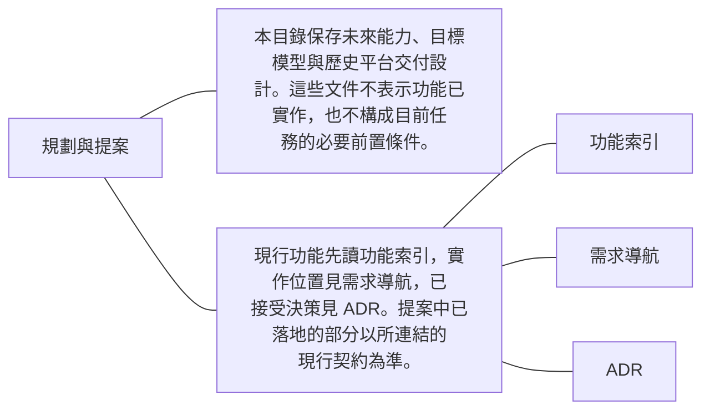
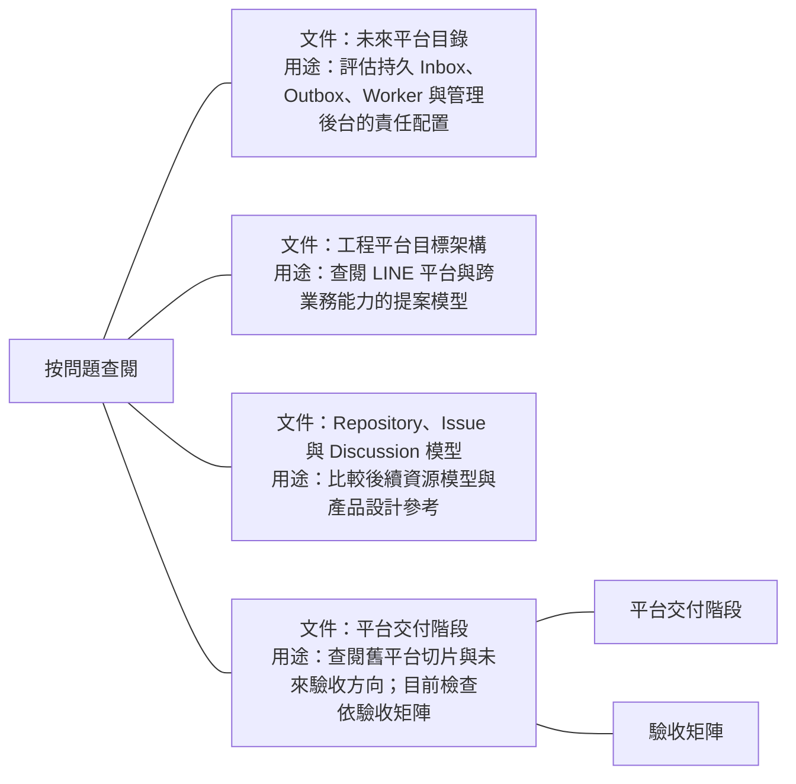
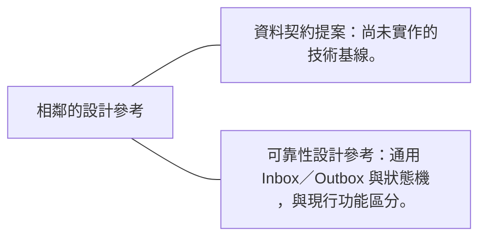
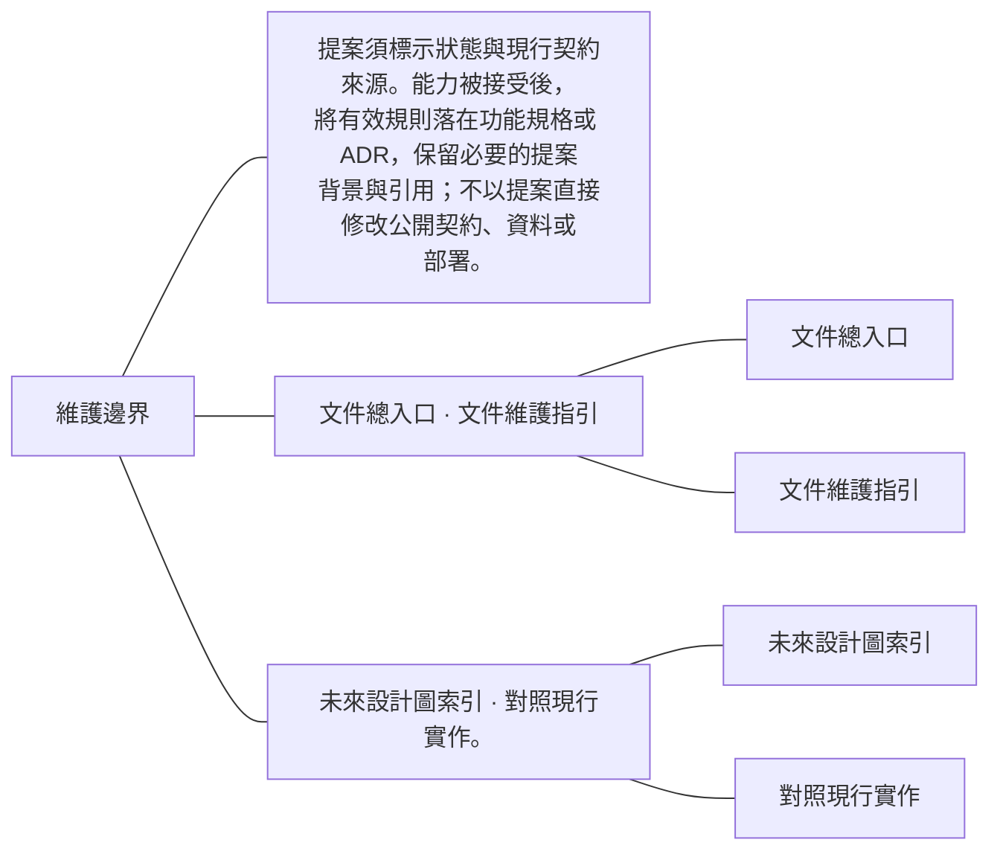

# 規劃與提案

[平台能力提案](platform/README.md) · [Webhook 可靠交付提案](webhook-delivery/README.md)

## 用途與範圍

保存待評估或演進中的設計提案。

## 架構與責任邊界

提案描述目標與取捨，現行行為以程式、契約與領域規格為準。

## 閱讀與修改入口

先查閱[line-engineering](line-engineering/README.md)。

## 相關規格

[本層規格與指引](../architecture/README.md)

## 規劃中的業務領域

[Membership 統一成員關係設計](membership.md)：使用者與資源的成員、邀請、角色及撤權生命週期。

[Operations 設計](operations.md) · [Workflow 設計](workflow.md) · [Agent 設計](agent.md) · [Knowledge 設計](knowledge.md)

[四領域架構、共用詞條與落地驗收](domain-collaboration.md)

[適用工作指引](../AGENTS.md) · [上層導覽](../README.md)
