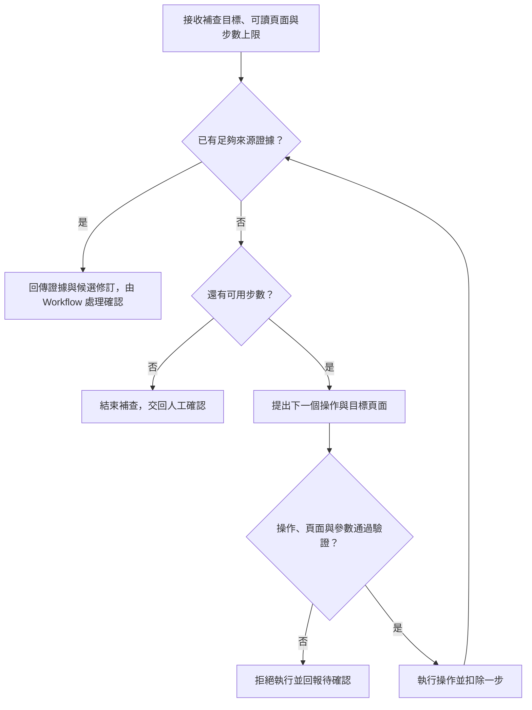

# Agent 領域設計

狀態：提案。目錄入口見[領域導覽](../../backend/internal/business/agent/)。

Agent 依任務目標與目前證據選擇下一步。呼叫端指定可讀資源、允許的[操作](operations.md)及步數上限。每次模型提出操作，由執行端核對唯讀工具清單、授權與參數。模型只交回候選、證據及停止原因。未來若抽出共用模型用戶端，可放在 `backend/internal/genai`；業務欄位與驗證仍歸使用它的領域。

## 執行邊界

依 [用例](../references/ddd/use-case.md)及[出站 Port](../references/ddd/driven-port.md)，以一次有界補查建模。任務輸入包含可信資源範圍、唯讀工具及預算；候選包含來源定位與待確認事項。由呼叫端保存流程狀態及決定是否採納。模型與工具 Adapter 由組裝層注入；用測試替身驗證越界、耗盡預算及來源不足時能停止。

## 補查與終止流程圖

未來設計

## PDF 補查與驗收

[Workflow](workflow.md) 可在候選工項缺少來源時委派補查。Agent 可重讀允許的頁面，回傳證據與候選修訂，交由流程處理確認。驗收時涵蓋找到來源、要求讀取範圍外頁面，以及用盡步數仍無證據三種結果。後兩種應拒絕越權或結束補查，將待確認狀態交回呼叫端。

## 對外契約草案

以下為邏輯簽章，實作時對照既有介面。身分及資源範圍取自可信呼叫情境。

| 操作                                                           | 結果、副作用與失敗語意                                                                                           |
| -------------------------------------------------------------- | ---------------------------------------------------------------------------------------------------------------- |
| Investigate(task, resourceScope, allowedOperations, stepLimit) | 回傳有頁碼的候選修訂或明確的人工處理原因。每次工具呼叫由執行端重新驗證；失敗嘗試亦消耗預算。                     |
| AssessEvidence(candidate, pages)（由 呼叫端 擁有）             | 核對引用頁屬於選取範圍且支持數量、單位與項次。有矛盾或無法驗證時保留待確認。採納修訂後產生新版，再由使用者確認。 |

[共用架構、時序與驗收](domain-collaboration.md)
