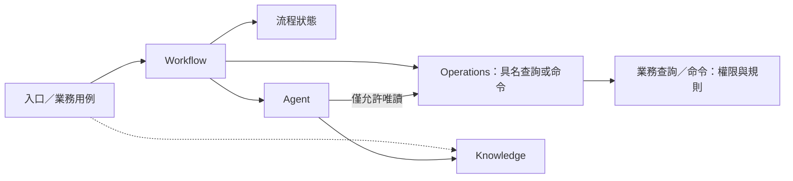

# 四領域協作提案

狀態：提案。四種能力可以各自使用。以一次具名業務查詢或命令為預設，只有遇到跨請求等待、需要可追溯知識或下一步無法預先列舉時，才加入對應能力。

## 領域邊界、能力契約與依賴方向

| 能力                                          | 負責的決策                                                                 | 最小對外契約                                                                               |
| --------------------------------------------- | -------------------------------------------------------------------------- | ------------------------------------------------------------------------------------------ |
| [Workflow](../domains/workflow/design.md)     | 掌握流程步驟、等待確認與恢復點。持有流程狀態、候選版本、確認與提交識別碼。 | `Start` 建立執行；`AcceptConfirmation` 核對候選、目標與命令；`Resume` 依已保存的狀態續跑。 |
| [Knowledge](../domains/knowledge/design.md)   | 管理來源、發布版本、適用範圍與可見性。                                     | `Retrieve` 回傳目前有權引用的規則、版本與來源。不符合時回空結果，服務失敗另外回報。        |
| [Agent](../domains/agent/design.md)           | 在限定資源、唯讀工具及預算內補查，交回候選、引用和待確認事項。             | `Investigate` 回傳候選修訂或停止原因。輸出由呼叫端核對，正式寫入交由業務命令。             |
| [Operations](../domains/operations/design.md) | 提供具名操作的輸入、作用範圍、結果及副作用契約。                           | 唯讀工具回傳資料與可引用的來源。寫入工具轉接既有具名命令，以穩定提交識別碼執行並取得收據。 |

業務域決定資料歸屬、目前權限及合法狀態。以可信 Session 帶入操作者，模型與連結只能提出目標。候選與引用可留在流程紀錄，但讀取時仍須核驗可見性。Workflow 與 Agent 可同屬 Execution；Operations 和 Knowledge 可按用例獨立接入。現有業務用例可直接執行。

未來設計。圖中箭頭表示呼叫方向。組裝層把具名業務用例接到工具；業務命令不反向依賴 AI 執行器。

## 採用的 DDD 概念

依 [DDD 設計流程](../references/ddd/design-process.md)從用例、拒絕條件和併發反例推回模型。四個名稱描述能力及責任。只有具備獨立語言、規則與資料生命週期的部分才形成獨立限界上下文，部署方式另依需要決定。

| 採用概念                                                                                                                                                        | 在本規格的用途                                                                                                                  | 驗證依據                                                         |
| --------------------------------------------------------------------------------------------------------------------------------------------------------------- | ------------------------------------------------------------------------------------------------------------------------------- | ---------------------------------------------------------------- |
| [通用語言](../references/ddd/ubiquitous-language.md)與[上下文映射](../references/ddd/context-mapping.md)                                                        | 區分候選、確認、提交意圖、業務收據與知識版本。Journal 是日誌生效結果的權威來源。Workflow 保存流程進度，Knowledge 保存引用版本。 | 工作進度顯示完成前，須能指出具體的業務收據。                     |
| [公開契約](../references/ddd/domain-contract.md)與[領域授權](../references/ddd/domain-authorization.md)                                                         | 跨邊界傳具名輸入及結果，操作者由可信情境帶入。工具資格、來源可見性與正式寫入權分別在對應邊界判斷。                              | 撤回授權後，舊確認及舊工具清單都不能授予寫入權。                 |
| [聚合](../references/ddd/aggregate.md)、[不變條件](../references/ddd/invariant.md)與[狀態機](../references/ddd/state-machine.md)                                | 持久化需要成立時，以單次流程執行為一致性邊界。確認與提交意圖一起保存。日誌與收據由 Journal 在自己的交易內提交。                 | 並行確認或修改候選時，至多一個符合當前版本的確認能建立提交意圖。 |
| [依賴規則](../references/ddd/dependency-rule.md)、[Port／Adapter](../references/ddd/hexagonal-architecture.md)與[組裝根](../references/ddd/composition-root.md) | 呼叫端定義其所需的介面。組裝層注入 Firestore、模型供應商及工具轉接。領域模型依賴自身規則與型別。                                | 替換模型或儲存 Adapter 時，授權、狀態與寫入契約的測試仍成立。    |
| [交易](../references/ddd/transaction.md)、[冪等](../references/ddd/idempotency.md)與[架構測試](../references/ddd/architecture-testing.md)                       | 流程保存與業務命令各自提交。跨邊界用操作識別碼與收據對帳，重送同一請求沿用同一識別碼。                                          | 模擬日誌成功、流程未完成便中斷，恢復後仍只有一篇日誌。           |

首個切片沿用同步業務命令和既有收據。Outbox 留給已提交後需要可靠發送的通知；Saga 留給有明確補償規則的多方業務交易；事件溯源需另有回放或歷史模型需求。首版驗收以上述反例為準。

## 最小可驗證情境：指定儲存庫的日誌草稿

以下為目標旅程。日誌歸屬與可寫條件以[日誌規格](../domains/journal/journal.md)及[儲存庫規格](../domains/repository/design.md)為準。

1. 使用者指定 B 庫。Workflow 從可信身分取得授權情境，委派 Agent 使用少量唯讀操作查工項；如需規範，再向 Knowledge 取帶版本的依據。證據不足時列出缺項。
2. 使用者查看候選與來源。確認綁定操作者、候選版本、B 庫與 `CreateJournal` 命令。任何一項變更都要求重新確認。
3. 跨請求執行前先保存確認及穩定提交識別碼。命令重新檢查權限與日誌規則，成功後以日誌收據完成。結果未知時先查原結果，或沿用原識別碼安全重試。

驗收涵蓋：無權的工項、組織規則與紀錄不可見；Agent 無法呼叫寫入；改庫或改候選使舊確認失效；確認後撤權時拒絕保存；提交成功但回應遺失時恢復只產生一篇日誌。第一個切片沿用既有日誌保存契約，暫不建立通用流程引擎。

## 物件呼叫文件辨識能力

現行[Object 應用服務](../../backend/internal/business/object/application/object.go)先核對呼叫者與儲存庫，再呼叫 Operations 的文件候選擷取介面。[組裝入口](../../backend/internal/bootstrap/repository.go)按 `AI_DOCUMENT_MODEL` 和既有 OpenAI 憑證注入適配器。這條內部接線只回傳候選；正式物件仍由 Object 建立。

適配器透過 Responses API 在同一個請求中使用 `input_file` 傳送原檔，並以 `text.format` 指定嚴格的 JSON Schema。候選包含名稱、十進位數量字串、單位、來源位置與引文；數量、單位及位置允許 null。完成、拒答、截斷和無效輸出各有對應的結果，呼叫端可檢視模型回應。每次重送都會重新辨識且可能計費。[File inputs](https://developers.openai.com/api/docs/guides/file-inputs?api-mode=responses) · [Structured Outputs](https://developers.openai.com/api/docs/guides/structured-outputs#supported-schemas)

### 物件入口與驗收

物件操作以[候選覆核規格](../domains/object/design.md#從文件辨識候選)與 [OpenAPI](../../api/contract/object/objects.yaml) 為準。

1. 物件 API 提供候選辨識操作，契約定義檔案類型、上傳大小、候選及錯誤回應。驗收時確認無權限時不會呼叫模型，拒答與截斷可和零筆候選區分。
2. 物件畫面提供選檔與覆核。顯示原始數量、單位、位置與引文，讓使用者修正後透過既有建立操作逐筆送出。重送建立時沿用同一建立鍵。
3. 以實際 PDF、段落文件及試算表驗收來源可追溯性、缺欄與漏列。試算表處理有列數及摘要限制，需用原件核對完整性。

跨步驟續跑、補查外部證據及套用已發布規則分別由 Workflow、Agent 和 Knowledge 按需求承接。

## 驗收條件

- 未授權的呼叫無法讀取資源或執行寫入。
- 重試同一次寫入只產生一次業務結果。
- 補查只使用允許的來源；引用的知識版本可追溯。
