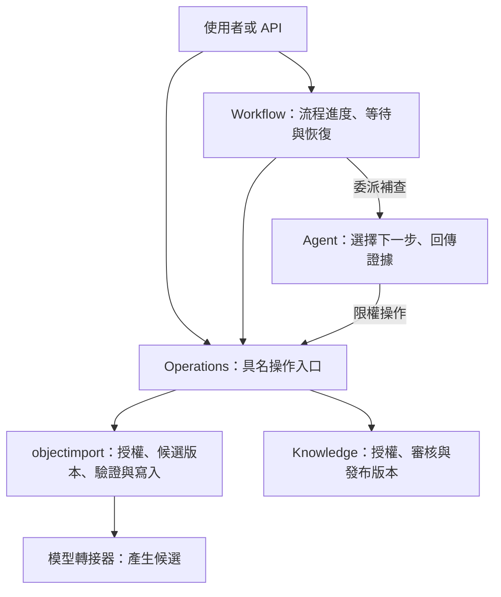
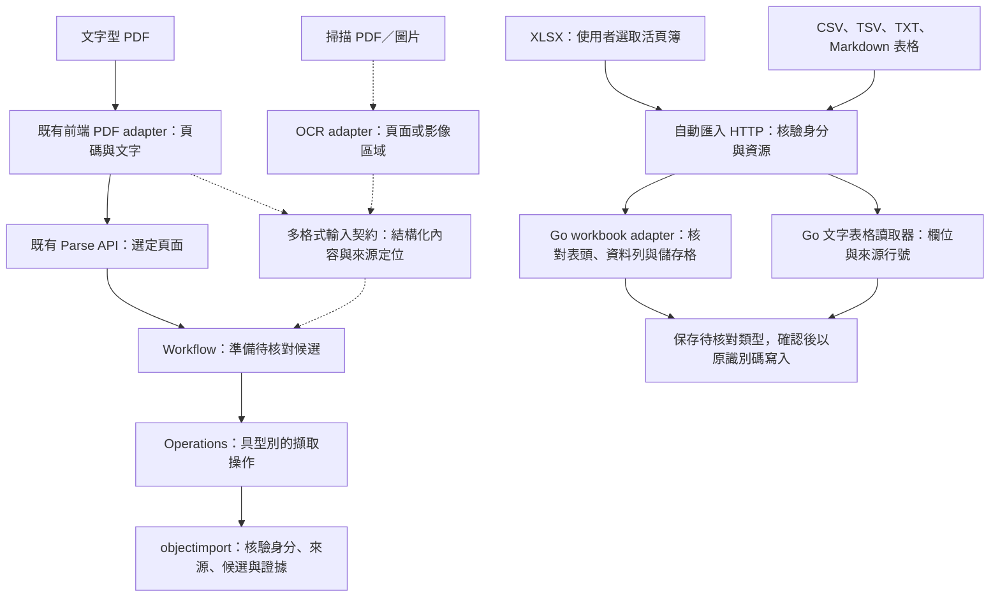
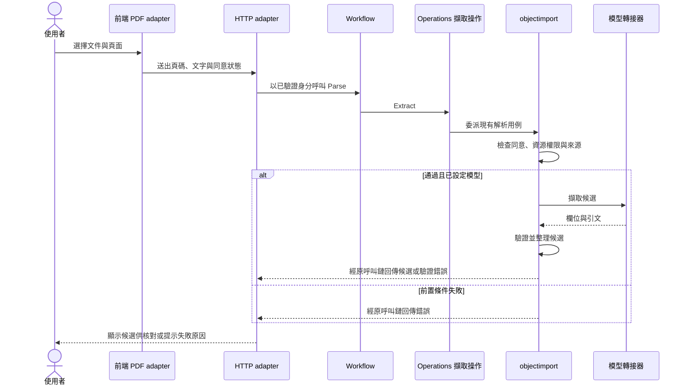
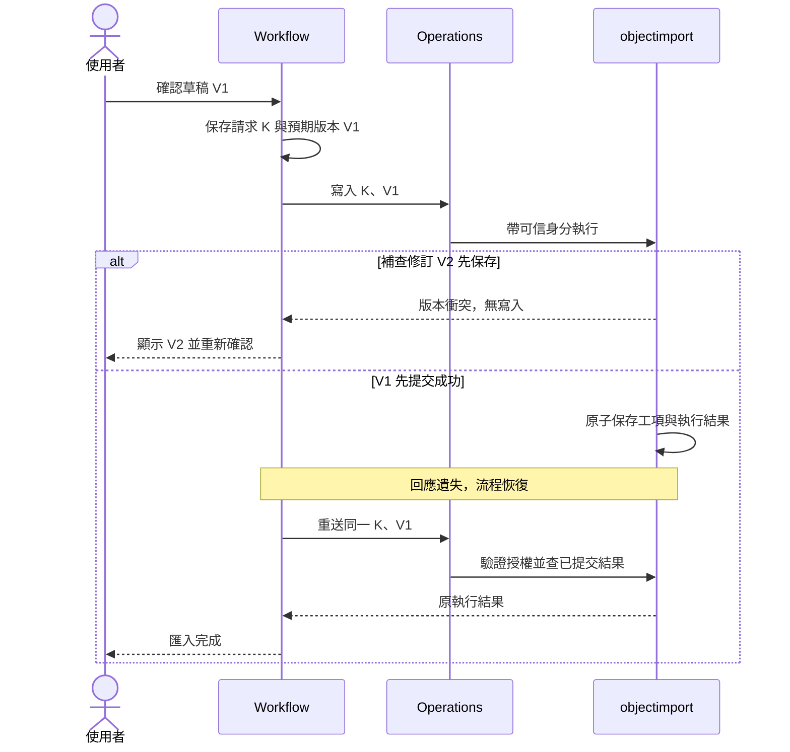
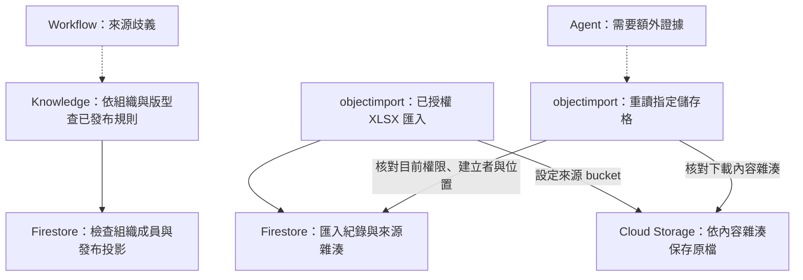

# 四領域架構與 PDF 匯入驗收

狀態：設計提案。現行入口見 [HTTP handlers](../../backend/internal/business/objectimport/adapter/http/routes.go)。現有 Parse 接受使用者同意與選定頁面，Get 讀取草稿，Review 與 Confirm 接受 ExpectedVersion。下列跨領域契約描述目標行為；上線前應從實際入口逐項驗證。

## 從選檔到工項

使用者的目標是建立可追溯且數量正確的工項。前端選擇檔案並呈現資料傳送方式；HTTP 驗證身分及解碼請求。自動匯入入口交由 Workflow 選取 Operations，objectimport 負責核對資源存取、凍結本次候選及處理重送。Excel 使用已授權的工作表讀取器；文字型 PDF 沿用頁面辨識及模型分類。Object 擁有最終工項寫入規則。

目前 Excel 的讀取與判定在後端。PDF 的本機選頁資料及原始活頁簿各自有明確輸入格式；Workflow 的分派不代表已辨識所有檔案。需要人工確認的列會保留候選，其他依現行自動匯入契約處理。

目標流程中，只有「缺哪個已發布的版型對應」才查 Knowledge；只有「還能去哪個允許的來源找到證據」才委派 Agent。補查結果仍回 objectimport 驗證。證據不足時交回人工，不讓模型直接寫入。這兩個選擇性分支尚未接到自動匯入入口。

## 責任與依賴

箭頭表示執行時呼叫。Operations 委派資源領域執行檢查；引用知識的任務記下版本。固定流程可直接執行擷取；表頭位置確定時可直接讀取，只有補查方式不明確時才委派 Agent。函數契約分見 [Operations](operations.md)、[Workflow](workflow.md)、[Agent](agent.md)、[Knowledge](knowledge.md)。

## 多格式文件的入口與證據

現況與提案對照。現行文字型 PDF 在瀏覽器讀成選定頁面，後端 Parse 接收頁碼與文字。以下虛線是提案接點；來源讀取器放在實際讀檔的一端，bootstrap 只組裝後端依賴。

目標契約以文件識別與修訂識別綁定內容。每個區塊保存段落或含表頭的表格；證據引用區塊及原始位置。PDF 用頁碼，Excel 用工作表與儲存格範圍，CSV 用記錄列與欄位，影像用影像識別與區域。讀取器無法解讀格式、頁面沒有文字，或工作表缺少必要欄位時，回傳可辨識的原因。授權與同意應先於後端付費辨識及模型呼叫。

### 手動解析呼叫時序

現行實作（本地骨架）。確認寫入有獨立入口。Knowledge 目前只有查詢介面。Agent 已提供可選的模型證據補查器，這條手動解析路徑尚未呼叫它。

跨格式驗收使用內容相同的 PDF 與 Excel 驗收：比較項次、名稱、數量、單位，再分別核對來源頁與儲存格。保留既有頁面 API 的相容映射；跨格式契約的驗證、API 與前端證據顯示須一併完成，才開放新入口。

## 一次確認和兩種競爭結果

重新授權後才可回傳既有結果。執行識別碼綁定資源、操作與請求內容；同碼不同內容回報衝突。首次寫入在同一一致性邊界檢查版本與可寫狀態。已完成的匯入拒絕遲到的修訂。

## 共用詞條

| 詞條 | 在本設計中的含義 |
|---|---|
| 操作／操作執行 | 前者定義能力與契約；後者是一次具身分與資源範圍的呼叫。重試沿用同一執行識別碼。 |
| 候選版本／知識版本 | 前者識別本次待匯入內容；後者識別跨任務引用的已發布規則。分別由 objectimport 與 Knowledge 管理。 |
| 使用者確認／發布核准 | 確認允許寫入指定候選版本；發布核准允許特定範圍的後續任務引用規則。 |
| Knowledge／Persistent Memory | Knowledge 具備來源、版本與適用條件。持久化記憶是跨任務保留經驗；經審核的版型規則可成為知識。Workflow 的恢復點只屬本次執行。 |
| Retrieval／RAG | Retrieval 按權限與條件查回資料；將查回的證據交給模型生成候選，即為 RAG。 |
| Context Engineering | 使用案例選擇傳給模型的指令、證據、知識版本與上下文大小。文件內容當作資料，引用規則與原文衝突時交回確認。 |

## 可重現的驗收樣本

以下是合成頁面文字與預期結果，可作為 PDF 測試素材。進行端到端驗收時，將樣本排成指定頁數的 PDF，從實際上傳入口執行。

| 樣本 | 頁面輸入或事件 | 預期結果 |
|---|---|---|
| 一般工項 | 第 1 頁：項次 01，模板，12.5 m² | 一列，保留數量、單位及第 1 頁來源。 |
| 跨頁 | 第 1 頁末：02 不鏽鋼；第 2 頁首：欄杆 8 m | 同一項次一列，名稱「不鏽鋼欄杆」，來源涵蓋兩頁。 |
| 相似欄名 | 同列契約數量 20、累計完成數量 30；任務要求契約數量 | 取 20。其他組織的同名版型規則不可見。 |
| 缺證據 | 去掉表頭，留下兩個數字且沒有可信對應 | 標示待確認，不自動挑選數字或發布規則。 |
| 重送與競爭 | 確認後斷線重送；另測確認與修訂同時發生 | 重送只產生一次業務寫入；競爭結果符合上圖。 |

## 落地與觀測

1. 先對照[後端 PDF 擷取測試](../../backend/internal/business/objectimport/adapter/workbook/pdf_test.go)與[匯入測試](../../frontend/miniapp/tests/object-import.test.tsx)，從現有入口跑通擷取、確認、重送。以實際儲存的工項數與來源頁驗收。
2. 接入知識查詢後，以同一批樣本比較每百筆候選的人工修正數與錯誤自動採納數；另測撤回、跨組織隔離及新版取代舊版。
3. 只對仍需動態補查的案例接入 Agent，記錄找到證據、證據不足、越權拒絕及步數耗盡的結果。以相同樣本對照固定流程的正確率、耗時與模型呼叫數。
4. 用匯入 ID 關聯候選版本、執行識別碼、來源頁、知識版本、模型與提示版本及結果。日誌記錄識別資訊與計數，避免記錄整頁原文。上線時保留停用補查、撤回知識版本及回到人工確認的路徑。

## 儲存接線與權限邊界

現況與提案對照。實線是後端接線，虛線是後續的匯入決策。

[規則投影與發布邊界](knowledge.md) · [附件留存與重讀契約](../domains/objectimport/design.md)
