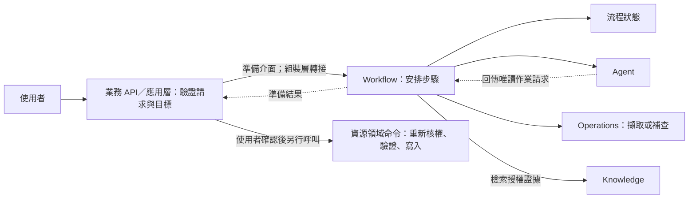
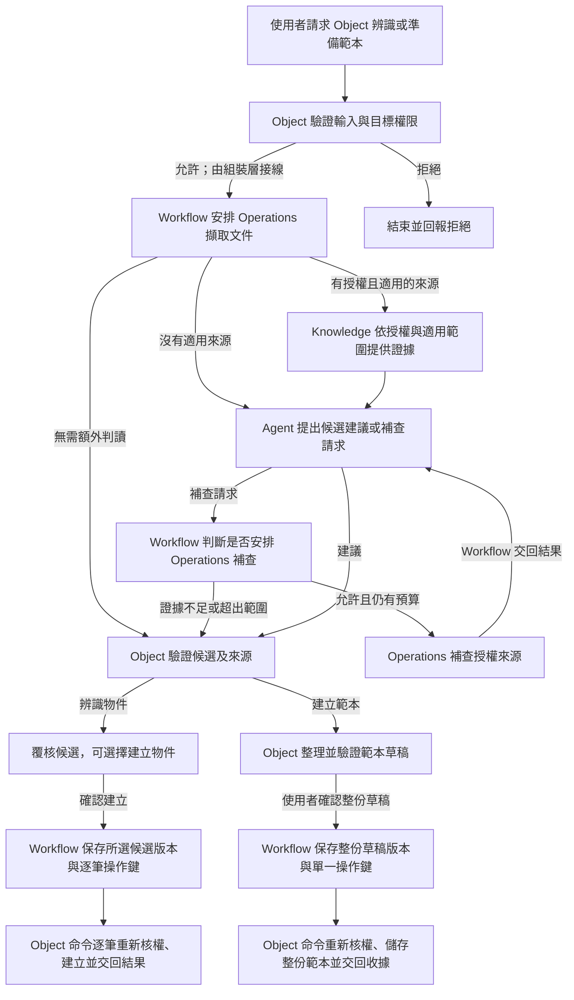

# 跨領域協作提案

狀態：提案。Workflow、Knowledge、Agent、Operations 四種支援能力可以各自使用。以一次具名業務查詢或命令為預設，遇到流程編排、知識檢索、推理或具名作業需求時，才加入對應能力。

## 領域邊界、能力契約與依賴方向

各領域擁有自己的核心契約：[Object](../domains/object/design.md) 管物件與範本的業務能力，[Workflow](../domains/workflow/design.md#核心契約) 管流程，[Knowledge](../domains/knowledge/design.md#核心契約) 管知識與證據，[Agent](../domains/agent/design.md#核心契約) 提出判斷或作業請求，[Operations](../domains/operations/design.md#核心契約) 執行作業。本提案只定義跨領域交接，不重新定義各領域規則。

對「從文件辨識物件」與「從文件建立物件範本」，使用者請求的是 Object 能力。Object API／應用層接收請求、驗證輸入及目標範圍；組裝層以 Object 所需的準備介面接上跨領域協調。Workflow 安排文件準備的步驟；只有流程需要保存、等待確認或恢復時，才由 Workflow 擁有該 Run。正式建立物件或範本仍是 Object 命令。請求入口、流程執行者和資料擁有者不得混為同一責任。

| 領域       | 擁有的決策與狀態                                   | 對本用例交付的結果                             | 不得取代的責任                                           |
| ---------- | -------------------------------------------------- | ---------------------------------------------- | -------------------------------------------------------- |
| Object     | 目標權限、候選與草稿規則、物件及範本寫入與收據     | 可覆核候選／草稿、正式業務結果                 | 不以模型建議代替業務驗證；不直接依賴其他四域的實作       |
| Workflow   | 步驟、分支；需要跨請求時的 Run、確認版本與恢復位置 | 步驟結果與可追蹤的流程狀態                     | 不判定 Object 的業務權限或寫入是否合法                   |
| Knowledge  | 受管來源、版本、索引、檢索與讀權                   | 有來源與版本的可引用證據；無符合資料時為空結果 | 不從單次上傳或模型輸出推定已發布知識或讀權               |
| Agent      | 依目標和證據推理、規劃與評估                       | 建議、唯讀作業請求或待人工處理原因             | 不直接執行工具、批准草稿或寫入 Object                    |
| Operations | 具名作業、工具資格、參數、執行與結果紀錄           | 擷取／補查結果、作業失敗或執行收據             | 不決定候選是否符合 Object 規則；不以工具授權取代資源授權 |

跨界只傳明確的輸入與結果：可信操作者及目標範圍、擷取結果及來源位置、知識引用與版本、Agent 建議或作業請求、Object 候選／草稿及業務收據。缺少來源、無權、執行失敗與結果未知是不同結果，不能互相轉成空資料。跨領域轉譯由組裝層的 Adapter 完成；呼叫端定義所需的小介面，Object 核心不匯入 Workflow、Knowledge、Agent 或 Operations。

業務域決定資料歸屬、目前權限及合法狀態。以可信 Session 帶入操作者，模型與連結只能提出目標。候選與引用可留在流程紀錄，但讀取時仍須核驗可見性。Workflow 與 Agent 可同屬 Execution；Operations 和 Knowledge 可按用例獨立接入。現有業務用例可直接執行。

未來設計。實線表示請求或呼叫，虛線表示建議或結果回傳。組裝層接線；業務命令不反向依賴 AI 執行器。

## 採用的 DDD 概念

依 [DDD 設計流程](../references/ddd/design-process.md)從用例、拒絕條件和併發反例推回模型。五個名稱描述能力及責任。只有具備獨立語言、規則與資料生命週期的部分才形成獨立限界上下文，部署方式另依需要決定。

| 採用概念                                                                                                                                                        | 在本規格的用途                                                                                                                  | 驗證依據                                                         |
| --------------------------------------------------------------------------------------------------------------------------------------------------------------- | ------------------------------------------------------------------------------------------------------------------------------- | ---------------------------------------------------------------- |
| [通用語言](../references/ddd/ubiquitous-language.md)與[上下文映射](../references/ddd/context-mapping.md)                                                        | 區分候選、確認、提交意圖、業務收據與知識版本。Journal 是日誌生效結果的權威來源。Workflow 保存流程進度，Knowledge 保存引用版本。 | 工作進度顯示完成前，須能指出具體的業務收據。                     |
| [公開契約](../references/ddd/domain-contract.md)與[領域授權](../references/ddd/domain-authorization.md)                                                         | 跨邊界傳具名輸入及結果，操作者由可信情境帶入。工具資格、來源可見性與正式寫入權分別在對應邊界判斷。                              | 撤回授權後，舊確認及舊工具清單都不能授予寫入權。                 |
| [聚合](../references/ddd/aggregate.md)、[不變條件](../references/ddd/invariant.md)與[狀態機](../references/ddd/state-machine.md)                                | 持久化需要成立時，以單次流程執行為一致性邊界。確認與提交意圖一起保存。日誌與收據由 Journal 在自己的交易內提交。                 | 並行確認或修改候選時，至多一個符合當前版本的確認能建立提交意圖。 |
| [依賴規則](../references/ddd/dependency-rule.md)、[Port／Adapter](../references/ddd/hexagonal-architecture.md)與[組裝根](../references/ddd/composition-root.md) | 呼叫端定義其所需的介面。組裝層注入 Firestore、模型供應商及工具轉接。領域模型依賴自身規則與型別。                                | 替換模型或儲存 Adapter 時，授權、狀態與寫入契約的測試仍成立。    |
| [交易](../references/ddd/transaction.md)、[冪等](../references/ddd/idempotency.md)與[架構測試](../references/ddd/architecture-testing.md)                       | 流程保存與業務命令各自提交。跨邊界用操作識別碼與收據對帳，重送同一請求沿用同一識別碼。                                          | 模擬日誌成功、流程未完成便中斷，恢復後仍只有一篇日誌。           |

首個切片沿用同步業務命令和既有收據。Outbox 留給已提交後需要可靠發送的通知；Saga 留給有明確補償規則的多方業務交易；事件溯源需另有回放或歷史模型需求。首版驗收以上述反例為準。

## 最小可驗證情境：指定儲存庫的日誌草稿

以下為目標旅程。日誌歸屬與可寫條件以[日誌規格](../domains/journal/journal.md)及[儲存庫規格](../domains/repository/design.md)為準。

1. 使用者指定 B 庫。Workflow 從可信身分取得授權情境，由 Agent 提出查詢需求，再安排 Operations 以少量唯讀作業查工項。如需規範，Workflow 向 Knowledge 取得帶版本的依據並交給 Agent。證據不足時列出缺項。
2. 使用者查看候選與來源。確認綁定操作者、候選版本、B 庫與 `CreateJournal` 命令。任何一項變更都要求重新確認。
3. 跨請求執行前先保存確認及穩定提交識別碼。命令重新檢查權限與日誌規則，成功後以日誌收據完成。結果未知時先查原結果，或沿用原識別碼安全重試。

驗收涵蓋：無權的工項、組織規則與紀錄不可見；Agent 無法呼叫寫入；改庫或改候選使舊確認失效；確認後撤權時拒絕保存；提交成功但回應遺失時恢復只產生一篇日誌。第一個切片沿用既有日誌保存契約，暫不建立通用流程引擎。

## 文件辨識與建立物件範本

以下為需要跨請求確認與恢復時的目標流程，箭頭表示步驟或結果的傳遞。入口屬於 Object；Workflow 協調被請求的步驟並保存 Run。現行同步準備函式沒有持久化 Run。

- **Knowledge** 只查已明確提供、且操作者目前有權讀取的來源，回傳版本、位置與引文。沒有來源或找不到適用證據時繼續文件分析，並標示缺證。這一版不展開組織範圍、共用知識或範本發布後的索引回流。
- **Agent** 每次接收同一分析任務的文件擷取結果、可用證據及前次作業結果，回傳候選建議、單一唯讀作業請求或待人工處理原因。Workflow 檢查步數與允許範圍，Operations 重新核驗授權並執行。補查失敗也扣除預算。
- **Object** 核驗辨識目標的儲存庫權限，個人範本則核驗持有人範圍。它負責候選與草稿規則，也在每次正式寫入時重新授權及驗證。驗證失敗可交回 Workflow 安排補查或人工修正。
- **確認與重試**：目標流程由 Workflow 保存跨請求確認、操作者、目標、命令、快照版本與恢復位置；Object 命令仍重新核權。所選候選或草稿內容變更時重新確認。物件逐筆保存操作鍵與結果，只重送結果未知的項目；個人範本整份儲存，結果未知時沿用原鍵與相同草稿。現行前端確認及 Object 寫入不具備這段 Workflow 恢復能力。

### 現行同步接線

兩個 Object 上傳入口共用[文件準備轉接器](../../backend/internal/bootstrap/object_preparation.go)。[Workflow](../../backend/internal/business/workflow/application/document.go)先安排 Operations 擷取候選。PDF 有候選缺少頁碼時，Workflow 請 Operations 讀取同一份上傳的文字，Knowledge 依頁查找引文，Agent 僅在引文唯一對應到一頁時補上位置。最多查找 32 筆候選；缺證、引文跨頁或重複出現在多頁時，保留候選並交由使用者核對。輸出沿用候選的 `location`。來源文字只在本次請求使用。已發布知識檢索、動態補查與跨請求確認仍屬目標流程。

適配器透過 Responses API 在同一個請求中使用 `input_file` 傳送原檔，並以 `text.format` 指定嚴格的 JSON Schema。候選包含名稱、十進位數量字串、單位、來源位置與引文；數量、單位及位置允許 null。完成、拒答、截斷和無效輸出各有對應的結果，呼叫端可檢視模型回應。每次重送都會重新辨識且可能計費。[File inputs](https://developers.openai.com/api/docs/guides/file-inputs?api-mode=responses) · [Structured Outputs](https://developers.openai.com/api/docs/guides/structured-outputs#supported-schemas)

### 物件入口與驗收

物件操作以[候選覆核規格](../domains/object/design.md#從文件辨識候選)與 [OpenAPI](../../api/contract/object/objects.yaml) 為準。

1. 物件 API 提供候選辨識操作，契約定義檔案類型、上傳大小、候選及錯誤回應。驗收時確認無權限時不會呼叫模型，拒答與截斷可和零筆候選區分。
2. 物件畫面提供選檔與覆核。顯示原始數量、單位、位置與引文，讓使用者修正後透過既有建立操作逐筆送出。重送建立時沿用同一建立鍵。
3. 以實際 PDF、段落文件及試算表驗收來源可追溯性、缺欄與漏列。試算表處理有列數及摘要限制，需用原件核對完整性。

跨步驟續跑、補查外部證據及套用已發布規則分別由 Workflow、Agent 和 Knowledge 按需求承接。

## 驗收條件

- 未授權的呼叫無法讀取資源或執行寫入。
- 重試同一次寫入只產生一次業務結果。
- 補查只使用允許的來源；引用的知識版本可追溯。
