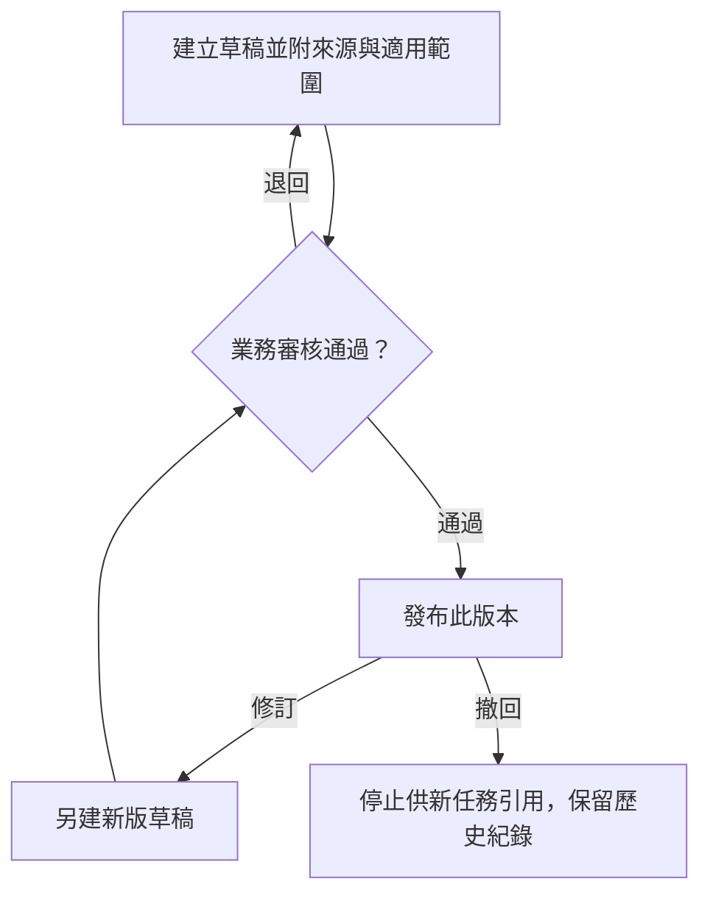

# Knowledge 領域設計

狀態：提案。[領域導覽](../../backend/internal/business/knowledge/)

Knowledge 管理知識從提出到撤回的過程。每個版本保存條目識別碼、內容、來源、所屬組織、適用範圍及審核紀錄。以 PDF 匯入為例，「某版型應讀契約數量欄」可以成為條目；單張文件中的數量仍屬該次匯入。規則的業務意義由 呼叫端 判定。

## 知識模型

依 [實體](../references/ddd/entity.md)及[不變條件](../references/ddd/invariant.md)，以知識條目追蹤穩定身分，以條目 ID、版本、來源定位組成可引用的值。發布使用版本比對，維持同一條目至多一個有效發布版本。新的檢索拒絕已撤回版本；歷史引用顯示時仍核對當下讀權。知識內容作為依據，適用及業務判定由消費它的用例負責。

## 知識版本生命週期

未來設計

新版發布時取代同一條目先前的有效版本。使用案例保存實際引用的版本，以便事後查明依據。

## 與其他領域協作

[Operations](operations.md) 可提供查詢入口，Knowledge 依可信身分、組織、版型及發布狀態選出可引用的版本。[Workflow](workflow.md) 可在使用者確認後提出知識草稿；確認單筆匯入不等於核准跨文件套用。[Agent](agent.md) 可檢索已發布的規則，和當前頁面一起交給模型判讀。若規則與原文衝突，回到人工確認。

## 驗收情境

以兩個組織使用同名版型測試隔離；發布新版後確認新任務取得新版、既有匯入仍能追溯原版；撤回後確認新查詢不再回傳該版本。

## 對外契約草案

以下為邏輯簽章，實作時對照既有介面。身分及資源範圍取自可信呼叫情境。

| 操作                                          | 結果、副作用與失敗語意                                                                                             |
| --------------------------------------------- | ------------------------------------------------------------------------------------------------------------------ |
| Propose(actor, scope, rule, source)           | 有權貢獻者建立附來源草稿；草稿尚不可供一般檢索。                                                                   |
| Publish(reviewer, draftVersion, expectedHead) | 檢查範圍內發布權限與審核紀錄；原子比對現行版本並切換。並行發布的落後請求回報衝突。                                 |
| Retrieve(actor, scope, templateVersion)       | 僅回傳來自授權範圍、適用且有效的已發布規則與版本；無符合規則時回傳空集合。讀取服務失敗另行回報，不能視為沒有規則。 |
| Withdraw(reviewer, entryVersion)              | 檢查撤回權限；停止新引用並保留歷史紀錄。重複撤回同版維持已撤回狀態。                                               |

[共用架構、時序與驗收](domain-collaboration.md)

## 已發布規則的 Firestore 讀取接線

後端以同一筆唯讀用途的交易讀取組織與發布投影，先檢查 actor 是該組織的 owner 或成員。投影路徑為 `channels/{channel}/organizations/{organization}/publishedKnowledge/{templateDigest}`，其中 templateDigest 使用專案既有的 firestorekey.Digest。文件保存 templateVersion 與 rules 陣列；每條規則包含 ID、Version、Source、Text。授權通過但找不到投影時回傳空集合。實作見[讀取 adapter](../../backend/internal/business/knowledge/adapter/firestore/rules.go)。

這次只接讀取端。未來發布操作應在核准時建立或取代投影，撤回時移除相應規則。查詢缺少可信的組織與版型識別時，不會推測組織或自動套用規則。

## Firestore 向量搜尋接線

現行內部接線提供 [SearchEvidence](../../backend/internal/business/knowledge/application/port/search.go)。呼叫端從可信情境傳入操作者、組織、現成的查詢向量與筆數上限（1–20）。既有按版型精確查詢仍可獨立使用。

[Firestore Adapter](../../backend/internal/business/knowledge/adapter/firestore/search.go)在同一次交易核對組織資格、搜尋該組織的向量及讀取正式發布投影。向量文件位於 `channels/{channel}/organizations/{organization}/publishedKnowledgeVectors/{id}`，欄位為 `embedding`（Firestore Vector）、`templateVersion`、`ruleId`、`ruleVersion`。Adapter 依歐氏距離排序，僅回傳仍在發布投影中、識別碼與版本均相符的規則及來源。舊向量只影響召回數，可能使結果少於請求筆數；撤回不用等待清理向量才生效。

這條接線適用於組織內可見的已發布規則。正式使用前需為 `publishedKnowledgeVectors.embedding` 建立向量索引，並讓索引與呼叫端使用相同維度、同一組 embedding 模型設定及前處理。測試使用手動提供的向量。產生向量、維護索引文件、正式部署與業務呼叫端尚未接線。
