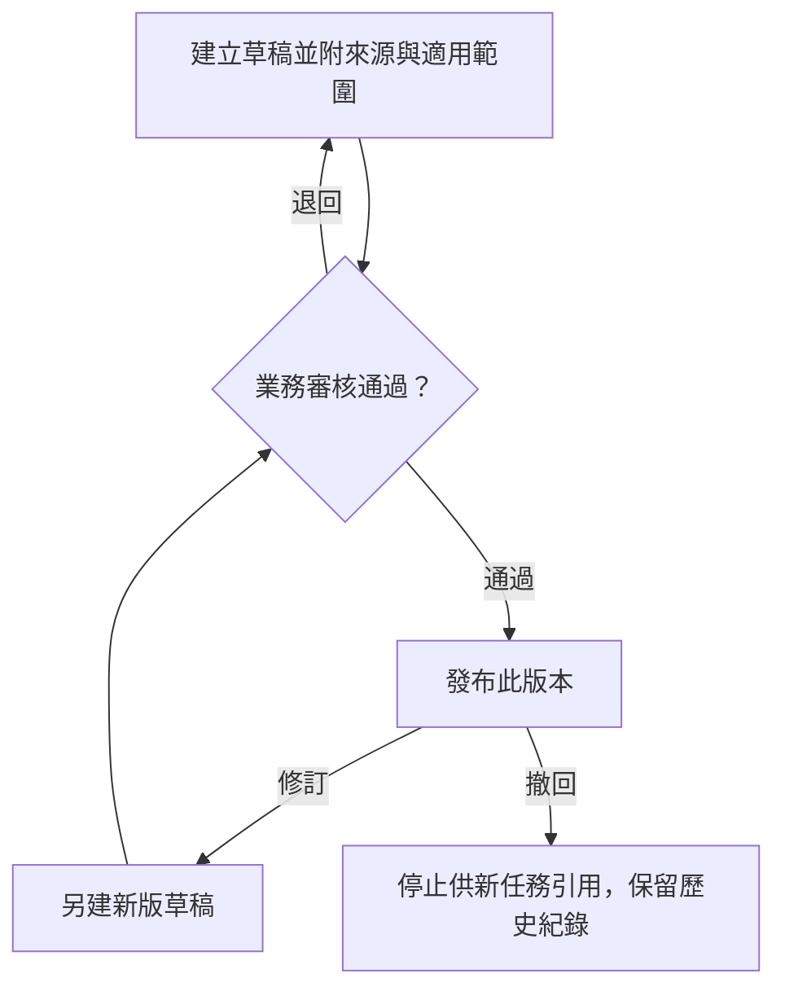

# Knowledge 領域設計

狀態：提案。[領域導覽](../../backend/internal/business/knowledge/README.md)

Knowledge 管理知識從提出到撤回的過程。每個版本保存條目識別碼、內容、來源、所屬組織、適用範圍及審核紀錄。以 PDF 匯入為例，「某版型應讀契約數量欄」可以成為條目；單張文件中的數量仍屬該次匯入。規則的業務意義由 objectimport 判定。

## 知識版本生命週期

新版發布時取代同一條目先前的有效版本。使用案例保存實際引用的版本，以便事後查明依據。

## 與其他領域協作

[Operations](operations.md) 可提供查詢入口，Knowledge 依可信身分、組織、版型及發布狀態選出可引用的版本。[Workflow](workflow.md) 可在使用者確認後提出知識草稿；確認單筆匯入不等於核准跨文件套用。[Agent](agent.md) 可檢索已發布的規則，和當前頁面一起交給模型判讀。若規則與原文衝突，回到人工確認。

## 驗收情境

以兩個組織使用同名版型測試隔離；發布新版後確認新任務取得新版、既有匯入仍能追溯原版；撤回後確認新查詢不再回傳該版本。

## 對外契約草案

以下為邏輯簽章，實作時對照既有介面。身分及資源範圍取自可信呼叫情境。

| 操作 | 結果、副作用與失敗語意 |
|---|---|
| Propose(actor, scope, rule, source) | 有權貢獻者建立附來源草稿；草稿尚不可供一般檢索。 |
| Publish(reviewer, draftVersion, expectedHead) | 檢查範圍內發布權限與審核紀錄；原子比對現行版本並切換。並行發布的落後請求回報衝突。 |
| Retrieve(actor, scope, templateVersion) | 僅回傳來自授權範圍、適用且有效的已發布規則與版本；無符合規則時回傳空集合。 |
| Withdraw(reviewer, entryVersion) | 檢查撤回權限；停止新引用並保留歷史紀錄。重複撤回同版維持已撤回狀態。 |

[共用架構、時序與驗收](domain-collaboration.md)
