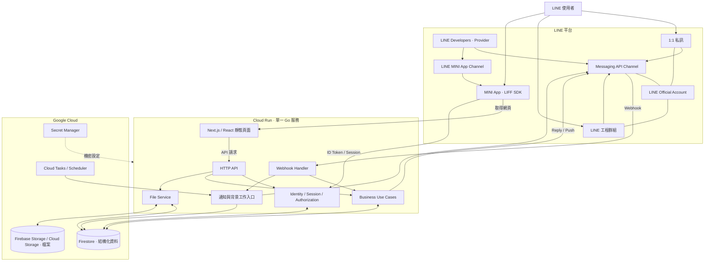
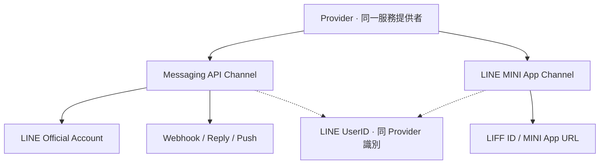
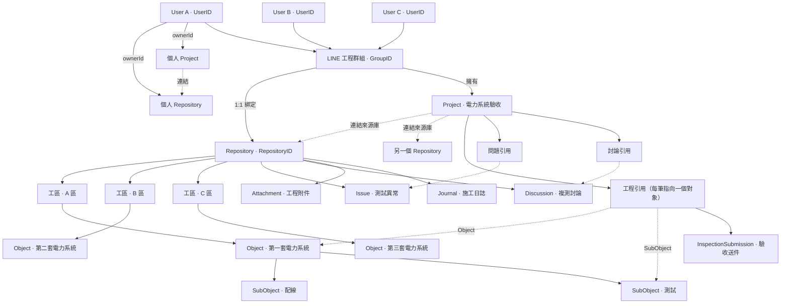
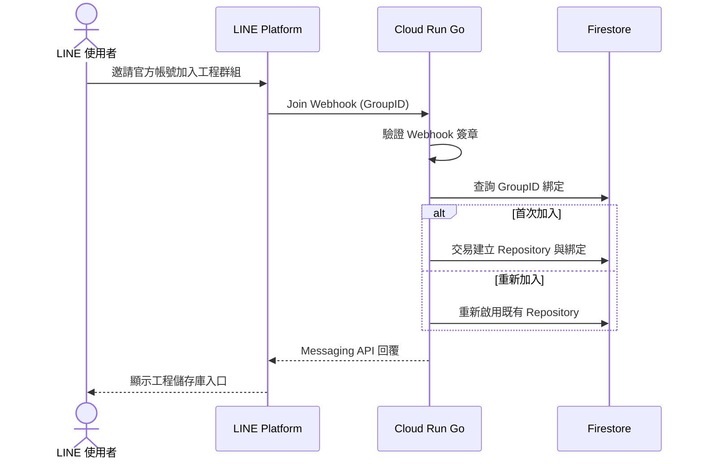
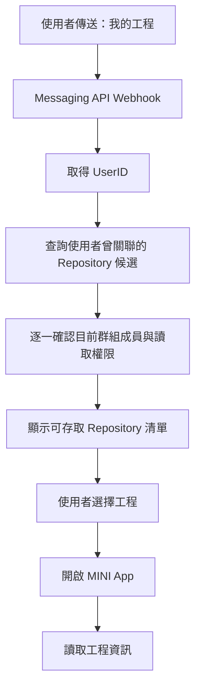
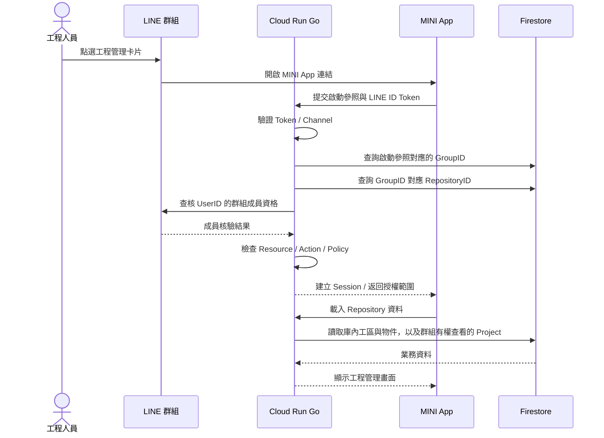
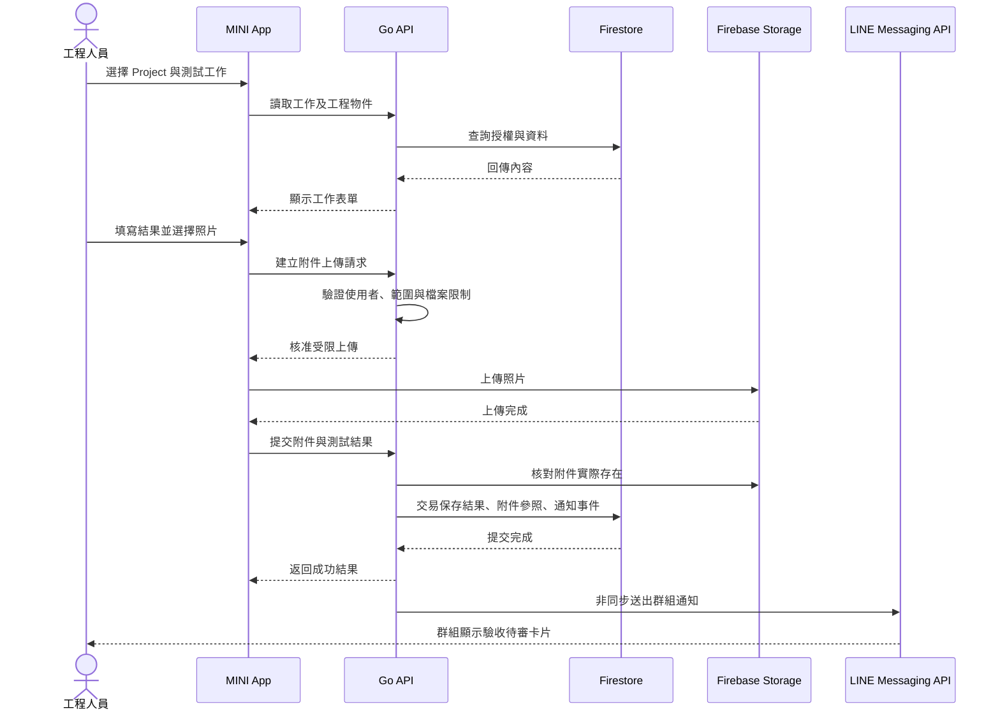
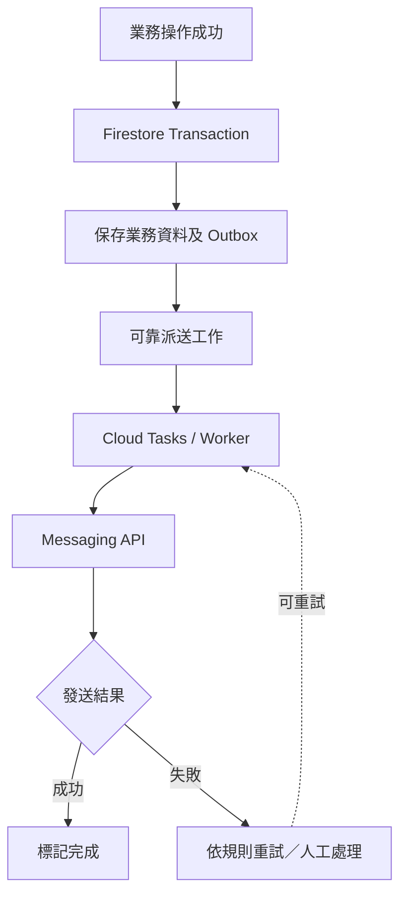

# LINE 工程平台架構

以下圖表記錄工程平台提案。現行服務與已接線的功能見 [執行架構](../../architecture/runtime/overview.md) 與 [LINE 旅程](../../integrations/line/journey.md)。

## 平台總覽

未來設計

## LINE 渠道與身分

未來設計

## 資源階層

未來設計

## 加入工程群組

未來設計

## 私訊查詢工程

未來設計

## MINI App 入口

未來設計

## 工程通知

未來設計

## 背景派送

未來設計

