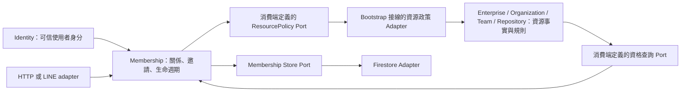
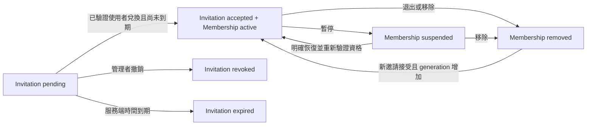

# Membership 統一成員關係設計

狀態：Bot 私聊邀請已接入既有 Organization 授權模式，待真實 LINE／Firestore 驗收。下述獨立 Membership 儲存與切換仍屬未來設計。需求方向為新增 `membership` 業務領域，統一管理使用者與資源的成員關係；下列角色、API 與遷移方案為本次提出的設計基線，尚不改變現行契約。

原始來源基準：2026-11-21，`work`／`fe571ab`，下述圖譜與封裝結果屬當時查證。此次規格一致性修訂以 `b046fa5` 及目前工作區文件為準；工作區另有未提交業務變更，不將歷史原碼查證視為目前完整實作或環境驗收證據。

## 目標與範圍

新增 `backend/internal/business/membership`，集中保存、查詢及異動成員關係，其他領域不再各自維護可授權的使用者陣列。使用者先透過 Identity 獨立登入，可以沒有任何 Membership。

第一階段交付 Organization People 的邀請、接受、Owner 移轉、離開與移除；共同模型支援 Enterprise、Organization、Team、Repository，依階段接入。新資源種類須明確註冊政策與識別碼驗證，不能只傳任意 `resourceType` 就建立關係。

Bot 邀請切片沿用現有 webhook 與 Organization 資料。獨立儲存切換、OpenAPI 與部署另行交付。Team 對 Repository 的授權屬於資源對資源的 `Grant`，仍由 Repository 管理；直接使用者角色則由 Membership 保存。

## 現況與需要替換的來源

| 現行位置 | 原碼核對結果 | 接入後責任 |
| --- | --- | --- |
| [Organization store](../../backend/internal/business/organization/adapter/firestore/store.go) | `Context` 查 `ownerUserId`／`memberUserIds`；`Transfer` 核對現任 Owner 與既有成員 | 可見組織與角色查 Membership；建立組織時一併建立 Owner |
| [Enterprise store](../../backend/internal/business/enterprise/adapter/firestore/store.go) | 使用 `ownerUserId`／`ownerUserIds`／`managerUserIds`；People 可見性還讀組織成員 | 企業直接成員由 Membership 管理；旗下 People 可另做聚合讀模型 |
| [Team store](../../backend/internal/business/team/adapter/firestore/store.go) | 直接讀組織成員與管理者陣列；清單還經 Group 查資格 | 改由明確查詢契約取得資格；管理歸屬仍屬 Team |
| [共用 Firestore document](../../backend/internal/business/internal/adapter/firestore/store.go) | 混合 Owners、Members、Managers 與資源歸屬欄位 | 成員欄位逐步退役；資源歸屬不能一起當成成員資料搬走 |
| [Repository service](../../backend/internal/business/repository/application/repository.go) | 個人庫比對 Owner；群組庫經 Port 即時查 LINE Membership | 保留既有個人／群組模式；組織庫另接 Membership 與 Grant |
| [LINE Membership](../../backend/internal/platform/line/membership.go) | LINE 群組資格的外部查詢能力 | 保留技術整合；不作為內部邀請或組織成員的保存位置 |

Graphify `explain` 找到 Team、Organization store 與 bootstrap 的依賴；`path --undirected` 找到 Repository Application → bootstrap → LINE Membership 的兩跳連線。廣泛 query 有截斷，後續以精確 explain/path 及原碼補查，不能把圖中 import 路徑視為完整執行時序。

## 領域邊界

未來設計

箭頭表示使用能力，不要求 Go package 雙向 import。各消費端在自己的 `application/port` 定義最小介面，由 bootstrap 的整合 adapter 轉換 DTO；核心不得 import 對方的 Firestore adapter。ResourcePolicy 僅提供資源事實及純政策判定，不可再次呼叫 Membership，避免循環查詢。

| 模組 | 擁有的權威資料／規則 |
| --- | --- |
| Identity | 登入者身分、Session；第一版沿用目前可信使用者 ID，不另造帳號遷移 |
| Membership | 使用者與資源的唯一關係、邀請、狀態、版本、資格世代與異動稽核 |
| Enterprise／Organization／Team | 資源是否存在、管理歸屬、允許角色、誰能管理成員的政策與 Owner 保護要求 |
| Repository | 庫的擁有者、角色對操作的映射、Team Grant、內容與子資源規則 |
| Bootstrap／整合 Adapter | 跨領域契約轉譯與同一工作單元協調，無獨立業務權威 |

資源歸屬與資格分開：`enterpriseId`、Team 的 `managementScope/managementId`、Repository owner 不因搬移成員欄位而改變。企業 Owner 不因角色名稱而自動取得旗下所有 Repository 內容權限。

## 核心模型

未來設計；以下為邏輯關係，不代表資料庫外鍵。

| 實體 | 必要欄位與約束 |
| --- | --- |
| `ResourceRef` | `channelId`、`type`、`id`；三者共同識別範圍。Channel 由服務端設定取得，不能採信請求指定的租戶 |
| `Membership` | `id`、`resource`、`userId`、`role`、`status`、`generation`、`version`、`joinedAt`、`updatedAt`、`endedAt`、`createdBy`、`updatedBy`、`dependencies` |
| `Invitation` | `id`、`resource`、`role`、`status`、`expiresAt`、`createdBy`、`acceptedAt`、`acceptedMembershipGeneration`、`version`、建立時的資源政策版本、邀請者資格世代、邀請碼摘要及兌換後的 `acceptedBy` |
| `ResourceMembershipState` | 每資源一筆，保存 `version`、政策版本及授權模式；Organization 首版另以 `ownerUserID` 保存唯一 Owner 指標，Team 不使用此指標，Enterprise 多 Owner 權威格式待定；所有異動讀取適用的模式與政策版本；只有改變 Owner、模式或政策的異動寫入此狀態 |
| `Audit` | `actorUserId`、`action`、`resource`、`targetUserId`、前後角色／狀態／版本、`requestId`、時間；不保存 token 或完整邀請連結 |

`Membership` 使用由服務端對完整範圍與 userId 做無歧義編碼後產生的確定鍵，確保同一關係最多一筆。重新加入沿用關係識別碼、增加 `generation`，歷史由 Audit 保留。`version` 用於每次異動的併發控制，不能取代 `generation`。

Invitation 與 Membership 分開：待接受的邀請不是有效成員。Owner 發邀時不指定使用者。私下轉傳的一次性邀請碼可由第一位符合條件的已驗證使用者兌換，轉傳後可能被其他人先使用。

### 基本規則與模型責任

1. 一個關係只對一個可信使用者與一個完整的 ResourceRef 成立。關係存在、狀態為 active、當下具備有效資格是三件事。有效資格是基於最新資源與依賴事實推導的結果。
2. 邀請只允許一位已驗證且符合當下條件的使用者建立或重新啟用關係。邀請與成員關係各有獨立身分及生命週期。
3. 可管理且要求 Owner 的資源，必須維持至少一位具有效管理資格的 Owner。第一階段的單一 Owner 指標只適用 Organization，該角色無上層資格依賴，且不得透過邀請或一般改角色取得。一般角色異動、停權及離開不得解除其 Owner 身分，須透過專用移轉命令。Enterprise 保留現行多 Owner 語意，其獨立模式須先依企業規格定案，不能套用 Organization 指標。Team 使用 maintainer 與上層管理政策，不要求 Owner。資源停用時先阻斷該資源授權，重新啟用須重新驗證適用的管理資格。後續若允許 Owner 依賴上層資格，須先定義上層撤權與政策變更如何同時保護此規則；須重新證明範圍中的 Owner 仍有效。此承諾限 Membership 管轄的資格，不保證登入供應端始終可用。

`Invitation`、`Membership` 與 `ResourceMembershipState` 各自是異動入口。Invitation 保護接受與撤銷；Membership 保護角色及狀態轉換；資源狀態保護 Owner 指標、政策及模式。Application 取得當下授權事實並協調跨聚合交易。成員以識別引用資源與依賴，單筆操作只載入受影響的關係與必要依賴，不載入整份 People 名單。對首版 Organization，`ResourceMembershipState.ownerUserID` 是 Membership 模式下唯一的 Owner 權威。該指標必須指向同一範圍內一筆有效成員關係。首版關係及邀請的角色值只接受 `member`；People 和資格查詢在核對有效關係後依指標推導 `owner`。既有 Owner 欄位在切換後只可作相容投影，不能參與授權。指標缺漏或指向無效關係時，拒絕授權與一般異動並交由資料修復處理。

建立新關係時配置確定 ID、generation 1、version 1；重新加入或恢復沿用 ID 並增加 generation 與 version。一般角色或狀態變更增加 version。從儲存重建保留原 ID、時間及版本，檢查必要欄位與狀態相容性，損壞資料不可授權。JoinedAt 代表首次加入，歷史未知時保留 unknown；重新加入的時間另由稽核記錄。

## 角色與有效資格

以下為提案預設；落地時由各資源政策明確定義，Membership 負責套用而不提供任意自訂角色引擎。

| 資源 | 初始角色 | 成員管理基線 |
| --- | --- | --- |
| Enterprise | `owner`、`manager`、`member` | Owner 管理企業角色；manager 維持核准的管理能力，不得自行升 Owner |
| Organization | `owner`、`member` | Owner 邀請、移除、移轉；恰有一位有效 Owner |
| Team | `maintainer`、`member` | 授予、撤銷與首次開通的角色政策以 [Team 規格](../domains/team/design.md#授予撤銷與首次開通)為權威；不得自行改變管理歸屬 |
| Repository | `admin`、`write`、`read` | admin 管理直接使用者存取與 Team Grant；資源擁有者保留管理能力，不能由成員異動變成無人可管理 |

角色不是跨種類的數值大小。Organization member 不代表 Repository read；Team maintainer 不代表 Repository admin。Repository 內可定義 `admin ≥ write ≥ read`，由 Repository 政策解釋。

有效資格必須同時符合：資源存在且可使用、該資源採 Membership 授權模式、關係為 active、角色合法、所有必要上層資格有效且 generation 匹配。查詢結果區分 `active`、`inactive`、`not_found`；依賴或資料庫不可用回 `unavailable`，不得當成有效或靜默套用舊陣列。

第一版上層規則：Organization 成員不必先屬於 Enterprise；組織管理的 Team 成員須有同組織有效 Membership；企業管理的 Team 須有該企業有效 Membership。組織庫的直接或 Team 授權都須先滿足該庫所屬組織的有效成員資格。企業 Team 指派至組織不會自動開通組織資格。

離開上層後，下層紀錄可暫留但立即無效；重新加入上層產生新 generation，舊下層關係因世代不符仍無效，須明確重新授予。Dependency 只能指向政策允許的上層，不接受任意圖或循環；改變資源歸屬須拒絕舊 dependency 並走明確重新授權流程。

Enterprise People 可彙整旗下組織成員，但畫面 MUST 區分直接企業資格與組織來源。聚合出現某人不會替他建立企業 Membership。

## 狀態與邀請流程

未來設計

### 邀請狀態

| 操作 | 前置條件 | 成功與拒絕 |
| --- | --- | --- |
| 發邀請 | 目前 Owner 發起 | 建立 pending、簽發一次性邀請碼，保存摘要及發邀時的 Owner 版本。 |
| 接受 | pending、邀請碼符合、未到期，且發邀者仍為相同版本的 Owner | 以已驗證 Actor 為加入者，原子消耗邀請並建立關係。若已是成員則不消耗邀請。 |
| 撤銷 | 目前管理者，邀請仍 pending 且未到期 | 轉 revoked；已撤銷可安全重送，已接受或到期則拒絕。 |
| 到期 | pending 且服務端判定時間大於或等於 expiresAt | 視為 expired，拒絕接受與撤銷。背景清理只整理紀錄。 |

每個邀請只能成功兌換一次。Owner 移轉，使舊邀請即使原 Owner 日後回任仍不可用。獨立 Membership 模式接入重新加入前，還須以最近一次退出或撤權為下限，拒絕在該次異動前發出的舊邀請。

### 首版 Bot 私聊入口

1. A 建立組織後，向官方帳號傳送 `邀請加入 <組織 ID>`。Bot 建立邀請後回傳可直接轉傳的指令。
2. A 私下把 `接受邀請 <邀請碼>` 傳給 B。B 開啟自己的官方帳號私聊，送出該指令即可加入。有效期為 24 小時。A 也可傳送 `撤銷邀請 <邀請碼>`。
3. LINE Adapter 使用已驗簽私聊事件的 Actor 與事件 ID。Membership Application 核對目前 Owner、效期和接受資格。Firestore Adapter 在同一交易消耗邀請、寫入稽核並更新現行 `memberUserIds` 權威。Organization Owner 移轉在原交易中遞增 Owner 版本。

邀請碼依渠道、Actor 與事件 ID 經服務端密鑰產生；同一發邀事件可重建同一邀請碼，儲存只保留摘要。接受結果以同一已驗簽事件重送為準。Bot 在交易提交後才回覆。此相容切片僅可在 legacy 模式執行，未建立第二套成員權威，獨立 Membership 模式仍待交付。

### MINI App 組織頁

選取組織後，同一頁呈現概況、成員、原有團隊列表及儲存庫狀態。首版成員名單只對當前成員開放，使用組織範圍內的成員代碼供辨識。使用者可分享自己的代碼供 Owner 核對；原始 LINE 使用者 ID 不回傳。一般成員可退出，Owner 可移除他人，現任 Owner 必須先移轉才能退出。

現行 HTTP 契約為 `GET /api/v1/organizations/{organizationId}/members`、`DELETE /api/v1/organizations/{organizationId}/membership`（本人退出）及 `DELETE /api/v1/organizations/{organizationId}/members/{memberId}`（Owner 移除）。兩個異動都要求 `Idempotency-Key`。交易中以同一組織文件重新判斷權限，原子更新 `memberUserIds`、記錄最近退出時間並保存稽核與重送收據。最近退出時間阻擋之前簽發、尚未兌換的邀請重新開權。退出後重載組織選單，移除後重載名單。儲存庫區塊目前顯示尚未支援。

### 成員狀態

| 操作 | 起始狀態與結果 | 版本與資格 |
| --- | --- | --- |
| 首次加入 | 無紀錄 → active | 建立 ID、version 1、generation 1。 |
| 重新加入 | removed → active，須接受新邀請 | 沿用 ID，增加 version 與 generation。 |
| 改角色 | active → active | 改角色才增加 version；generation 不變。 |
| 移除／退出 | active 或 suspended → removed | 增加 version，立即停止授權。 |
| 暫停／恢復 | active → suspended；suspended → active | 兩者增加 version，恢復另增加 generation，且重新核對依賴。 |

suspended 關係只能經恢復流程重新生效。上層資格失效時下層關係可仍為 active，但有效資格立即失效。Owner 異動另需遵守資源狀態的保護規則。

## 操作契約與 API 草案

所有操作以可信 Actor、服務端解析的 ResourceRef、明確 Action、目前版本與時間為 Context。Membership 協調 Authority、ResourcePolicy 及結果；HTTP／LINE adapter 不自行決定權限。資源不可見時沿用既有隱藏資源的錯誤慣例，避免洩漏成員資料。

下表為候選路徑，尚未寫入 OpenAPI；類型複數及 ID 的對應表由服務端固定解析，不能任意映射 collection 名稱。

| 操作 | 候選 HTTP 路徑 | Authority／Policy 與成功結果 |
| --- | --- | --- |
| People | `GET /api/v1/{resourceCollection}/{id}/members` | 可見該資源名單的成員／管理者；分頁回傳 Member DTO，不揭露其他資源角色 |
| 我的資格 | `GET /api/v1/me/memberships` | 僅目前 Actor；包含有效性及失效原因，不以此清單替代操作時授權 |
| 邀請 | `POST /api/v1/{resourceCollection}/{id}/invitations` | 未來可沿用 Owner 建立一次性邀請的用例，現行入口為 Bot 私聊 |
| 接受 | `POST /api/v1/membership-invitations/{id}/accept` | 未來可沿用 Bot 兌換用例；須持有效邀請碼，原子接受並建立關係 |
| 撤銷 | `DELETE /api/v1/membership-invitations/{id}` | 該資源目前管理者；僅 pending 可轉 revoked，重複撤銷冪等 |
| 改角色 | `PATCH /api/v1/{resourceCollection}/{id}/members/{userId}` | 首版 Organization 不開放；後續新增可指派角色才定義異動契約 |
| 移除／退出 | `DELETE /api/v1/{resourceCollection}/{id}/members/{userId}` | 管理者移除或本人退出；Owner 保護；removed 不做實體刪除 |
| 移轉 Owner | 依資源定義具名命令 | 目前 Owner 將資格移轉給同資源另一位有效成員；同一交易更新 Owner 指標與範圍版本。 |
| 暫停／恢復 | 後續明確狀態命令 | 模型預留；第一切片不開放 API，待企業治理用例接入 |

People 的 `Member` 是 Membership 與允許公開的個人資料投影，不新增 Member 業務領域。前端可在各資源下呈現 People／邀請頁面，共用操作能力，依伺服器 capabilities 顯示可用操作；畫面隱藏按鈕不是授權。

所有寫入帶 requestId；需改變現有關係的操作另帶 expectedVersion。相同 Actor、資源、操作及 requestId 依下節的收據契約處理。錯誤分類為 invalid、unauthenticated、forbidden／not_found、conflict、invitation_expired、unavailable。預期版本過期、最後 Owner 或邀請已終結均拒絕並保持資料不變；傳輸層再映射至既有錯誤 envelope。

## 六邊形契約與一致性

### 首版檔案與用例入口

以 `backend/internal/business/membership/` 為根。以下是責任配置，依實際用例落地：

| 檔案 | 查找入口 |
| --- | --- |
| `domain/resource_ref.go` | `NewResourceRef`、資源引用的相等與關係識別規則。 |
| `domain/invitation.go`、`domain/membership.go` | 邀請與成員的合法轉換；接受邀請的領域行為決定首次加入或重新加入。 |
| `domain/scope.go` | 首位 Owner、Owner 移轉及現任 Owner 不可退出或移除的規則。 |
| `application/invitations.go` | `Invite`、`AcceptInvitation`、`RevokeInvitation`。 |
| `application/members.go`、`application/ownership.go` | `Leave`、`RemoveMember`、`TransferOwner`。 |
| `application/queries.go`、`application/ports.go` | `ListMembers`、`ResolveMembership`、個人資格查詢，以及交易內讀寫和查詢契約。 |
| `adapter/firestore/transaction.go`、`adapter/firestore/records.go` | Firestore 交易、保存格式及查詢投影。 |

HTTP 由共用 transport 接入用例，Bootstrap 在模組外組裝。狀態轉換及資格決策留在核心，不按 DDD 概念預建子套件。

契約草案如下，尚未固定 Go signature 或生成 DTO：

| 能力 | 輸入／輸出 | 信任與失敗規則 |
| --- | --- | --- |
| `ResolveMembership` | ctx、可信 Actor、ResourceRef、targetUserId → 有效角色、generation、依賴版本或錯誤 | 對第三人查詢須授權；I/O 接受取消及期限；unavailable 與無資格分開 |
| `ListMembers` | ctx、Actor、資源、cursor／limit → Member page | 限定同一資源，先授權再回資料；limit 與 cursor 由 adapter 驗證 |
| `Invite`／`Accept`／`ChangeRole`／`Remove` | ctx、可信 Actor、明確命令、requestId、適用版本 → 結果／錯誤 | 不採信前端角色；同工作單元核對政策、關係與依賴 |
| `ResourcePolicy` | 工作單元中的資源事實、Actor 與目標有效角色、Action → 允許角色／管理條件 | 不讀 Membership、不產生外部副作用；使用同一快照，避免檢查後改寫 |

Membership 查詢回傳資格事實，Repository 再判定具體 action；不能用 `IsMember == true` 直接放行所有操作。Team Grant 與直接使用者角色可依 Repository 定義合併，但都要先滿足組織資格。列表、詳情、附件、搜尋與子資源應採同一資格規則。

重要寫入須將授權讀取與資源變更置於同一工作單元。Firestore 整合 adapter 由 bootstrap 組裝，將資源狀態、成員、依賴、Grant 與相關版本納入同一交易讀集合；核心不接收 SDK transaction。禁止先呼叫獨立資格 API，再無條件寫庫。

撤權承諾：撤權提交後開始的新授權不得成功；與撤權重疊的寫入須由共同交易的版本衝突重查。已回傳資料、已下載檔案與已完成操作不能追回。第一版不使用跨請求有效資格快取，Session 不保存角色。查詢大清單可分頁，分頁結果不構成整批操作的授權快照。

建立資源與首位 Owner／資源擁有者資格須原子提交；失敗不能留下無人管理的可用資源。涉及 Owner 的異動共用並更新資源狀態文件，序列化最後 Owner 檢查。資源刪除或停用先阻斷授權，再按保留政策清理關係；不在一次交易刪除無上限成員。

邀請通知在提交後由既有可用機制發送，不在交易 callback 呼叫 LINE。通知失敗不撤回已建立邀請，操作者可複製連結或重送；第一版不以此要求新增通用 Outbox。

### 原子操作與重送契約

| 命令 | 同一工作單元讀取 | 成功時共同保存 |
| --- | --- | --- |
| 建立資源 | 建立者權限、資源識別占用情況、收據 | 資源、資源狀態、首位 Owner、收據、Audit。 |
| 發邀請／撤銷 | 資源、政策、Actor 授權及其依賴；發邀與撤銷均讀邀請狀態 | 新邀請或更新後的邀請、收據、Audit。 |
| 接受邀請 | 邀請、資源與政策、邀請者目前有效資格、受邀者關係及雙方必要依賴 | 邀請、成員關係、收據、Audit。 |
| 改角色／移除／退出／暫停／恢復 | 資源與政策、Actor 與目標關係、受影響的資格依賴及預期版本 | 關係、收據、Audit；若會失去最後有效 Owner 則拒絕，保留原狀態。 |
| 移轉 Owner | 資源狀態與預期範圍版本、現任 Owner 與接任者的有效關係 | Owner 指標、範圍版本、收據、Audit；兩筆關係的版本與世代不變。 |

移轉與退出都須在同一交易讀取範圍狀態；移轉讀取接任者關係，退出寫入該關係。若退出先提交，移轉重試看到接任者無效而拒絕。若移轉先提交，退出重試看到目標成為現任 Owner 而拒絕。兩種拒絕均不更新關係、指標或成功收據。

每個命令都在同一交易先查收據。邀請只帶 ID 時，由服務端載入邀請辨認資源後再定位收據。收據鍵包含可信 Actor、完整 ResourceRef、命令種類、requestId；指紋包含規範化後的目標與業務輸入（含預期版本）。同鍵不同內容回 conflict。同鍵同內容重新核對身分及回放可見性，仍可見時只回原提交的最小結果；已失去可見性則依隱藏資源慣例拒絕。已接受的邀請不能再次兌換。已提交的 Bot 接受事件可在加入者仍有可見性時回放成功。結果是歷史收據，不能用來判斷現在的權限。

每次交易嘗試重新讀取授權事實並以該次嘗試的服務端時間判斷到期，期限相等視為到期；已提交的接受結果不再套用到期判斷。命令 ID、收據鍵與請求指紋在重試間固定。逾時或取消可能發生在提交後，呼叫端應用原 requestId 查回。收據保留期限須覆蓋承諾的可重送窗口，期限及過期後的處理由 API 定案；不得承諾期限外仍可判定原請求是否成功。

People 預設只回有效成員，每頁重新驗證目前可見性，跨頁允許因成員異動而改變，不承諾完整快照。失效原因只供本人或有權查閱的管理者。拒絕原因至少區分邀請到期、已終結或失效、已是成員、最後 Owner 及版本衝突；未通過可見性檢查時不揭露這些細節，儲存不可用則獨立回報。

## 儲存與遷移方案

候選路徑沿用現有 `channels/{channelId}` 隔離，其下新增 `memberships`、`membershipInvitations`、`resourceMembershipStates`、`membershipAudits` 與冪等收據集合。先列出「按 userId 查資格」、「按 resource 查成員／狀態」、「按資源查 pending 邀請」及穩定分頁需求，再於實作時查證並落實索引；本提案不宣稱索引與交易限制已驗證。

採每資源明確 `legacy`／`membership` 授權模式，同一時刻只有一個權威來源，禁止將兩份結果 OR 在一起放行。

1. **盤點與只讀比對**：收集 owner／manager／member 欄位、重複與無效 ID、沒有 Owner 的異常資源及所有寫入入口。先產生遷移差異報告，不因文件存在就推定正式資料可搬。
2. **Organization 試點**：以舊 ownerUserId 初始化 Owner 指標；合併 ownerUserId 與 memberUserIds 後去重。為兩類使用者建立 `member` 關係，另建立 Owner 指標與來源版本；未存在的 joinedAt 保留 unknown，另記 importedAt，不捏造歷史。
3. **受控切換**：封鎖該資源舊成員寫入，或令所有舊 writer 也讀取同一切換版本；在一致性邊界內比對來源版本與完整匯入結果後切換模式。HTTP、LINE、組織選單、Team 清單與企業導航同步改讀新來源。
4. **Enterprise／新 Team**：企業既有 Owner 欄位須先比對去重，manager 不升 Owner；多 Owner 獨立權威與切換契約須先定案。依目前沒有舊 Team 要匯入的範圍，新 Team 依 [首次開通](../domains/team/design.md#授予撤銷與首次開通)原子建立歸屬與首任資格，不做舊 Team manager 映射或名單匯入。不從 LINE 群組推算 Team 成員。若後續發現舊資料，先隔離並重新評估遷移範圍，不能自動補授權。
5. **Repository**：新增組織庫模式，明確記錄所屬組織；現行只接受 LINE User／Group Owner 的驗證、查詢與子資源授權須一併調整。既有個人／LINE 群組庫保留原授權模式，沒有證據時不得批量轉成內部成員。
6. **退役欄位**：確認無舊 reader／writer 後，移除成員陣列與適用的共用 document 欄位。OwnerUserID 等舊 API 表達單一 Owner，若改多 Owner 須先設計相容 DTO 與版本策略，不能任選一人掩蓋語意改變。

回復不能只改回 legacy：切換後若有角色異動，舊陣列已過期。須先停成員寫入、依新權威重建相容投影並驗證，再回復；多 Owner 等無法表示的狀態只能以前滾修復。所有切換與回復工具的執行、雲端寫入另依實作任務範圍處理。

## 交付順序與驗收條件

| 階段 | 交付範圍 | 必須取得的證據 |
| --- | --- | --- |
| 一 | Membership 核心＋Organization People＋試點切換 | 無組織仍可登入；建立資源與 Owner 原子性；邀請、接受、名單、移除閉環 |
| 二 A | Organization Team 首次開通與成員管理 | 先完成階段一及可信群組管理授權入口；開通、名單、授予與撤銷可由正常入口完成；上層退出再加入不恢復舊 Team 權 |
| 二 B | Enterprise 直接資格與 Enterprise Team | 先定案多 Owner 權威及角色管理契約，完成企業資格建立、加入、撤權與世代查詢，再開通企業 Team；企業 Team 指派不自動授予組織資格 |
| 三 | 組織 Repository 的直接角色與 Team Grant | read／write／admin 行為一致；列表、詳情、子資源、舊連結與併發寫入均服從撤權 |
| 四 | Enterprise People 聚合與舊欄位退役 | 以階段二 B 的直接資格為基礎，區分直接與衍生資格；管理角色不洩漏內容；原 API 與資料相容策略完成 |

### 閉環判定與待定規則

每個流程 MUST 具備可信 Actor、可辨識目標、正常入口、授權與狀態規則、原子提交、失敗／重送結果，以及使用者可觀察的驗收條件。編譯、後端交易或列表接線只算進度。各資源的入口與政策以 [Organization](../domains/organization/design.md#獨立資格的交付邊界)、[Team](../domains/team/design.md#正常入口與開通阻塞條件)、[Enterprise](../domains/enterprise/design.md#獨立資格與治理的交付邊界)維護，本提案保存共通關係與一致性規則。

| 尚未定案的規則 | 阻擋範圍與處理 |
| --- | --- |
| 群組管理授權審核人員與可採用的獨立委任證據 | [Team 首版提案](../domains/team/design.md#群組開通授權)已定義申請、審核、撤銷及交易消耗。正式開通前須確認渠道審核人員、可接受的獨立證據及效期。 |
| Enterprise 多 Owner 權威、直接成員入口及 manager 管理動作 | 阻擋企業獨立資格與 Enterprise Team；不阻擋 Organization Team。 |
| 獨立模式邀請效期、收據重送窗口與 Audit 保留期間 | 對應正式寫入能力啟用前須定案；不能將 legacy 的 24 小時直接當成獨立模式既定政策，也不能承諾無限重送。 |

待定項目必須在對應操作實作前解決；未定案時維持未啟用，不以手動改資料代替正常入口。本次整理未將這些產品決策視為已獲確認，也未宣稱四領域已全部閉環。

設計要求驗證：跨 channel／resourceType 的 ID 不能混用；未驗證的使用者或未持有效邀請碼者不能接受；撤銷、到期與接受併發只產生一個合法結果；同邀請重送不重新開權；唯一 Owner 退出被拒且移轉與接任者離開的併發不留下無 Owner 資源；資料庫失敗不放行；資源移轉後舊依賴失效；相同 requestId 不重複寫入；列表不因新模式候選來源遺漏有效成員。

上述是未來行為的驗收條件，並非已執行測試。本庫[現行驗收基線](../development/tooling/testing/commands.md)限制新增測試方案／案例，落地前須明確調整階段決策，或將現有檢查未涵蓋項目標為缺口；不能把只編譯通過當成授權驗收。

### 設計反例

| 情境 | 必須可觀察的結果 |
| --- | --- |
| 兩人同時兌換同一邀請 | 最多一人成功。另一人不得取得成員資格。 |
| 接受與撤銷並行，或接受遇交易重試而跨過到期點 | 只有一個合法終態。尚未提交的接受依重試當下重新判斷；拒絕不寫入成員、成功收據或成功 Audit。 |
| 唯一 Owner 退出，或移轉時接任者同時離開 | 直接退出被拒。移轉與接任者離開的衝突須重新判斷，資源不得落入沒有有效 Owner 的中間狀態。 |
| 提交後回應逾時，操作者在重送前失去可見性 | 原寫入保留且不重做；重送不揭露已不可見的結果。 |
| 上層移除後再加入 | 下層原紀錄可保留，但舊 generation 持續無效。重新授權須透過後續切片定義的明確操作。 |

設計依據：[聚合與聚合根](../references/ddd/aggregate.md) · [不變條件](../references/ddd/invariant.md) · [一致性與交易](../references/ddd/consistency.md) · [冪等](../references/ddd/idempotency.md) · [六邊形架構](../references/ddd/hexagonal-architecture.md)

## 本次查證與待定事項

已使用 Graphify CLI 0.9.103 的 query／explain／path，既有圖譜含 9,968 個節點；只作定位，未重新產生 code graph。Repomix 1.18.1 封裝上述四領域 Go 原碼及相關整合檔至暫存檔，核對關鍵 store 與 service 已收錄；非全庫封裝，沒有對未收錄入口宣稱完整盤點。

文件驗證：三張 Mermaid 均以鎖定的 `mermaid@13.0.0-alpha.3` CLI 渲染為暫存 SVG，XML 解析通過；新增來源連結與索引錨點核對通過，`git diff --check` 通過。工具 wrapper 找不到 Mermaid／Repomix 可執行入口，因此 Repomix 使用已安裝同版的 Node 入口，Mermaid 使用 npm exec 的確切同版套件；未改工具設定。純文件變更，未執行應用測試。

本次只依 repository 原碼設計契約，不宣稱外部 LINE 或 Firestore 新行為已查證。實作前仍須以屆時鎖定版官方文件確認交易工作單元、索引、取消、上限與身份有效期；真實資料遷移與線上資格待環境驗收。

目前待定規則及其啟用阻塞範圍統一見 [閉環判定與待定規則](#閉環判定與待定規則)。Team 的角色管理政策以領域規格為準；Organization 單一 Owner 與 Enterprise 多 Owner 不混用。

[提案索引](README.md) · [現行組織與 Team 契約](../contracts/organization-team-ownership.md) · [操作模型](../contracts/business-operations.md)
