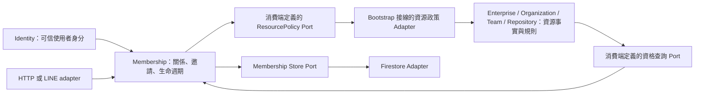
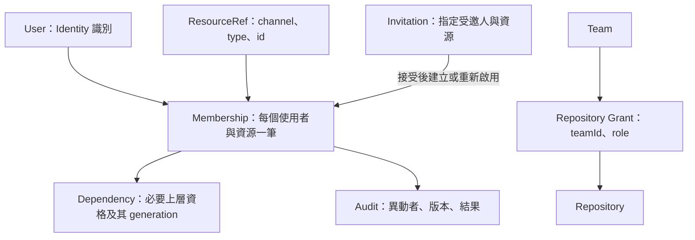
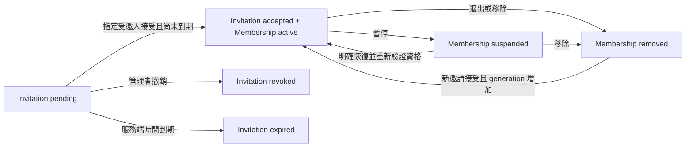

# Membership 統一成員關係設計

狀態：未來設計，尚未實作。需求方向為新增 `membership` 業務領域，統一管理使用者與資源的成員關係；下列角色、API 與遷移方案為本次提出的設計基線，尚不改變現行契約。

來源基準：2026-11-21，`work`／`fe571ab`。既有未提交變更限工具文件，不影響本次業務原碼核對。以 Graphify CLI 定位、Repomix 範圍封裝與直接讀碼交叉確認；不是線上資料盤點或功能驗收。

## 目標與範圍

新增 `backend/internal/business/membership`，集中保存、查詢及異動成員關係，其他領域不再各自維護可授權的使用者陣列。使用者先透過 Identity 獨立登入，可以沒有任何 Membership。

第一階段交付 Organization People 的邀請、接受、角色變更、離開與移除；共同模型支援 Enterprise、Organization、Team、Repository，依階段接入。新資源種類須明確註冊政策與識別碼驗證，不能只傳任意 `resourceType` 就建立關係。

本次只設計規格。不新增業務程式、修改 OpenAPI、遷移資料、部署或變更 LINE 遠端設定。Team 對 Repository 的授權屬於資源對資源的 `Grant`，仍由 Repository 管理；直接使用者角色則由 Membership 保存。

## 現況與需要替換的來源

| 現行位置 | 原碼核對結果 | 接入後責任 |
| --- | --- | --- |
| [Organization store](../../backend/internal/business/organization/adapter/firestore/store.go) | `Context` 查 `ownerUserId`／`memberUserIds`；`Transfer` 核對現任 Owner 與既有成員 | 可見組織與角色查 Membership；建立組織時一併建立 Owner |
| [Enterprise store](../../backend/internal/business/enterprise/adapter/firestore/store.go) | 使用 `ownerUserId`／`ownerUserIds`／`managerUserIds`；People 可見性還讀組織成員 | 企業直接成員由 Membership 管理；旗下 People 可另做聚合讀模型 |
| [Team store](../../backend/internal/business/team/adapter/firestore/store.go) | 直接讀組織成員與管理者陣列；清單還經 Group 查資格 | 改由明確查詢契約取得資格；管理歸屬仍屬 Team |
| [共用 Firestore document](../../backend/internal/business/internal/adapter/firestore/store.go) | 混合 Owners、Members、Managers 與資源歸屬欄位 | 成員欄位逐步退役；資源歸屬不能一起當成成員資料搬走 |
| [Repository service](../../backend/internal/business/repository/application/repository.go) | 個人庫比對 Owner；群組庫經 Port 即時查 LINE Membership | 保留既有個人／群組模式；組織庫另接 Membership 與 Grant |
| [LINE Membership](../../backend/internal/platform/line/membership.go) | LINE 群組資格的外部查詢能力 | 保留技術整合；不作為內部邀請或組織成員的保存位置 |

Graphify `explain` 找到 Team、Organization store 與 bootstrap 的依賴；`path --undirected` 找到 Repository Application → bootstrap → LINE Membership 的兩跳連線。廣泛 query 有截斷，後續以精確 explain/path 及原碼補查，不能把圖中 import 路徑視為完整執行時序。

## 領域邊界

未來設計

箭頭表示使用能力，不要求 Go package 雙向 import。各消費端在自己的 `application/port` 定義最小介面，由 bootstrap 的整合 adapter 轉換 DTO；核心不得 import 對方的 Firestore adapter。ResourcePolicy 僅提供資源事實及純政策判定，不可再次呼叫 Membership，避免循環查詢。

| 模組 | 擁有的權威資料／規則 |
| --- | --- |
| Identity | 登入者身分、Session；第一版沿用目前可信使用者 ID，不另造帳號遷移 |
| Membership | 使用者與資源的唯一關係、邀請、狀態、版本、資格世代與異動稽核 |
| Enterprise／Organization／Team | 資源是否存在、管理歸屬、允許角色、誰能管理成員的政策與 Owner 保護要求 |
| Repository | 庫的擁有者、角色對操作的映射、Team Grant、內容與子資源規則 |
| Bootstrap／整合 Adapter | 跨領域契約轉譯與同一工作單元協調，無獨立業務權威 |

資源歸屬與資格分開：`enterpriseId`、Team 的 `managementScope/managementId`、Repository owner 不因搬移成員欄位而改變。企業 Owner 不因角色名稱而自動取得旗下所有 Repository 內容權限。

## 核心模型

未來設計；以下為邏輯關係，不代表資料庫外鍵。

| 實體 | 必要欄位與約束 |
| --- | --- |
| `ResourceRef` | `channelId`、`type`、`id`；三者共同識別範圍。Channel 由服務端設定取得，不能採信請求指定的租戶 |
| `Membership` | `id`、`resource`、`userId`、`role`、`status`、`generation`、`version`、`joinedAt`、`updatedAt`、`endedAt`、`createdBy`、`updatedBy`、`dependencies` |
| `Invitation` | `id`、`resource`、`inviteeUserId`、`role`、`status`、`expiresAt`、`createdBy`、`acceptedAt`、`acceptedMembershipGeneration`、`version`、建立時的資源政策版本 |
| `ResourceMembershipState` | 每資源一筆，保存 `activeOwnerCount`、`version`、政策版本及授權模式；所有成員異動共同讀寫，協調最後 Owner 與併發 |
| `Audit` | `actorUserId`、`action`、`resource`、`targetUserId`、前後角色／狀態／版本、`requestId`、時間；不保存 token 或完整邀請連結 |

`Membership` 使用由服務端對完整範圍與 userId 做無歧義編碼後產生的確定鍵，確保同一關係最多一筆。重新加入沿用關係識別碼、增加 `generation`，歷史由 Audit 保留。`version` 用於每次異動的併發控制，不能取代 `generation`。

Invitation 與 Membership 分開：待接受的邀請不是有效成員。第一版只支援指定可信 userId 的邀請；分享連結本身不授權，沒有指定使用者的公開加入連結不在此版。

## 角色與有效資格

以下為提案預設；落地時由各資源政策明確定義，Membership 負責套用而不提供任意自訂角色引擎。

| 資源 | 初始角色 | 成員管理基線 |
| --- | --- | --- |
| Enterprise | `owner`、`manager`、`member` | Owner 管理企業角色；manager 維持核准的管理能力，不得自行升 Owner |
| Organization | `owner`、`member` | Owner 邀請、移除、改角色；至少保留一位有效 Owner |
| Team | `maintainer`、`member` | 管理範圍的授權管理者指派 maintainer；maintainer 管理普通成員，不得自行改變管理歸屬 |
| Repository | `admin`、`write`、`read` | admin 管理直接使用者存取與 Team Grant；資源擁有者保留管理能力，不能由成員異動變成無人可管理 |

角色不是跨種類的數值大小。Organization member 不代表 Repository read；Team maintainer 不代表 Repository admin。Repository 內可定義 `admin ≥ write ≥ read`，由 Repository 政策解釋。

有效資格必須同時符合：資源存在且可使用、該資源採 Membership 授權模式、關係為 active、角色合法、所有必要上層資格有效且 generation 匹配。查詢結果區分 `active`、`inactive`、`not_found`；依賴或資料庫不可用回 `unavailable`，不得當成有效或靜默套用舊陣列。

第一版上層規則：Organization 成員不必先屬於 Enterprise；組織管理的 Team 成員須有同組織有效 Membership；企業管理的 Team 須有該企業有效 Membership。組織庫的直接或 Team 授權都須先滿足該庫所屬組織的有效成員資格。企業 Team 指派至組織不會自動開通組織資格。

離開上層後，下層紀錄可暫留但立即無效；重新加入上層產生新 generation，舊下層關係因世代不符仍無效，須明確重新授予。Dependency 只能指向政策允許的上層，不接受任意圖或循環；改變資源歸屬須拒絕舊 dependency 並走明確重新授權流程。

Enterprise People 可彙整旗下組織成員，但畫面 MUST 區分直接企業資格與組織來源。聚合出現某人不會替他建立企業 Membership。

## 狀態與邀請流程

未來設計

到期由服務端時間判定，不依賴背景清理是否已執行。suspended 不提供授權；恢復須增加 generation，避免下層資格在停權後自動復活。Owner 的移除、停權或降級均受最後有效 Owner 保護。

接受邀請 MUST 在同一工作單元重新讀取邀請、資源狀態、邀請者目前管理資格、受邀者及必要上層資格。邀請者已失去管理資格、政策改變或資源已移轉時拒絕，須由目前管理者重新發邀請。不得只信任建立邀請時的快照。

邀請接受、Membership 寫入、Owner 計數、冪等收據與 Audit 必須原子提交。重複接受同一邀請回傳原接受結果，不可重新啟用後來被移除的 Membership。已是 active 成員的邀請接受不得覆蓋或提升現有角色；回報已存在，角色變更走獨立操作。

## 操作契約與 API 草案

所有操作以可信 Actor、服務端解析的 ResourceRef、明確 Action、目前版本與時間為 Context。Membership 協調 Authority、ResourcePolicy 及結果；HTTP／LINE adapter 不自行決定權限。資源不可見時沿用既有隱藏資源的錯誤慣例，避免洩漏成員資料。

下表為候選路徑，尚未寫入 OpenAPI；類型複數及 ID 的對應表由服務端固定解析，不能任意映射 collection 名稱。

| 操作 | 候選 HTTP 路徑 | Authority／Policy 與成功結果 |
| --- | --- | --- |
| People | `GET /api/v1/{resourceCollection}/{id}/members` | 可見該資源名單的成員／管理者；分頁回傳 Member DTO，不揭露其他資源角色 |
| 我的資格 | `GET /api/v1/me/memberships` | 僅目前 Actor；包含有效性及失效原因，不以此清單替代操作時授權 |
| 邀請 | `POST /api/v1/{resourceCollection}/{id}/invitations` | 管理者可授予目標角色、受邀者符合上層條件；建立 pending，效期提案預設七天 |
| 接受 | `POST /api/v1/membership-invitations/{id}/accept` | Actor 必須等於 invitee；原子接受並建立有效關係 |
| 撤銷 | `DELETE /api/v1/membership-invitations/{id}` | 該資源目前管理者；僅 pending 可轉 revoked，重複撤銷冪等 |
| 改角色 | `PATCH /api/v1/{resourceCollection}/{id}/members/{userId}` | 管理者、目標角色合法、版本匹配、Owner 保護；更新角色與版本 |
| 移除／退出 | `DELETE /api/v1/{resourceCollection}/{id}/members/{userId}` | 管理者移除或本人退出；Owner 保護；removed 不做實體刪除 |
| 暫停／恢復 | 後續明確狀態命令 | 模型預留；第一切片不開放 API，待企業治理用例接入 |

People 的 `Member` 是 Membership 與允許公開的個人資料投影，不新增 Member 業務領域。前端可在各資源下呈現 People／邀請頁面，共用操作能力，依伺服器 capabilities 顯示可用操作；畫面隱藏按鈕不是授權。

所有寫入帶 requestId；需改變現有關係的操作另帶 expectedVersion。相同 Actor、資源、操作及 requestId、相同內容回原結果；同鍵不同內容為 conflict。錯誤分類為 invalid、unauthenticated、forbidden／not_found、conflict、invitation_expired、unavailable。預期版本過期、最後 Owner 或邀請已終結均拒絕並保持資料不變；傳輸層再映射至既有錯誤 envelope。

## 六邊形契約與一致性

建議套件：`membership/domain/entity` 保存 Membership／Invitation；`domain/policy` 保存生命週期與資格計算；`application/command` 協調異動；`application/query` 查有效資格與 People；`application/port` 定義 Store、ResourcePolicy、Clock；`adapter/http`、`adapter/firestore` 處理傳輸與儲存。按實際複雜度拆檔，不新增萬用 policy framework。

契約草案如下，尚未固定 Go signature 或生成 DTO：

| 能力 | 輸入／輸出 | 信任與失敗規則 |
| --- | --- | --- |
| `ResolveMembership` | ctx、可信 Actor、ResourceRef、targetUserId → 有效角色、generation、依賴版本或錯誤 | 對第三人查詢須授權；I/O 接受取消及期限；unavailable 與無資格分開 |
| `ListMembers` | ctx、Actor、資源、cursor／limit → Member page | 限定同一資源，先授權再回資料；limit 與 cursor 由 adapter 驗證 |
| `Invite`／`Accept`／`ChangeRole`／`Remove` | ctx、可信 Actor、明確命令、requestId、適用版本 → 結果／錯誤 | 不採信前端角色；同工作單元核對政策、關係與依賴 |
| `ResourcePolicy` | 工作單元中的資源事實、Actor 與目標有效角色、Action → 允許角色／管理條件 | 不讀 Membership、不產生外部副作用；使用同一快照，避免檢查後改寫 |

Membership 查詢回傳資格事實，Repository 再判定具體 action；不能用 `IsMember == true` 直接放行所有操作。Team Grant 與直接使用者角色可依 Repository 定義合併，但都要先滿足組織資格。列表、詳情、附件、搜尋與子資源應採同一資格規則。

重要寫入須將授權讀取與資源變更置於同一工作單元。Firestore 整合 adapter 由 bootstrap 組裝，將資源狀態、成員、依賴、Grant 與相關版本納入同一交易讀集合；核心不接收 SDK transaction。禁止先呼叫獨立資格 API，再無條件寫庫。

撤權承諾：撤權提交後開始的新授權不得成功；與撤權重疊的寫入須由共同交易的版本衝突重查。已回傳資料、已下載檔案與已完成操作不能追回。第一版不使用跨請求有效資格快取，Session 不保存角色。查詢大清單可分頁，分頁結果不構成整批操作的授權快照。

建立資源與首位 Owner／資源擁有者資格須原子提交；失敗不能留下無人管理的可用資源。角色異動共用資源狀態文件，序列化最後 Owner 檢查。資源刪除或停用先阻斷授權，再按保留政策清理關係；不在一次交易刪除無上限成員。

邀請通知在提交後由既有可用機制發送，不在交易 callback 呼叫 LINE。通知失敗不撤回已建立邀請，操作者可複製連結或重送；第一版不以此要求新增通用 Outbox。

## 儲存與遷移方案

候選路徑沿用現有 `channels/{channelId}` 隔離，其下新增 `memberships`、`membershipInvitations`、`resourceMembershipStates`、`membershipAudits` 與冪等收據集合。先列出「按 userId 查資格」、「按 resource 查成員／狀態」、「按 invitee 查 pending」及穩定分頁需求，再於實作時查證並落實索引；本提案不宣稱索引與交易限制已驗證。

採每資源明確 `legacy`／`membership` 授權模式，同一時刻只有一個權威來源，禁止將兩份結果 OR 在一起放行。

1. **盤點與只讀比對**：收集 owner／manager／member 欄位、重複與無效 ID、沒有 Owner 的異常資源及所有寫入入口。先產生遷移差異報告，不因文件存在就推定正式資料可搬。
2. **Organization 試點**：ownerUserId → owner；memberUserIds 去重後 → member；同一人重複出現以 owner 為準。建立 Membership、Owner 計數與來源版本；未存在的 joinedAt 保留 unknown，另記 importedAt，不捏造歷史。
3. **受控切換**：封鎖該資源舊成員寫入，或令所有舊 writer 也讀取同一切換版本；在一致性邊界內比對來源版本與完整匯入結果後切換模式。HTTP、LINE、組織選單、Team 清單與企業導航同步改讀新來源。
4. **Team／Enterprise**：企業 Owner 欄位取聯集，manager 不升 Owner；Team manager 僅候選映射 maintainer，先確認實際意義與上層資格。不從 LINE 群組推算完整 Team 成員；無明確紀錄的人須正式加入。孤兒資料隔離處理，不能自動補授權。
5. **Repository**：新增組織庫模式，明確記錄所屬組織；現行只接受 LINE User／Group Owner 的驗證、查詢與子資源授權須一併調整。既有個人／LINE 群組庫保留原授權模式，沒有證據時不得批量轉成內部成員。
6. **退役欄位**：確認無舊 reader／writer 後，移除成員陣列與適用的共用 document 欄位。OwnerUserID 等舊 API 表達單一 Owner，若改多 Owner 須先設計相容 DTO 與版本策略，不能任選一人掩蓋語意改變。

回復不能只改回 legacy：切換後若有角色異動，舊陣列已過期。須先停成員寫入、依新權威重建相容投影並驗證，再回復；多 Owner 等無法表示的狀態只能以前滾修復。所有切換與回復工具的執行、雲端寫入另依實作任務範圍處理。

## 交付順序與驗收條件

| 階段 | 交付範圍 | 必須取得的證據 |
| --- | --- | --- |
| 一 | Membership 核心＋Organization People＋試點切換 | 無組織仍可登入；建立資源與 Owner 原子性；邀請、接受、名單、移除閉環 |
| 二 | Team 成員、管理者接入與上層依賴 | 移除組織資格即拒絕；重新加入不恢復舊 Team 權；企業 Team 指派不自動授予組織資格 |
| 三 | 組織 Repository 的直接角色與 Team Grant | read／write／admin 行為一致；列表、詳情、子資源、舊連結與併發寫入均服從撤權 |
| 四 | Enterprise 直接成員與 People 聚合、舊欄位退役 | 直接與衍生資格可區分；管理角色不洩漏內容；原 API 與資料相容策略完成 |

設計要求驗證：跨 channel／resourceType 的 ID 不能混用；非受邀者不能接受；撤銷、到期與接受併發只產生一個合法結果；同邀請重送不重新開權；兩位 Owner 同時退出至少保留一位；資料庫失敗不放行；資源移轉後舊依賴失效；相同 requestId 不重複寫入；列表不因新模式候選來源遺漏有效成員。

上述是未來行為的驗收條件，並非已執行測試。本庫[現行驗收基線](../development/acceptance.md)限制新增測試方案／案例，落地前須明確調整階段決策，或將現有檢查未涵蓋項目標為缺口；不能把只編譯通過當成授權驗收。

## 本次查證與待定事項

已使用 Graphify CLI 0.9.103 的 query／explain／path，既有圖譜含 9,968 個節點；只作定位，未重新產生 code graph。Repomix 1.18.1 封裝上述四領域 Go 原碼及相關整合檔至暫存檔，核對關鍵 store 與 service 已收錄；非全庫封裝，沒有對未收錄入口宣稱完整盤點。

文件驗證：三張 Mermaid 均以鎖定的 `mermaid@13.0.0-alpha.3` CLI 渲染為暫存 SVG，XML 解析通過；新增來源連結與索引錨點核對通過，`git diff --check` 通過。工具 wrapper 找不到 Mermaid／Repomix 可執行入口，因此 Repomix 使用已安裝同版的 Node 入口，Mermaid 使用 npm exec 的確切同版套件；未改工具設定。純文件變更，未執行應用測試。

本次只依 repository 原碼設計契約，不宣稱外部 LINE 或 Firestore 新行為已查證。實作前仍須以屆時鎖定版官方文件確認交易工作單元、索引、取消、上限與身份有效期；真實資料遷移與線上資格待環境驗收。

待產品確認的提案預設：七天邀請效期、manager／maintainer 可管理的角色範圍、多 Owner 與舊 owner API 的相容策略、Audit 保留期間。這些不影響新增 Membership 領域的方向，但在對應操作實作前須定案。

[提案索引](README.md) · [現行組織與 Team 契約](../architecture/contracts/organization-team-ownership.md) · [操作模型](../architecture/contracts/business-operations.md) · [圖表索引](../diagrams.md#未來設計)
