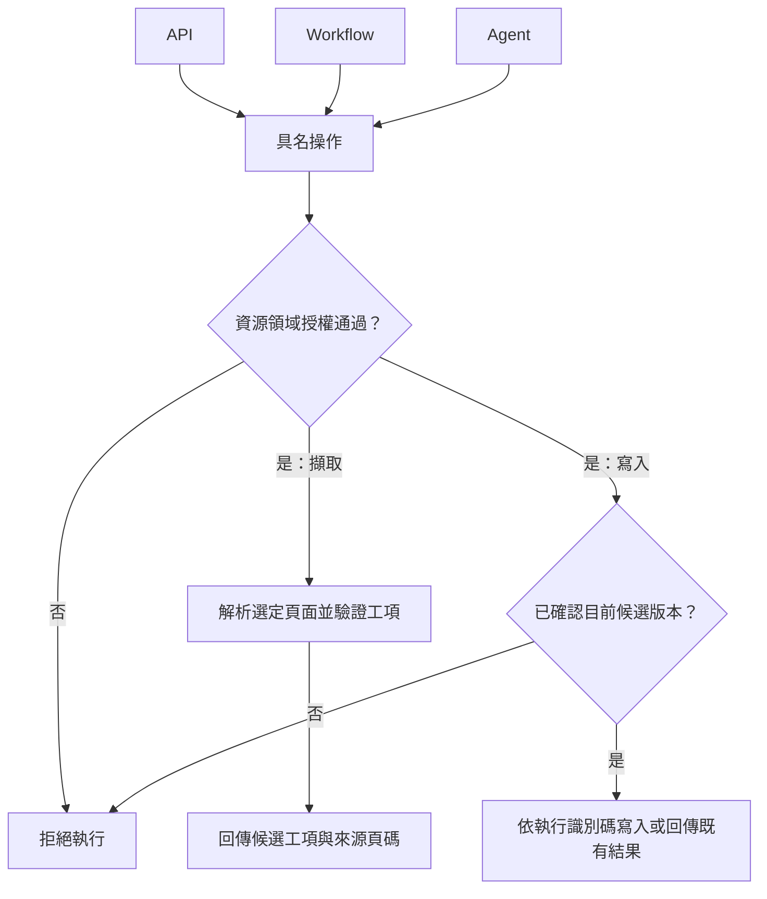

# Operations 領域設計

狀態：提案。目錄入口見[領域導覽](../../backend/internal/business/operations/README.md)。

具名操作可由 API、[Workflow](workflow.md) 或 [Agent](agent.md) 呼叫。每個操作定義輸入、結果及副作用，透過介面委派資源領域執行。授權沿用[業務操作模型](../architecture/contracts/business-operations.md)，由資源領域依可信呼叫者及資源範圍判定。

## 操作與授權流程圖

## PDF 操作與驗收

將「擷取候選工項」與「確認寫入」定為兩個操作。擷取接受原始 PDF，並由[後端取得逐頁文字及明細](../../backend/internal/business/objectimport/adapter/workbook/pdf.go)，由 objectimport 驗證項次、數量、單位及來源頁碼。以同一份去識別化 PDF 比對[既有解析結果](../../backend/internal/business/objectimport/adapter/openai/parsing/automatic.go)。寫入操作應驗證授權與已確認的候選版本；使用同一執行識別碼重試時應取得同一次結果。

## 對外契約草案

以下為邏輯簽章，實作時對照既有介面。身分及資源範圍取自可信呼叫情境。

| 操作 | 結果、副作用與失敗語意 |
|---|---|
| Parse(actor, resource, selectedPages, consent) | 授權且同意後產生候選與來源頁。解析失敗保留草稿，可重新擷取。 |
| Get(actor, resource, importID) | 回傳可讀草稿與版本；無權時不回傳內容。 |
| Review(actor, importID, expectedVersion, edits) | 驗證工項後保存新版；過期修訂回報衝突。 |
| Confirm(actor, importID, expectedVersion, executionID) | 重新授權；已成功的相同請求回傳原結果。同碼不同內容拒絕。首次提交時原子核對狀態與版本、寫入並保存結果。 |

[共用架構、時序與驗收](domain-collaboration.md)
