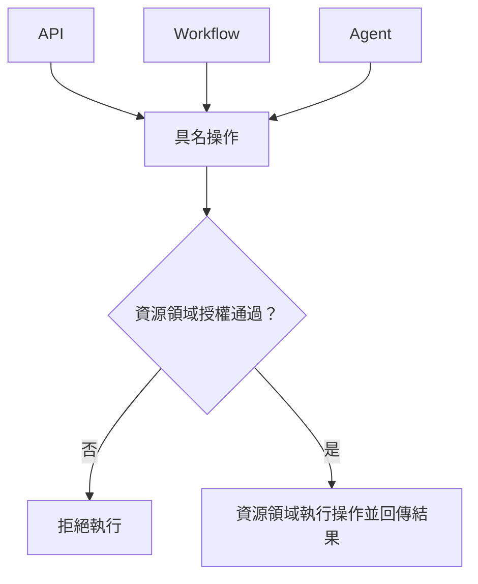

# Operations 領域設計

狀態：提案。目錄入口見[領域導覽](../../backend/internal/business/operations/README.md)。

具名操作可由 API、[Workflow](workflow.md) 或 [Agent](agent.md) 呼叫。每個操作定義輸入、結果及副作用，透過介面委派資源領域執行。授權沿用[業務操作模型](../architecture/contracts/business-operations.md)，由資源領域依可信呼叫者及資源範圍判定。

## 操作與授權流程圖

[跨領域協作與驗收](domain-collaboration.md)
