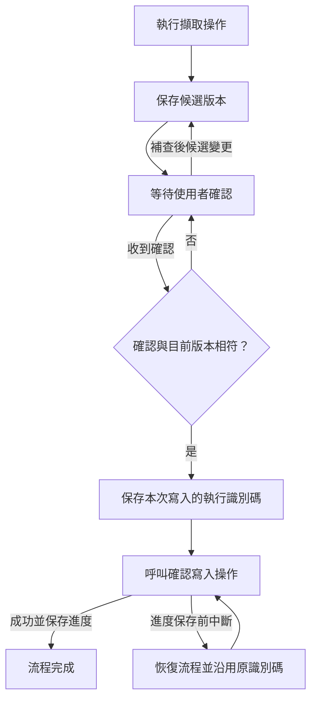

# Workflow 領域設計

狀態：提案。目錄入口見[領域導覽](../../backend/internal/business/workflow/README.md)。

Workflow 定義固定步驟、等待條件及恢復位置。步驟可以呼叫 [Operations](operations.md) 執行工作，也可以委派有界任務給 [Agent](agent.md)，再按回傳結果繼續。需要跨請求恢復時才引入持久化，儲存格式與公開 API 留待使用案例決定。

## 確認與恢復流程圖

## PDF 匯入與驗收

先執行擷取操作，再保存候選版本並等待使用者確認。只有確認與目前版本相符時才進入寫入步驟；補查造成候選變動時需重新確認。驗收時模擬寫入成功後、流程進度保存前發生中斷，確認恢復後以相同執行識別碼重試，只匯入一次。

## 對外契約草案

以下為邏輯簽章，實作時對照既有介面。身分及資源範圍取自可信呼叫情境。

| 操作 | 結果、副作用與失敗語意 |
|---|---|
| Start(actor, importID) | 建立或取回本次流程與等待步驟；記錄所引用的草稿版本。 |
| AcceptConfirmation(actor, runID, candidateVersion) | 檢查流程與版本，保存寫入意圖和執行識別碼；過期確認要求使用者重看。 |
| Resume(actor, runID) | 讀取等待點。若寫入結果未定，以原碼重送；若版本衝突回到確認，遇權限拒絕則停止。 |

[共用架構、時序與驗收](domain-collaboration.md)

[多格式文件架構與手動解析呼叫時序](domain-collaboration.md#document-ingestion)
