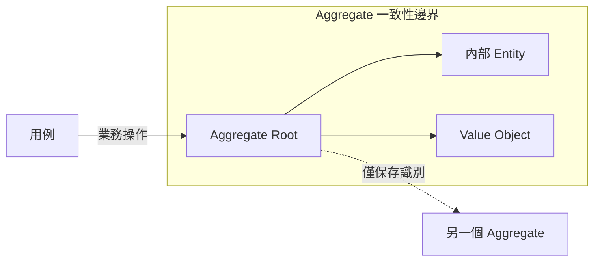

# 聚合與聚合根（Aggregate / Aggregate Root）

Aggregate 是需要一起保護不變條件的模型邊界，由一個 Aggregate Root 作為對外異動入口。它可以只有一個 Entity，也可以包含必要的內部 Entity 與 Value Object。

## 如何決定邊界

先問「哪些規則在一次成功操作後必須立即成立」，再把保護它們需要的狀態納入邊界。資料有關聯、屬於同一畫面或存在父子關係，都不足以證明它們是同一 Aggregate。

保持邊界小，評估成員數量、載入成本與競爭寫入。跨 Aggregate 優先使用身分引用；跨限界上下文交換契約，不能共享可修改的內部模型。

## 邊界與存取入口

開發與維運指引；實線表示業務操作或根管理的內部物件，虛線表示對外部 Aggregate 的身分引用，不表示共用交易。

外部透過 Root 執行異動；讀取投影可有自己的查詢路徑，但不得透過投影繞過根修改內部 Entity。圖只說明模型邊界，不限定資料庫文件數量或 Go 套件數量。

## 規則與持久化

Root 的業務方法保護合法轉換；Repository 與交易實作負責讓讀取版本及寫入保持一致。記憶體裡驗證成功，不能排除另一個請求同時改寫。

Aggregate 不等於一份資料庫文件，但若拆成多份文件，仍須說明哪些資料一起載入、如何防止部分保存與繞過根。宣稱「只載入部分成員」時，必須證明摘要、版本與必要事實足以保護所有受影響規則，不能忽略未載入資料。

## 設計例子

若成員範圍必須保留至少一位 Owner，須評估由範圍根保護計數，或採較小 Aggregate 並明確協調一致性。不能直接把全組織所有成員放進一個無上限 Aggregate。具體邊界須依規則與競爭情況確認。

## 聚合邊界決策紀錄

| 決策 | 必須回答的問題 |
|---|---|
| 根與操作入口 | 哪個身分對外代表聚合？哪些方法可以改變它？ |
| 內部狀態 | 哪些欄位與成員必須共同維護同一條不變條件？ |
| 最大規模 | 成員數量、載入量與變更頻率是否有界？ |
| 讀寫集合 | 哪些文件、摘要或版本必須一起讀取及提交？ |
| 衝突單位 | 改不同成員是否仍會競爭同一根或共用計數？ |
| 外部引用 | 哪個上下文擁有來源，如何核對存在、權限與時效？ |
| 替代方案 | 較小聚合、局部交易或延遲協調會失去哪些保證？ |

先寫需要保護的[不變條件](invariant.md)，再選邊界。記錄取捨與反例，而非只畫一個包含所有相關資料的框。

## 競爭寫入與熱點

以「至少保留一位 Owner」為設計示例：兩個移除請求可能都讀到兩位 Owner，分別移除一位後違規。若透過共同版本或計數保護，必須讓兩個請求在相同權威資料上發生衝突，再用最新資料判定；只驗證各自的成員文件不足以維護全域規則。

共同根也可能造成熱點。先量測衝突率與延遲，確認哪些操作真正需要互斥，再評估更小邊界或摘要；不能為降低競爭，悄悄把立即成立的規則改成最終一致。

## 跨聚合引用與容器關係

跨聚合以身分引用，必要時經公開契約查詢事實。引用不授予修改對方的權限，也不保證未來仍存在或可讀；失效、刪除及資格變動須有明確語意。跨上下文的資料不應由消費者直接寫入。

例如一張訂單包含多個項目，若折扣與總價規則要求各項目一起核對，就要評估共同提交。反過來，兩張訂單屬於同一客戶，僅憑共同歸屬無法推定它們是同一聚合。

若某操作需要同時更新多個聚合，明列共同交易的理由、衝突與載入成本；若採分次提交，明列中間狀態、重試、補償及規則可容忍的延遲。不要以「跨聚合必須非同步」替代需求分析。

## 邊界驗收

選兩個同時操作根或不同成員的案例，寫出允許的提交結果；再檢查部分載入、部分保存、失效引用及拒絕後狀態。模型測試驗證決策，儲存整合驗證原子性與版本衝突。演進邊界前依[模型演進](model-evolution.md)檢查舊格式與混合版本。

## 設計產出與核對

列出 Root、內部物件、外部身分引用、不變條件、最大規模、載入／保存單位與衝突策略。兩個 Aggregate 共用一次本機交易是須說明的取捨，不能因此把兩者稱為同一 Aggregate。

概念參考：[Microsoft Learn：戰術 DDD](https://learn.microsoft.com/en-us/azure/architecture/microservices/model/tactical-domain-driven-design)。僅採概念，不採其微服務部署前提。

[Invariant](invariant.md) · [Repository](repository.md) · [一致性](consistency.md) · [DDD 設計索引](design-guide.md)
