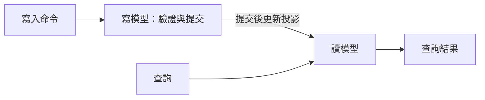

# 讀寫職責分離（CQRS）

**採用方式：按需。** 本頁為進階設計參考，不是目前架構的必要條件，也不表示專案已實作此模式。採用前須以具體用例、替代方案及成本評估決定，必要時依既有 ADR 流程記錄。

CQRS 將更新狀態與讀取資料的責任分開，允許各自使用符合目的的模型。它可以共用資料庫，也不要求事件匯流排、非同步或 Event Sourcing。

## 何時按需採用

當寫入需要嚴格業務規則，讀取卻需要多種彙整投影，或兩者有可量測的效能差異時再評估。單純 CRUD 與少量資料通常不值得引入投影同步的成本。

## 模型與一致性

| 選擇 | 必須承擔的責任 |
| --- | --- |
| 同一儲存、不同讀寫模型 | 維護寫入規則與查詢契約，明定可見時間 |
| 獨立讀模型、非同步更新 | 處理延遲、重複、亂序、投影重建與失敗修復 |

分開命令與查詢函數可改善語意，但不足以證明已建立獨立讀寫模型。寫入成功也不必然代表讀模型已更新。查詢投影不可省略資源授權；尤其撤權不能只等待非同步投影刷新。

## 設計例子與成本

未來 People 名單可用查詢投影呈現，角色異動仍經用例與模型驗證。先比較直接查詢是否足夠，再決定是否維護獨立投影，不為了檔名 command／query 而導入新資料庫。

## 圖解

**設計參考。**

## 設計產出與核對

列出讀寫模型擁有者、更新方式、延遲容忍、授權來源、重建及回復策略。比較實際查詢成本與新增同步成本；使用者介面須能解釋「提交成功但查詢尚未更新」。

來源：[Microsoft Learn：CQRS](https://learn.microsoft.com/en-us/azure/architecture/patterns/cqrs)，2026-11-21 查閱。

[Application Service](application-service.md) · [一致性](consistency.md) · [Event Sourcing](event-sourcing.md)

[DDD 設計索引](README.md) · [現行驗收基線](../../development/tooling/testing/commands.md)
