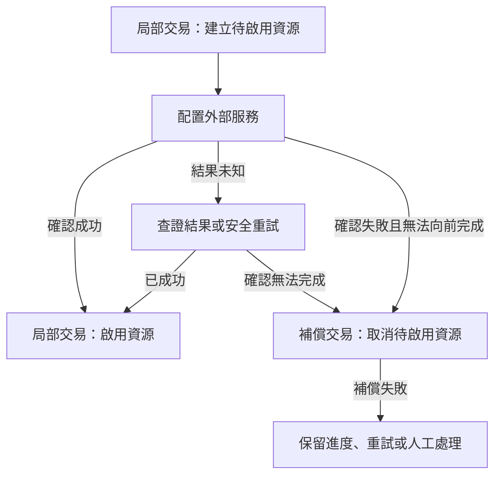

# Saga：跨交易流程與補償

**採用方式：按需。** 本頁為進階設計參考，不是目前架構的必要條件，也不表示專案已實作此模式。採用前須以具體用例、替代方案及成本評估決定，必要時依既有 ADR 流程記錄。

Saga 以一系列局部交易完成跨交易的業務流程；後續失敗時，依業務規則執行補償，或重試以向前完成。每一步已提交的狀態都可能被其他操作看見。

## 何時按需採用

流程無法由一個合理的本機交易完成，且確實需要協調多步提交與失敗恢復時再評估。可用單次交易保護的規則，優先保留原子處理。

## 補償與協調

補償是新的業務操作，不是資料庫 rollback；已寄出的訊息不能收回，已被他人使用的資源也未必能還原。補償本身可能失敗，必須有持久進度、重試上限與人工處理入口。

可由集中協調者發起步驟，或由參與者接收事件推進。兩者都須明定步驟身分、目前狀態、逾時、重複與亂序。協調器不能取代各參與領域對命令的授權及合法性驗證。

## 設計例子與限制

假設未來開通流程涉及獨立提交的資源建立與外部服務配置，外部配置失敗後，可依規則取消尚未啟用的資源。這是示例，不是現行需求；若兩個內部寫入可同交易完成，不必拆成 Saga。

Saga 不提供跨步驟的資料庫隔離。對不可容忍中間狀態的規則，須另設保留狀態、版本或重新檢查，不能只依賴補償。

## 圖解

**設計參考。**

## 設計產出與核對

列出每步交易、成功條件、補償／向前恢復、不可逆步驟、並行操作、結果未知及最終處置。故障恢復須涵蓋「遠端已成功但回覆遺失」，避免直接補償或重複執行。

來源：[Microsoft Learn：Saga](https://learn.microsoft.com/en-us/azure/architecture/patterns/saga)，2026-11-21 查閱。

[Process Manager](process-manager.md) · [一致性](consistency.md) · [Outbox](outbox-pattern.md)

[DDD 設計索引](design-guide.md) · [現行驗收基線](../../development/tooling/testing/commands.md)
