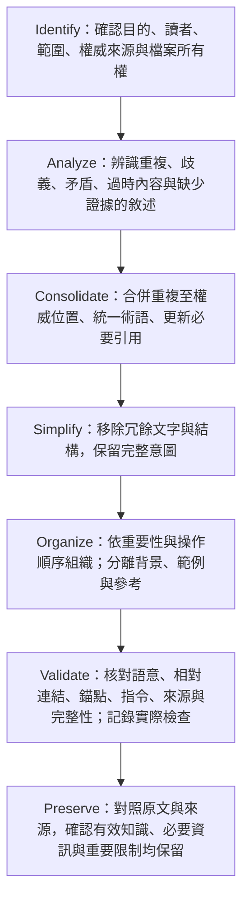

# 編寫與修正流程

此規範適用於所有角色編寫、修改或審查的自有 Markdown，含 README、AGENTS 與專題文件。先確認讀者需要做什麼，以及哪一份規格、實作或測試能回答問題。

開發與維運指引

## 適用範圍與要求等級

MUST 表示必要，MUST NOT 表示禁止，SHOULD 表示有具體理由才可偏離，MAY 表示可選。偏離 SHOULD 時 MUST 說明理由及影響。

完整自有文件適用以下規則。嵌入片段 MAY 沿用宿主的標題層級；例外須有明確來源或用途。生成文件、vendor 與上游技能 MUST 保留來源格式；需要修正時，取得對應範圍的所有權，改來源或生成流程。

## 編寫原則

| 要求 | 如何判定 |
| --- | --- |
| 清楚性 | MUST 分清規則、事實、假設、建議與範例；定義讀者無法推知的術語。每段 SHOULD 聚焦一個概念。 |
| 精簡性 | MUST 移除重複、冗詞與無關背景，同時保留理解、決策、執行及驗證所需的資訊。 |
| 結構 | MUST 使用標準 Markdown，每份完整文件一個 H1，後續標題逐級展開，以主題命名。比較項目 SHOULD 用表格，步驟用清單，可執行範例用程式碼區塊。 |
| 單一來源 | 每條規則 MUST 有一個權威位置。其他文件用相對連結；來源或標題變動時一併查索引、引用與錨點。 |
| 可執行性 | MUST 使用明確動詞、要求等級、適用條件、限制與完成條件，使讀者能判斷何時執行、如何驗收。 |
| 上下文效率 | 核心結論、限制與操作 MUST 放在前段，背景與範例分開。細節 SHOULD 可按需查閱。 |
| 一致性 | 同一概念 MUST 使用一致名稱；路徑、命令、參數與程式碼 MUST 核對有效來源。 |
| 可驗證性 | 技術事實 MUST 可追溯至實作、契約或相符版本的權威來源。報告列出執行結果、假設與限制。MUST NOT 把工具可用或配置存在當成功能驗收。 |
| 可維護性 | SHOULD 按責任分頁並清理已確認過時的內容。MUST NOT 為尚無內容或維護責任的分類建立空頁。 |
| 漸進閱讀 | 入口 MUST 提供必要規則與下一個目的地；專題保存細節。按當前任務選讀，MUST NOT 要求每次通讀全庫。 |

取捨時優先保留正確性、清楚性、必要上下文、單一來源與可執行的規則；以簡單且能繼續維護的結構呈現。僅以少了多少字或 token 無法判定改善。

## 圖表狀態與入口

一般目錄與對照表用 Markdown 連到目的地，使搜尋、文件圖及閱讀器都能找到來源。流程、狀態或依賴方向適合用 Mermaid 說明。每張圖前標明「現行實作」、「未來設計」或「開發與維運指引」；比較圖標「現況與提案對照」並區分各分支。

現行圖在主題頁連到實作或契約，提案有現行對照時連到該章節。新增圖或變更狀態時，依[圖表維護規則](../AGENTS.md#圖表維護)更新受影響的入口及引用。

## 獨立圖檔

短圖直接保存在主題頁；獨立維護的圖只保存一份 Mermaid 原始檔，由使用它的章節連結。

## 自主修正與所有權

代理 MUST 在任務擁有的檔案或 hunks 內修正有證據的缺陷，包括失效引用、重複與格式問題，並保留原意及既有變更。每檔同時一個寫入者；必要的直接引用、額外檔案與程式或設定變更由協調者安排。全庫掃描或重寫需有相應的任務授權。

遇到歧義或來源衝突，依[根目錄指引](../../AGENTS.md)查證。證據不足時 MUST 列明待確認事項，MUST NOT 自行補出產品決策或技術事實。

## 增量驗證

1. 用 `git diff --name-only` 找出已追蹤的變更，用 `git status --short` 補查新增頁面。核對相對連結、標題錨點、來源路徑與引用。搬移頁面或更名時搜尋舊目的地，再從分類索引走一次。
2. [文件圖](../development/tooling/shared/graphify.md#docs-only-graph)可查標題與本機連結，錨點需另查。程式 AST 用於定位實作。更改 Mermaid 原始內容時，以[專案鎖定的 CLI](../development/tooling/shared/mermaid.md)渲染到暫存檔，再用 handler、契約或 ADR 核對條件與方向。
3. 審閱本次 diff 並執行 `git diff --check`。涉及設定時執行 `bash scripts/tooling/tool-exec.sh python3 scripts/check/check-config.py`。配置檢查只涵蓋它明定的項目。
4. 對照來源檢查命令語法、參數及前置條件。文件驗證不觸發需要憑證的外部寫入或部署。交付時分清「已核對來源」與「已執行」，列明修正範圍、證據、實際檢查與剩餘限制。
